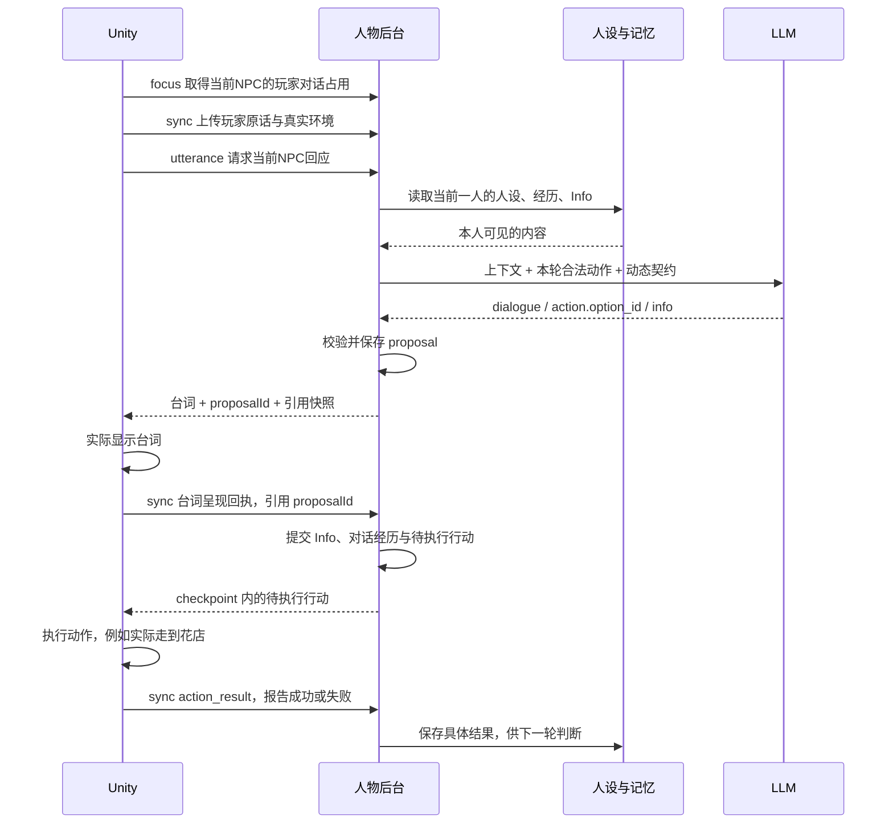

# Project Z：NPC Schema 与前后端对接说明

对齐日期：2026-11-09，review-4。依据当前本地 `unity-sideview` 工程，包含执行证据、请求恢复、回执与存档恢复边界。本文说明如何接线；不代表线上版本已经更新。配套机器校验文件为同目录的 `Project-Z-NPC全链路.schema.json`，下文 `#/$defs/...` 均指向该文件。

**统一的是人物、记忆、数值与提交规则。Unity 请求、模型上下文、模型输出、执行命令各有用途，不能把同一个 JSON 原样从头传到尾。**

### 字段是否已经在游戏中使用

本文不是当前运行包的逐字段抓包结果。它包含当前本地代码实际使用的字段、刚加入本地代码的字段、兼容/预留字段和文档说明结构，不能都标记成“现有游戏已上线”。

| 状态 | 例子 | 对接时怎样理解 |
| --- | --- | --- |
| 当前本地代码实际读写 | `worldId/runId/eventData/proposalId/checkpoint`；模型的 `dialogue/action.option_id/info.changes`；后台记忆和行动记录 | 按对应层和端点接；不是每个请求都发所有字段，也不是都交给前端 |
| 最近补入本地代码 | `character_state.execution_evidence`、`previous_action_result.action_type/effect_scope`、行动记录 `receiptHour` | 本地代码已生成/使用；Unity 花店移动流程已实测，其他动作仍需对应执行器验收 |
| 仅服务端支持，当前 Unity DTO 未发送 | 请求扩展 `availableActions` | 当前 Unity 通过 `walkableLocations/reachableLocations` 提供范围，由后台生成动作；不要强加这个扩展给现有客户端 |
| 兼容格式 / 契约预留 | `legacy-full`、空的 `memory_updates/knowledge_updates`；基础输入中的 `player`、`eligible_share_ids/share_scope_target_id` | 完整格式中的空数组有兼容用途；后三个输入字段目前未发现正常链路的生产/消费逻辑，不列为必接 |
| 仅文档结构 | `$defs` 定义名、`x-*` 注解、`PersonaDocument` 中的 `profile_path/markdown/sha256` | 用来读说明、选择校验器或携带人设参考；不是新增游戏请求字段，运行时人设仍加载 Markdown |
| 未来能力说明 | 展示菜单、递物、制作等流程 | 尚未加入当前可执行动作枚举，不可当成现成能力 |

另外，`plot_node` 确实由当前后台输出，但目前是通用 `event_driven` 引导，不表示完整剧情编排已接好。本文的“当前”默认指当前本地源码，线上/已构建运行包需另外核验。

## 1. 谁负责什么

| 模块 | 输入 | 产出 / 职责 | 不负责什么 |
| --- | --- | --- | --- |
| Unity / 剧情引擎 | 玩家操作、实际场景、位置、听众、时间、剧情节点 | 报告真实发生的事件；提供可执行地点；显示台词；执行行动并回执 | 不根据台词猜测 NPC 已移动、已递物或任务已完成 |
| 人设与内容包 | 当前角色 ID | 当前一人的私有人设、公共职业与地图、共用行为规则、任务定义 | 不保存每位玩家本局的经历 |
| 后台上下文组装 | 玩家事件、本人记忆与状态、环境、任务 | `ModelContext` 和本轮合法动作列表 | 不把全岛所有人的秘密一起发给模型 |
| LLM | 人设提示词 + `ModelContext` + 动态输出契约 | `dialogue / action / info` 三部分提案 | 不直接改位置、背包、任务完成或数据库 |
| 后台 Policy / Engine | 模型提案、当前版本与规则 | 校验、展开动作、计算新数值、等待提交、保存执行队列 | JSON 合法不等于台词内容必然真实 |
| 记忆系统 | 实际呈现的对话、可信世界事件、执行回执 | 原话、经历、承诺、反思和下一轮检索 | 不把“我说过给你了”记成真的给过 |
| 直播适配器 | 同一角色与同一存档、直播公开消息 | 将行动换成发弹幕 / 主持；实际发布后同步感知 | 不另造一套人物与独立岛民记忆 |

NPC 的决定来自人设、记忆、关系、情绪、环境和具体代价。数值提供状态，合法动作提供能力范围；没有一条“好感达到某值就必须帮助玩家”的总开关。

## 2. 总体调用链



有两次不同的确认：**台词显示确认**提交这个回应；**动作执行确认**证明事情真的发生。前者不能代替后者。空台词的判断使用 `/commit`，不伪造一句发言。

## 3. 四层 Schema 与关键 ID

| 层 | 格式 / 校验入口 | 对接方式 |
| --- | --- | --- |
| Unity → 后台 | `OpenRequest / SyncRequest / UtteranceRequest` 等，使用 `camelCase` | HTTP 请求，前端不要自己组装模型完整上下文 |
| 后台 → 模型 | `ModelContext`，使用 `snake_case` | 后台按角色组装；人设正文放 system prompt |
| 模型 → 后台 | `PlayerTurnZ` 等角色入口；三部分输出 | 岛上 Action 只选 `option_id`；Info 提增量；最终以本轮动态 Schema 为准 |
| 后台 → Unity / 持久存储 | `UtteranceResponse / ActionRecord / ActorState / Checkpoint` | 普通 UI 拿台词与任务状态；执行器拿行动队列；完整 Info、记忆留在后台 |

| ID | 谁生成 | 用途 |
| --- | --- | --- |
| `worldId` | 新游戏 / 存档方 | 标识这一局人物世界，不用角色名代替 |
| `runId` | Unity 每次启动 / 读档后的运行会话 | 隔离旧请求，读档后迟到结果不能覆盖新进度 |
| `requestId` | 请求方 | 同一请求重试保持不变；后台同时绑定来源、角色、会话、环境并核对内容哈希 |
| `conversationId` | 会话协调器 | 标识一段玩家对话或 NPC 会话 |
| `eventData.id / seq` | Unity 持久事件队列 | 真实事件的稳定 ID 与本局事件序号，重试保持相同内容 |
| `turn_id / contextId` | 后台 | 单次模型判断的上下文身份；后者用于直播 |
| `proposalId` | 后台 | 已校验、尚待确认呈现的回应提案 |
| `option_id` → `action_id` | 后台先给选项，模型选择 | 本轮动作选项，例如 `move_flower_shop` |
| `ActionRecord.id` → `action_result.actionId` | 提案提交后由后台生成 | 真正的执行实例，例如 `action_proposal_demo_001`；回执必须引用它 |
| `roomId / roomToken` | 直播后台 | 当前房间绑定；token 留在宿主和服务端，不进入人物 prompt |

`scene` 在 Unity 请求里是场景名，例如 `Street`；`locationId` 是逻辑地点，例如 `flower_shop`。模型 `environment.scene/location_id` 使用逻辑地点，`sceneId/scene_id` 保留宿主场景信息。**场景、逻辑地点、屏幕坐标不可混用。**

版本分别是输入协议 `1.2.0`、模型契约 `moonlife-turn/3.0`、内容包 `3.0`、引用快照 `version:3`、完整快照 `version:2`；它们标识不同层，不要求改成同一个数字。

## 4. 人设如何接进模型

统一内容根目录：`unity-sideview/Tools/MemoryLab/content/current/`。

| 角色 ID | 当前姓名 / 公开职业 | 私有人设文件（相对内容根目录） |
| --- | --- | --- |
| `z` | Z / 主播 | `moonlife-actors/references/characters/z.md` |
| `liyuan` | 梨园 / 绘图与路线勘察 | `moonlife-actors/references/characters/liyuan.md` |
| `liting` | 李庭 / 咖啡店老板 | `moonlife-actors/references/characters/liting.md` |
| `axing` | 阿星 / 设备维护 | `moonlife-actors/references/characters/axing.md` |
| `zhengyi` | 正义 / 警察 | `moonlife-actors/references/characters/zhengyi.md` |
| `xiaoxiaoqing` | 小小晴 / 花店老板 | `moonlife-actors/references/characters/xiaoxiaoqing.md` |
| `linxu` | 林序 / 船长，原老周 | `moonlife-actors/references/characters/linxu.md` |
| `zhou_bobo` | 周伯伯 / 照相馆老板 | `moonlife-actors/references/characters/zhou_bobo.md` |

`actor-registry.json` 决定实际加载哪些档案、初始关系、数值策略和能力边界。`Catalog.prompt(actorId)` 拼接五份共用规则（world / behavior / social / memory / interface）、本次角色的正文、全岛公开身份和地理信息；`ActorRuntime` 追加本轮规则与动态输出契约。只修改 `SKILL.md` 顶部文字，不代表 API 的人物提示词已经改变。

所有人的公开职业与地图可以共享；其他角色的私有档案、私聊和秘密不共享。周伯伯知道岛上很多事，不代表每个 NPC 知道周伯伯的幕后身份。角色全文已收录在配套 Schema 的 `x-content-snapshot.personas`，便于团队核对，但不能整包发给每个模型实例。

## 5. 模型读什么、返回什么

`#/$defs/ModelContext` 的重点字段：

| 字段 | 内容 | 权威来源 |
| --- | --- | --- |
| `actor_id` | 这次替谁判断 | 角色注册表 + 请求路由 |
| `interaction` | `mode`、谁说的、本次事件 ID、输入原话、会话与通道 | 已入库的实际事件 |
| `plot_node` | 当前剧情引导 | 剧情引擎；目前是通用 `event_driven` 引导 |
| `environment` | 日期、时段、天气、当前位置、在场者、实际听众、地图和可行走地点 | Unity / 场景引擎 |
| `character_state.info` | 本人当前情绪与数值 | 后台已提交状态 |
| `known_facts` | 已核实事实 | 可信世界事件 / 回执 |
| `memories / received_claims` | 检索到的经历与听说 | 本人可见记忆 |
| `recent_conversation / recent_experiences` | 近期实际原话与跨场景经历 | 已呈现的对话日志 |
| `peer_relations` | 对其他 NPC 分别保存的关系 | 人设基线 + 本局变化 |
| `pending_action / execution_evidence` | 未完行动 / 最近的真实成功或失败回执 | 后台行动记录 |
| `metric_policy / applied_event_ids` | 本轮数值可变范围、已计分来源 | 后台规则 |
| `cooperation_requests / cooperation_state` | 玩家协作邀请、本人已有承诺 | 任务系统 |
| `available_actions` | 本轮实际允许选择的动作及参数 | 后台能力规则 + 宿主真实可执行范围 |
| `previous_action_result` | 上一个结果及其具体作用范围 | 后台回执处理 |
| `reply_budget` | 台词长度与等待预算 | 后台 |

当前可执行动作示例。**这是后台给模型的选项，不是模型回包。**

<!-- schema: AvailableAction -->
```json
{
  "id": "move_flower_shop",
  "type": "move",
  "target": "flower_shop",
  "parameters": {
    "origin": "z_home",
    "route": ["z_home", "residential_middle", "public_middle", "flower_shop"]
  }
}
```

Z 决定同行时的模型回包：`#/$defs/PlayerTurnZ`。

<!-- schema: PlayerTurnZ -->
```json
{
  "dialogue": "好啊，我们去小小晴的花店看看。",
  "action": {"option_id": "move_flower_shop"},
  "info": {
    "emotion": "interested",
    "changes": {
      "affinity": {
        "delta": 2,
        "reason": "玩家邀请我去看看感兴趣的花店。",
        "source_event_ids": ["evt_player_001"]
      }
    }
  }
}
```

- `dialogue`：只含角色说的话。保持人感、可以拒绝或反问，不写动作旁白。
- `action`：岛上只选择本轮一个选项。模型不能自造路线、物品或成功状态。
- `info`：这次判断引起的变化及理由。没有变化时 `changes:{}`，不发送数值快照。

普通岛民另有 `support_willingness`，必要时输出任务或交流判断。Z 没有 `persuasion/support_willingness`；周伯伯的 `persuasion` 固定为 0，援助意愿固定 `unwilling`。按 `x-role-entrypoints` 选当前角色的校验入口，不能用 Z 的结构验证所有人。

后台将选项展开成 `action_id/type/target/parameters/description`，将旧数值加 `delta` 得到完整 Info，再存为 proposal。**展开后的 `BackendTurn*` 不能误当成模型最初要生成的格式。**

## 6. Info 和记忆如何影响下一轮

| Info | 含义 / 作用 |
| --- | --- |
| `affinity` | 对玩家的亲近感；喜欢玩家不等于同意他的方案 |
| `trust` | 对玩家言行可靠程度的判断；与好感可不同方向变化 |
| `world_suspicion` | 对世界及异常的怀疑；怀疑不等于知道真相 |
| `persuasion` | 普通岛民对支持 Z 离岛的接受程度 |
| `emotion` | 当前情绪，影响下一轮的表达与判断 |
| `support_willingness` | 未判断 / 考虑 / 愿意 / 不愿意；表示态度，不直接完成行动 |
| `peer_relation_changes` | 对实际交流对象的关系变化，不混入对玩家的数值 |
| `agenda_update` | 继续或调整本人计划，只能引用允许的目标和下一步动作 |
| `social_decision / communication` | 是否交流、交流意图和允许分享的来源 |
| `task_participation / task_followup` | 是否协作，及任务被玩家拒绝后如何处理 |

新局对玩家的好感、信任在 30—70，世界怀疑在 0—20，普通岛民 persuasion 在 0—30；按本局种子形成初印象，读档保持一致。NPC 彼此的既有关系从人设基线加载，不套用对陌生玩家的初始范围。

更新不统一限制为“每回合最多加两分”。后台根据当前值生成 `metric_policy`，保证最终范围 0—100、来源有效、同一事件不重复计分，并执行角色特例。Info 在提案被实际提交后进入下一轮；仅生成但没显示的回应不应改关系。

记忆链路是：**真实事件 → 原话日志 → 私有记忆 → 检索到下一轮上下文**。提炼与反思在后台异步进行，当前对话不必等待它们完成。

| 记忆 / 证据 | 可以证明什么 |
| --- | --- |
| `claim / hearsay` | 某人确实这样说过；不证明话里的动作发生 |
| `experience` | 本人获得的经历，仍要看来源是观察还是具体执行回执 |
| `commitment` | 本人作出的承诺；未完成时继续保留，不能当结果 |
| `reflection / inference` | 基于经历形成的看法，可被新证据修正 |
| `known_facts` | 可信来源确认的事情 |
| `execution_evidence` | 本人当前时间线最近的真实行动成功/失败记录；不含 wait 或台词送达 |

NPC 的纯对话历史即使出现“已经把菜单给你”，仍是说法。记忆重复出现、被摘要或被另一个 NPC 转述，都不能升级为物品交付事实。`info.memory_updates/knowledge_updates` 不让模型直接写世界；模型紧凑回包省略它们，后台完整格式中保留空数组。

## 7. Unity 按什么顺序调用

以下均使用 `POST /api/game/...`，JSON body，头部 `Content-Type: application/json`、`X-Z-Memory: 1`。当前服务限制本机访问；该头部不是公网鉴权方案。

示例 ID 为文档数据。请求中的角色和地点须来自本局，响应中的提案、快照引用和行动 ID 必须使用服务端真实返回值。

**① 新局 / 读档：`/open`。** 新游戏创建 worldId，开始一次运行创建 runId；读档保留存档 worldId，并生成新的 runId，携带保存的 checkpoint。

<!-- schema: OpenRequest -->
```json
{
  "worldId": "world_demo",
  "runId": "run_demo_1",
  "day": 1,
  "period": 0,
  "weather": "晴",
  "syncMode": "reference-v1",
  "checkpoint": null
}
```

`period` 当前为 0—3，分别对应上午、下午、傍晚、夜晚。显式发送 `reference-v1`；省略时旧兼容模式可能回完整数据。

**② 开始玩家对话：`/focus`，`actorId:"z"`。** 等待对话占用成功后再生成。退出时发送 `actorId:null`。这里只占用正在和玩家交谈的那位 NPC，其他自由 NPC 仍可彼此交流。

**③ 先把玩家原话放入持久队列，再 `/sync`。**

<!-- schema: SyncRequest -->
```json
{
  "worldId": "world_demo",
  "runId": "run_demo_1",
  "day": 1,
  "period": 0,
  "eventData": {
    "id": "evt_player_001",
    "seq": 1,
    "day": 1,
    "period": 0,
    "kind": "utterance",
    "speakerId": "player",
    "recipientId": "z",
    "conversationId": "chat_001",
    "text": "我们一起去小小晴的花店看看吧。",
    "channel": "private_player_chat",
    "locationId": "z_home",
    "observers": ["player", "z"]
  }
}
```

**④ 同步成功后 `/utterance`，请求 NPC 回应。** 消息正文来自第③步的历史；不能只在此请求加一个 `text` 就认为后台已经收到玩家发言。

<!-- schema: UtteranceRequest -->
```json
{
  "worldId": "world_demo",
  "runId": "run_demo_1",
  "requestId": "req_001",
  "actorId": "z",
  "recipientId": "player",
  "conversationId": "chat_001",
  "day": 1,
  "period": 0,
  "scene": "Street",
  "locationId": "z_home",
  "channel": "private_player_chat",
  "observers": ["player", "z"],
  "reachableLocations": ["residential_middle"],
  "walkableLocations": ["z_home", "residential_middle", "public_middle", "flower_shop"]
}
```

`walkableLocations` 提供宿主当前已实现的地点锚点，后台据地图生成完整路径；不是把整张设定地图都当成可到达地点。

普通成功响应含 `ok/runId/seq/responseRevision/checkpoint`；`/utterance` 另含 `requestId/actorId/proposalId/text/result/endConversation/recalledMemoryIds`。在 `reference-v1` 下，**`result` 只有 `{dialogue: string}`**，不要从这里读取 Action 或 Info，也不要把 `text` 与 `result.dialogue` 显示两遍。

**⑤ 实际显示台词后，再 `/sync` NPC 的 `utterance` 事件。** `speakerId` 改为 z、`recipientId` 改为 player，分配新的事件 ID/seq，带上真实 `proposalId` 和完全一致的台词。后台据此提交 Info、原话和待执行行动。无台词用 `/commit` 提交判断；不要对同一回应再发送一份虚构发言。

**⑥ 从最新 `checkpoint` 取待执行行动。** `checkpoint` 是 JSON **字符串**，先解析；`records.action` 里是 pending 执行实例。

<!-- schema: ActionRecord -->
```json
{
  "id": "action_proposal_demo_001",
  "experimentId": "world_world_demo",
  "epoch": 1,
  "hour": 9.3333333333,
  "actor": "z",
  "type": "move",
  "target": "flower_shop",
  "parameters": {
    "origin": "z_home",
    "route": ["z_home", "residential_middle", "public_middle", "flower_shop"]
  },
  "status": "pending"
}
```

行动按实例 `id` 去重执行。当前交谈期间移动暂停，结束后继续；闲逛和偶遇不能抢走已确认行程。已经有 `pending_action` 时，模型选 wait 保留原行程，不重复创建一条。

**⑦ 真正到达 / 失败后 `/sync action_result`。**

<!-- schema: SyncRequest -->
```json
{
  "worldId": "world_demo",
  "runId": "run_demo_1",
  "day": 1,
  "period": 0,
  "eventData": {
    "id": "evt_arrived_001",
    "seq": 3,
    "day": 1,
    "period": 0,
    "kind": "action_result",
    "actionId": "action_proposal_demo_001",
    "succeeded": true,
    "locationId": "flower_shop",
    "text": "已实际走到花店。"
  }
}
```

失败时 `succeeded:false`，报告真实停留地点和失败原因。只有回执通过验证，后台才将动作结果写入状态与记忆。不能在开始走路、播放动画或发出指令时就回成功。

## 8. Action 的实际能力与“菜单”问题

| 当前内置 type | 作用 | 执行 / 完成依据 |
| --- | --- | --- |
| `wait` | 本轮不新增动作；保留已有行程 | 没有新的物理结果 |
| `move` | 移动到真实可执行地点 | Unity 导航完成或失败回执 |
| `cancel_move` | 明确停止既有行程 | 后台取消待执行实例，Unity 停止对应移动 |
| `communicate` | 对另一个 NPC 发言 | 实际听众和台词送达确认；包含允许分享的来源 |
| `schedule_meeting` | 表达希望走近某个 NPC | `/intent` 返回目标，协调器真正走近后才进入对话 |
| `offer_task` | 向玩家提出本人的正式任务 | 已呈现的任务提案和后台任务状态 |
| `give_task_reward` | 领取符合条件的任务结果 | 任务已完成且尚未领取；不代表任意物理道具交付 |

当前通用行动执行器实际消费 `move`；约见由会话协调器处理，任务动作由任务系统处理。**没有展示菜单、递物、制作咖啡、修理、试航等通用物理执行能力。** 有职业、人设或任务文字，不等于这些能力已实现。

`previous_action_result.status:succeeded` 要结合 `effect_scope` 读：

| `effect_scope` | “成功 / 状态”具体指什么 |
| --- | --- |
| `no_world_change` | wait 已提交，没有完成其它事项 |
| `message_delivery` | 发言实际送达，不证明发言内容是真的 |
| `task_state` | 任务提案或结果状态已提交 |
| `awaiting_execution` | 行动已排队，尚未执行完成 |
| `world_action` | 有对应类型、目标、成功/失败与结果的真实动作回执 |
| `action_cancelled` | 行程被取消，不能当成到达 |

未来接菜单等能力时，必须整条接通：**内容方给出真实菜单资源 → 后台提供可选动作 → Unity 用现有样式展示 → 实际展示后回执 → NPC 才可引用已展示的结果**。如果要交付物品，还必须确认物品身份、持有者及库存变化，不能拿“UI显示过”代替“玩家获得物品”。

这部分是待开发流程，本文没有把新动作塞进当前枚举。2026-11-08 真实模型测试仍出现编造菜单情况和制作承诺，不能只靠提示词或 JSON 格式宣称已彻底修复。

## 9. A2A 如何对接

1. Unity 找到实际可见、在同一场景、距离合适且未被占用的 NPC 候选。玩家正在交谈的 NPC（包括 Z）不参加 A2A；不要打断已承诺行程。
2. 调用 `/intent`，带 `actorId/candidates/conversationId/scene/locationId/day/period`。模型只判断是否走近，返回 `targetId/reason/topic`；`targetId` 为空则继续本人安排，此阶段不显示台词。
3. 协调器使 NPC 真正走近对方；成功后 `/sync` 一条实际会面观察。没有走到就没有这段对话。
4. 调用 `/utterance`，`recipientId` 为另一 NPC，`channel:"face_to_face"`，给出实际地点和听众 `observers`。
5. 本人结合关系、记忆和当前事情给出 `social_decision`。决定交流则 `communicate` 并提供 `communication`；决定独处则空台词，不交换信息。相遇并不强制交换秘密。
6. 实际呈现后沿用台词回执链路；下一位角色获得实际听到的内容，再独立判断是否继续。会话轮数、冷却和占用由协调器控制，避免无限聊天。

`communication.shared_claim_ids` 只可引用允许对实际听众分享的来源。后台先按角色过滤记忆，再检查披露范围；不能把双方完整记忆拼起来让模型“自行保密”。若生成后出现新的旁听者，当前客户端会放弃旧提案，不能沿用对原听众生成的私密台词。

## 10. NPC 任务如何对接

任务定义在 `moonlife-actors/references/tasks.json`；任务拥有者为 NPC，`assignee` 必须是 player。界面沿用现有任务样式。

| 阶段 | 谁决定 / 谁调用 | 数据与状态 |
| --- | --- | --- |
| NPC 提出 | NPC 选择 `offer_task`，实际呈现后后台提交 | `available → offered` |
| 玩家接受或拒绝 | 玩家 UI 提交 `task_response` 事件 | `offered → active / declined` |
| 玩家邀请 NPC 一起做 | 已接受后提交 `task_invite`，指定 NPC 和任务 | NPC 收到本人的协作邀请 |
| NPC 判断参与 | 本人的 `info.task_participation` | willing / declined / postponed，及允许承担的 step_ids |
| 实际完成步骤 | 游戏系统提交 `task_receipt` | 校验步骤前置、执行者、参与者、必要同意和真实结果 |
| 任务完成 / 发结果 | 后台确认进度；NPC 可选 `give_task_reward` | `completed` 与 `reward_claimed` |
| 玩家拒绝后 | 本人的 `info.task_followup` | stop / postpone；有新的玩家事件和理由才可 reoffer |

Unity 当前优先把 `task_response / task_invite / task_receipt` 放进与对话共用的持久 `/sync` 队列，避免读档、断线丢失。服务也保留 `/task/respond /task/invite /task/receipt` 专用端点；同一次玩家操作选一条提交路径，不两边重复提交。

NPC 可以协作完成某些步骤，但不能把任务派给另一个 NPC。玩家接受任务也不等于每个受邀 NPC 自动同意。`willing` 是承诺，`task_receipt` 才能推进真实步骤；配置中的步骤若没有执行器，接入仍未完成。

## 11. 直播如何接同一套 Skill

直播继续使用同一个 worldId、人物档案、Info 和私有记忆。Z 主持，其余七位岛民全员在线，玩家也在场；“参与”不等于每条弹幕都要八个模型同时回答。

| 顺序 | 端点 | 接线内容 |
| --- | --- | --- |
| 进入 | `/live/open` | 先结束私聊并同步事件；返回 binding（worldId/runId/roomId/roomToken/actors） |
| 准备某人回应 | `/live/prepare` | 带房间绑定与 actorId；返回 contextId、本人 prompt、context、动态 infoSchema |
| 调用模型 | 直播服务使用现有媒体调用入口 | 人物底稿和状态来自 prepare，互动改为主持 / 弹幕 |
| 暂存回应 | `/live/propose` | 带绑定、contextId、三部分 turn；返回 proposalId |
| 实际发布 | 前端 / 媒体宿主 | 岛民弹幕实际出现；Z 的台词实际播出 |
| 感知确认 | `/live/observe` | 同步实际发布事件和对应 proposalId；可见范围为全体在场者 |
| 退出 | `/live/close` | 先提交实际播出部分，关闭房间绑定，恢复岛上调度 |

岛民直播输出示例：`#/$defs/LiveTurnlinxu`。

<!-- schema: LiveTurnlinxu -->
```json
{
  "dialogue": "晚上好，听着呢。",
  "action": {
    "type": "send_danmaku",
    "intent": "atmosphere",
    "evidence_ids": []
  },
  "info": {
    "emotion": "relaxed",
    "changes": {},
    "support_willingness": "unassessed"
  }
}
```

不发言时 `dialogue:""`、`action:{"type":"wait"}`，仍保留房间感知，不能退出。`evidence_ids` 用直播公开事件 ID；Info 增量来源使用人物当前上下文允许的来源，本轮规则要求引用实际 `source_event_id`。二者不能混用。

Z 的直播 Action 目前保留宿主媒体结构：

<!-- schema: LiveTurnZ -->
```json
{
  "dialogue": "晚上好，今天想聊什么？",
  "action": {
    "action": "speak",
    "mood": "warm",
    "gesture": "none",
    "transition": "smooth",
    "handledIds": [],
    "wakeAfterMs": 4000,
    "continuation": "leave_space",
    "agendaUpdates": [],
    "tool": null
  },
  "info": {"emotion": "relaxed", "changes": {}}
}
```

这里内层 `action.action` 是现有媒体协议，**不能改成岛上的 `option_id` 直接发给当前适配器**。`mood` 是媒体表情，`info.emotion` 是人物状态，枚举不同。主持工具还要经过媒体服务的当前能力与状态校验。

`/live/observe` 事件含 `id/actorId/text/publicationId/stage`。stage 为 message、progress、completed 或 interrupted；Z 的 progress 只代表已播前缀，最终按完成或中断去重归档。生成但未发布的弹幕、没播出的后半句话不可进入他人经历。人物私聊不因进房自动公开。

直播返回并非都带 checkpoint：prepare/propose/observe 有各自的小回包，只有 open/close 使用普通 GameResponse。无台词 wait 当前会由后台直接提交，无需伪造一条公开消息。

## 12. 剧情引擎、存档和错误处理

**剧情引擎给上下文，不替 NPC 决定剧情。** 日期、天气和剧情消息用 `/sync` 提供；定向消息使用 `kind:"story_event"`，`observers` 决定谁实际收到，`discloseTo` 决定允许传播范围。`verified:true` 只能用于宿主有依据确认的事实。当前没有自动 Day4 撤离广播，不会因日期变化默认让某人知情或强迫所有角色推进到相同进度。

复杂剧情节点编排目前尚未完整实现，不能把 `plot_node` 字段存在当成已具备完整剧情导演。NPC 是否帮助 Z，要结合当前真正收到的消息与自主判断。

**存档负责保持因果。**

- `reference-v1` 的 checkpoint 为 version 3，含后台冻结快照引用、时间、任务、pending 行动和已投递剧情标识；完整人物状态仍留后台。
- `portable:true` 可请求 version 2 完整快照，包含人物、事件、记忆与调度记录。跨后端迁移不能只复制一个 reference ID。
- Unity 保存 worldId、checkpoint、nextSeq、acknowledgedSeq、outbox 和实际位置。后台确认前，outbox 事件不能丢弃；重试用相同 ID、seq 和原始内容。
- 读档创建新 runId，取消旧生成与对话占用，恢复存档中的位置、行程和记忆。不得读取未来记忆或接受旧运行回执。
- 当前客户端按 runId、seq、responseRevision 过滤旧快照；生成结果呈现前还需核对当前会话是否仍有效，避免迟到台词插进新会话。

**错误不能被当成剧情。** 模型超时、输出不合法、来源不符、动作无效时，不提交 Info 或成功结果；客户端保留队列和当前状态，允许重试或继续交谈。服务业务错误形如 `{ok:false,error:"..."}`，同时处理非成功 HTTP 状态。`/cancel`、`/close` 当前成功只返回 `{ok:true}`，没有 checkpoint，不能把空字段当新存档覆盖。

## 13. 队友可以按这个顺序接入验收

| 接入负责人 | 先做什么 | 可观察的通过标准 |
| --- | --- | --- |
| Unity 对话 | open → focus → sync玩家原话 → utterance → 显示 → sync呈现 | 一句 NPC 回应只显示一次；退出/读档后的旧结果不提交 |
| 后台人物 | 加载当前一人档案，按真实状态生成 ModelContext 与动态 Schema | 知道职业与地图；其他人的私聊不出现在上下文 |
| 后台状态与记忆 | proposal 与 commit 分开，来源校验、数值计算、原话与事实分开 | 未显示台词不加数值；重复回执不重复计分；说过不等于做过 |
| Unity 行动 | 解析 checkpoint.pending 行动，去重执行与回执 | Z 答应去花店后真正走到，失败/取消不算到达，聊天后能继续 |
| 任务 | 玩家接受/拒绝、NPC 协作判断、真实步骤回执 | NPC 不互派任务；玩家接受不强迫 NPC 帮忙；无执行器的步骤不自动完成 |
| A2A | 候选、占用、靠近、实际听众、逐人判断和投递 | 同地可以选择聊天或不聊；玩家交谈对象不被抢走 |
| 直播 | 房间全员绑定、同一人物存储、公开消息确认 | 八人在线可沉默；实际已播内容能回到岛上记忆，私聊不被泄露 |
| 物品 / 菜单后续开发 | 内容资源 → 合法动作 → 实际展示/交付 → 回执 | 玩家确实看到了内容或拿到了物品，之后 NPC 才能说已完成 |

2026-11-09 本地修复版：Schema 更新至 review-4，176 个定义。在有向关系、独立实验页基础上补齐请求恢复、重复回执、直播终态、原子读档和诊断导出。最新检查及 Unity 实测结果见[协议修复与验收](NPC协议修复与验收-20261109.md)。没有上线或推送；菜单展示/物品交付等执行器仍未补齐，Schema 合法不能保证自然语言不产生动作幻觉。

接入时把完整 JSON Schema 加入 Draft 2020-12 校验器，再使用 `x-endpoints` 或 `x-role-entrypoints` 指定的 `#/$defs/...` 验证对应数据。不要用顶层宽泛 anyOf 代替端点和角色校验，不要把一次样例的动作列表、数值范围冻结为所有回合的规则。最终仍由本轮动态契约、Policy 和真实执行回执共同决定是否提交。

## 14. 对应代码位置

以下路径均相对项目仓库根目录，便于队友定位：

| 功能 | 路径 |
| --- | --- |
| Unity DTO / HTTP / outbox与存档接线 | `unity-sideview/Assets/Seabreeze/Scripts/Memory/MemoryContracts.cs`、`MemoryLabClient.cs`、`MemoryGameController.cs` |
| 玩家与 NPC 会话、A2A 占用 | 同目录 `NpcConversationCoordinator.cs` |
| 移动执行与回执 | 同目录 `MemoryActionExecutor.cs` |
| 人物 HTTP 服务 | `unity-sideview/Tools/MemoryLab/server.mjs` |
| 上下文、提案、状态与执行证据 | `unity-sideview/Tools/MemoryLab/lib/engine.mjs` |
| 人设加载 / 模型调用 / 校验 | 同目录 `catalog.mjs`、`actor-runtime.mjs`、`policy.mjs` |
| 记忆 / 衰减检索 / 提炼 | 同目录 `memory.mjs`、`natural-memory.mjs`、`consolidator.mjs` |
| 任务与协作 | 同目录 `tasks.mjs` |
| 统一直播人物状态 | 同目录 `live-room.mjs` |
| 直播媒体适配 | `unity-sideview/Tools/live-service/server/character-bridge.mjs`、`shared/worker/agent-director.js` |
| 机器校验文件 | `docs/Project-Z-NPC全链路.schema.json` |

设计依据延续 K04/K06：人物的关系和能力要产生可观察的实际结果，不能用一句帮助台词代替已完成的玩法效果。

## 15. 本地修复版新增约定（2026-11-09）

- `UtteranceRequest.sourceEventId`：填刚刚 `/sync` 成功的玩家原话或实际会面事件ID。后台同时检查会话、参与者和可见性。旧客户端省略时，仅在相同会话内查找，不再拿另一段对话触发本轮。
- `peer_relation_changes`：玩家对话、NPC对话、直播或本人感知的事件均可影响当前NPC对其他NPC的看法；一轮最多7个不同目标。A→B变化不改B→A。变化必须非零、有当前可见来源、最终在0—100，且同一来源不重复计分。传闻仍是传闻，不能升级为事实。
- `peer_relations[target].history`：保存最近12次变化原因、来源、变化前后数值。原始事件、提案及完整记忆另行保留。缺失初始关系以50/50和`neutral_unspecified`明确标记，不凭空创造故事。
- `LivePrepareResponse.turnSchema`：角色后台返回完整直播输出约束，直播媒体桥把它传给模型，`/live/propose`使用同一约束校验；`stage`也在实际接收入口校验。
- `HostBinding`：Unity在`LiveBinding`之上加`memoryUrl`的适配对象，不要求`/live/open`返回此字段。
- `DiagnosticEventRecord`：内部记忆加工日志与`WorldEventRecord`同表保存，但没有角色听众，不进入角色对话历史或感知来源。不要把后台诊断消息显示成NPC听到的剧情。
- `/lab`是本机观察工具，`/api/lab/*`仅操作独立`lab_`存档。完整数据包含提案、动作、关系、记忆、加工记录；普通Unity对话界面仍只呈现台词。

重新生成：在`unity-sideview/Tools/MemoryLab`运行`node scripts/export-contract.mjs`；CI或本地复核使用`node scripts/export-contract.mjs --check`。角色、直播、存储定义来自运行契约，HTTP封装仍有手工描述，不能声称所有HTTP入口已切换成同一个Schema校验器。日期约束和物理执行器按本轮约定保留。

## 16. review-4：重试、实际呈现与恢复

| 场景 | 客户端怎么接 | 后台如何处理 |
| --- | --- | --- |
| 生成响应丢失 | `/utterance` 使用完全相同的请求与 `requestId` 重试；Unity 网络失败自动重试一次 | Job 保存 `request_ids/input_hash/proposal_id`，已有提案直接重放；相同ID不同内容拒绝。服务重启保留提案，未完成的孤立生成Job可以恢复 |
| 玩家发了新一句 | 先同步新原话，再用新 `sourceEventId` 请求 | 取消同会话尚未呈现的旧提案，不提交它的Info。被取代的旧输入换新ID也不能重新生成 |
| 台词实际显示 | `/sync` 的呈现回执必须带原 `proposalId`、角色、会话、频道和原文 | 不允许换角色、换会话、换频道或改写原文；`/commit`只接受空台词提案 |
| 重复回执 | 同一事件重试保持原ID和序号；如另一个事件ID重复确认已提交提案/动作，使用下一个序号 | 原ID原内容幂等；新ID的业务重复记为诊断 `receipt_replay`，消费序号但不重复计分、记忆或执行 |
| 直播播放 | 以稳定 `publicationId` 报告 `progress/completed/interrupted`；progress是已播前缀 | 完整内容必须延续已播前缀；终态不能被迟到progress重新打开。中断只保存实际已听片段，不提交未播完提案的整份Info |
| 读档 | 提交完整 `PortableCheckpoint` 或引用快照，使用新 `runId` | 共用存储Schema先检查类型、身份、任务JSON及引用，事务内恢复；失败时原世界和待提交回复保持不变。成功后才取消旧运行 |
| 后台查看/导出 | `/lab`→完整数据或导出JSON | `exportVersion:1`；`backend.world`是完整世界，`backend.taskCheckpoint`包含state/receipts/followups/collaboration底表。诊断导出移除访问凭据，不能当作可恢复备份 |

`lib/storage-contract.schema.json` 是存储类型源；`checkpoint.mjs` 将当前八个人物的动态Info约束合入它。提案必须通过有效输出约束；失败Job的 `error/rejected_output` 和加工记录允许保存诊断原始内容，避免“坏模型输出导致无法查看失败原因”。错误输出永远不因此获得执行资格。
