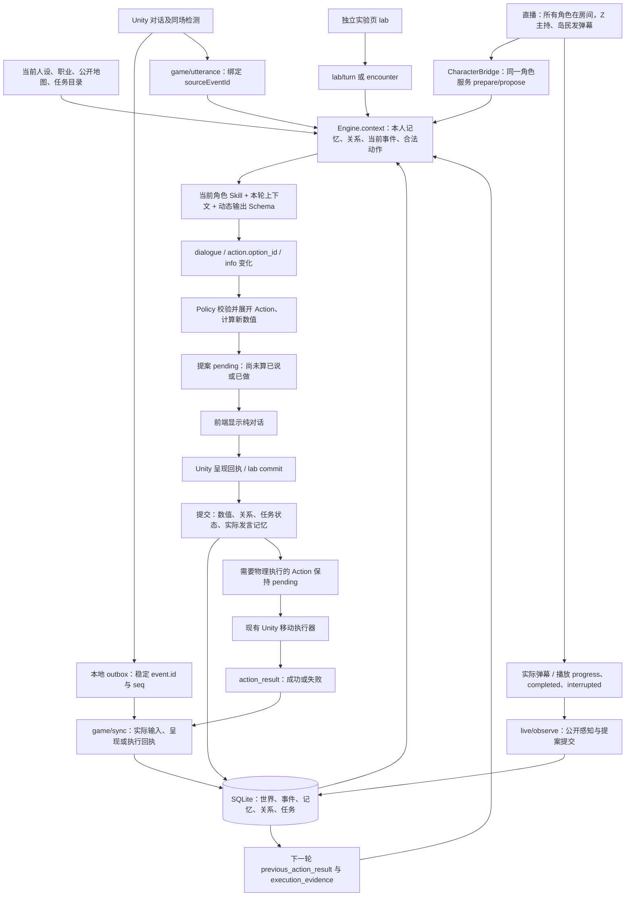

# NPC Schema 与前后端链路复核

> 本文保留的是修复前的审计记录。下述 R01—R07 已在本地修复，当前结果见 [协议修复与验收](NPC协议修复与验收-20261109.md)；不要用本文旧探针的“复现成功”作为修复后的验收结论。

复核时间：2026-11-09。对象：`/Users/bytedance/Project-Z` 当前本地工作区，包括已有的未提交修改。没有拉取或覆盖工作区，没有修改运行代码、真实存档或线上服务。

结论：普通交互的字段主链已经接上，但还不能据此认定整个协议可靠。本次 122 次请求、响应、存档及上下文结构校验没有出现意外失败；同时通过隔离探针复现了生成重试、重复回执、呈现绑定、直播播放生命周期和存档恢复问题。此外，实验页的“完整数据”与 Schema 的部分存储字段描述仍不完整。

以下优先级按影响判断：P1 应先修复，可能阻塞继续对话或改变当前进度；P2 是回执边界、诊断和文档完整性问题。表中“通过”只指本次列明的检查范围。

## 1. 当前实际调用链

需要区分：模型的 `action.option_id` 是选择，服务端展开后的 `action` 是决定，`records.action` 是待执行记录，`action_result` 才是实际执行结果。角色自己说“完成了”存为 `claim`，不能替代执行证据。

Unity 的正常流程只显示台词及现有任务交互；实验页另外显示后台诊断数据。实验页调用相同 Engine，但没有 Unity 的空间检测、实际行走和自动相遇扫描，不能作为整个游戏玩法的替代验收。

## 2. 字段与职责核对

| 数据块 | 当前落点与消费方 | 本次结论 |
|---|---|---|
| 八位角色 ID | `actor-registry.json` → Catalog → Unity 名册、模型上下文、直播绑定 | 当前八份人设文件均存在；没有沿用旧 NPC ID 来代替当前人设 |
| 人设、职业、地图 | `Catalog.prompt/identity/mapContext` → system prompt 与 context | 岛上与绑定后的直播从同一当前内容包取人物资料 |
| `worldId/runId` | Unity 请求、服务端世界及直播 binding | 区分存档和本次运行；恢复需检查内容版本 |
| `event.id/seq` | Unity outbox → `/sync` → 返回 `seq` → 清理已确认事件 | 同 ID 内容校验已有；不同 ID 指向同一回执的处理不完整，见 R02 |
| `conversationId/sourceEventId` | 输入同步 → `/utterance` → `interaction.source_event_id` | 生成前已有会话、说话者、知情范围绑定；输出呈现的反向绑定仍缺一项，见 R03 |
| `requestId/proposalId` | 生成请求 → pending proposal → 呈现提交 | `proposalId` 有状态；`requestId` 目前主要回显，缺少生成幂等恢复，见 R01 |
| `dialogue/action/info` | compact 模型输出 → Policy 展开 → 前端返回、后台提交 | 主路径结构通过；模型原始输出与持久化结构不应混用 |
| `info.changes` | 校验事件来源和范围 → 计算本人对玩家数值 | 不直接接受模型自报的新快照；传闻不会因此升级为事实 |
| `peer_relation_changes` | 当前 NPC → 多个目标 NPC 的单向关系 | 玩家对话、A2A、直播、感知事件均可作为触发；A→B 不自动改变 B→A |
| `task_participation/task_followup` | 玩家邀请、拒绝 → NPC 判断 → 任务协作与后续记录 | 接受任务的回应和拒绝后的 stop 分支通过探针；完整物理步骤暂缓 |
| `records.action/action_result` | 服务端建单 → Unity 执行 → 回执 → 下一轮证据 | 到花店的协议往返通过；不同事件 ID 重复回执仍有确认序号问题 |
| `memory/known_facts/recent_experiences` | 实际可见事件 → 本人记忆 → 下一轮检索 | 近期原话与长期记忆不同；不把全岛数据库直接给每个 NPC |
| 直播 `action` | Z 主持动作、岛民 `send_danmaku/wait` | 与岛上动作分别适配；全员在线不等于全员每轮必须发言 |
| `publicationId/stage` | 直播播放回调 → `/live/observe` | 字段格式受校验，但终态与已播放前缀约束不足，见 R04 |
| `checkpoint` | Unity 保存 JSON 字符串；v3 引用/v2 portable → 服务端恢复 | 正常结构匹配；恢复预校验不等同于文档契约，见 R05 |
| 实验页 `LabResponse` | `lab.inspect` → 状态、记录、选中人物记忆 | 是诊断投影，不是全量后台导出，见 R06 |
| 存储层 `JobRecord/WorldState` | 底层记录 → Schema → 队友对接、诊断展示 | 有未显式描述字段，被宽松扩展规则放过，见 R07 |

## 3. 必须处理的问题

| 编号 | 优先级 | 已复现的情况 | 对游戏的影响 | 修复方向 |
|---|---|---|---|---|
| R01 | P1 | 同一生成请求首次 200，重试 400；旧回复未提交时，新的玩家输入也返回“该角色正在处理另一回合” | 网络丢失响应后，玩家继续发消息可能一直没有 NPC 回复，需要结束会话恢复 | 持久化 `requestId → 输入摘要 → proposal/result`；相同请求重放原结果，冲突拒绝；提供待提交提案恢复入口 |
| R02 | P1 | 同一提案换新 `event.id` 再确认，200 但返回 seq4 而非5；同一移动回执换新 ID，返回 seq3 而非4 | Unity 只清除 `seq <= acknowledgedSeq` 的 outbox，该事件可能一直排队，阻塞后续生成 | 明确回执唯一性；合法重复确认应消费序号或返回客户端可处理的冲突，不能成功却不确认；复核其他提前 return 的回执路径 |
| R03 | P2 | `/commit` 接受非空台词；`/sync` 将匹配提案的台词改成另一 `conversationId` 也接受 | 可能绕过约定的呈现路径，或把原话及记忆记到错误会话 | 无台词接口强制空台词；呈现回执绑定 proposal 的会话、人物、频道及实际听众约束 |
| R04 | P2 | 播放已有前缀后，completed 提交完全不同的文字仍成功；completed 后的迟到 progress 又能重开，interrupted 再存一条记忆 | 角色记住的直播内容可能与实际已播内容不一致，同一段播放可能重复入记忆 | 以 `publicationId` 保存单调生命周期、当前前缀及唯一终态；终态后忽略或拒绝迟到进度；一次播放只产生一次最终观察 |
| R05 | P1 | `actor.info={}` 被恢复入口接受，但被文档 Schema 拒绝；无效任务行触发 SQL 错误前，原 pending proposal 已被取消 | 坏存档可能写入缺少必要字段的状态；恢复失败也会改变当前会话 | 恢复前完整校验人物、记录及任务表；取消旧运行与恢复状态作为受控提交过程，失败保持原状态 |
| R06 | P2 | 实验页导出无 portableCheckpoint 或任务原始表；数据库有 followup 行而导出只有任务投影 | 不能仅凭“完整数据”还原后台协作邀请、任务回执及恢复状态 | 增加明确版本的诊断导出，包含 world、taskCheckpoint 与 records；保留现有易读视图，导出不含配置密钥或活动访问凭据 |
| R07 | P2 | 文档 `JobRecord` 定义 `validation_error`，实际落库使用 `error/rejected_output`；部分 world 与后台任务字段只被宽松 object 接受 | 队友按文档生成类型时可能漏掉失败原因、原始拒绝输出、调度/恢复字段 | 分开 JobRecord 与 JobResult，补齐真实落库字段和版本；对需要扩展的部分明确扩展范围，不以任意 object 代替字段说明 |

### R01：生成与恢复

定位：`unity-sideview/Tools/MemoryLab/server.mjs:504`、`:518`、`:553`；`lib/engine.mjs:769`；`Assets/Seabreeze/Scripts/Memory/MemoryLabClient.cs:121`；`NpcConversationCoordinator.cs:109`。

服务端每次调用都新建 job，`ready()` 被同角色 pending proposal 挡住。Unity 失败后设置重试等待，并没有取得丢失的 proposal 的恢复流程。探针模拟的是“后台已生成，客户端没有确认”，没有用真实断网制造事故。实验页可刷新后显示待提交提案，Unity 玩家对话目前没有同等入口。

验收：丢弃首次成功响应后重试，仍拿到相同 proposal，模型调用和数值变化各发生一次；同 ID 不同内容拒绝；关闭会话后不得提交旧提案。

### R02：成功响应必须能清理 outbox

定位：`server.mjs:347`、`:419`、`:483`；`lib/engine.mjs:881`、`:1125`；`MemoryLabClient.cs:113`。

正常“同 event.id 重传”已有去重。本次缺口是同一业务结果换了新的事件 ID：commit/actionReceipt 提前返回，不创建事件、不推进 seq；HTTP 仍成功。不是声称当前 UI 每次都会生成重复回执，而是当前协议没有安全处理这一边界。不要以重新应用数值的方式解决确认问题。

验收：同 ID 重放、同提案新 ID、同动作新 ID、内容冲突分别测试；后续正常输入不被阻塞，数值和记忆不重复应用。

### R03：输出回执的反向绑定

定位：`server.mjs:408`、`:565`；`lib/engine.mjs:984`。当前已校验人物、目标和原文，但没有比较 `event.conversationId` 与 `proposal.conversation`。`/commit` 也未限制空台词。现有正常 Unity 分支按有无台词选择不同入口，这一缺口主要位于服务端契约边界。

验收：非空台词通过 silent commit 应被拒绝；更换会话的呈现应被拒绝；正常回执与合法重放通过。

### R04：直播格式校验不足以保证播放一致

定位：`lib/live-room.mjs:99`，尤其 `:107`、`:116`；`unity-sideview/Tools/live-service/server/character-bridge.mjs:21`。

目前 progress 只对前一个 progress 检查前缀。完成时不检查已播前缀，且没有以 publicationId 记录永久终态。桥接队列已有顺序发送和重试，但接收端仍应保证乱序、迟到或重放时只产生一次真实观察。

验收：正常完成、打断、关闭直播、重复终态、终态后进度、矛盾前缀；最终记忆必须对应实际播出的文字，Info 不能重复提交。

### R05：恢复失败也不能改变当前会话

定位：`lib/checkpoint.mjs:3`；`lib/engine.mjs:1344`、`:1354`、`:1370`；`lib/tasks.mjs:388`。

当前 shape validator 检查 info 是对象，没有检查必要数值和类型；任务集合检查是数组，没有检查每行列名和值。记录恢复的 SQL 事务会回滚，但先执行的 `cancel()` 不在这次回滚范围。探针中的失败恢复保留旧 runId，却把旧 proposal 从 pending 改为 cancelled。

验收：人物字段缺失、任务列非法、记录引用错误等均应在改变当前运行前拒绝；失败恢复前后 world、proposal、job、task 状态一致。正常恢复继续保留实际记忆与待执行移动。本项不要求改变时间设计。

### R06：后台数据的观察范围

定位：`lib/lab.mjs:15`；`lib/engine.mjs:1257`、`:1307`；`public/lab.js:41`、`:57`。

当前包含人物状态、任务当前状态、事件、提案和后台工作记录，足够日常排查；缺少完整 world 与任务 SQL 原始集合 `state/collaboration/receipts/followups`。所谓“缺少”指原始记录和恢复字段，不是说实验页没有任务或协作结果。

验收：完成一次拒绝、重提、接受、邀请与决定后，界面投影和导出原始记录能逐项对应；导出声明诊断用途及脱敏字段。

### R07：文档字段尚未完整收口

定位：`docs/Project-Z-NPC全链路.schema.json:22506`、`:22560`、`:22632`；`lib/engine.mjs:842`。

`validation_error` 是本次 run 的返回结果字段；落库 job 则用 `error`，并可能有 `rejected_output`。应分别描述，不能将一个名字当成另一个。WorldState 还未显式定义 `host/initialSeed/initialMetrics/version/memoryRevision/encounters/wakes/reflected/contentRevision/createdAt/lastAccess` 等已有字段；LabResponse 的部分后台 job/trace 仍是宽泛 object。它们因 `additionalProperties` 允许扩展而通过校验，不代表字段已写全。

`export-contract.mjs --check` 本次通过，证明从源码生成的角色与直播契约没有漂移；它不证明手写 HTTP/存储定义与每个运行入口完全一致。

## 4. 本次实测证据与边界

- 真实调用本地源码的 `createServer`、Engine、Policy、Lab、LiveRoom；使用独立内存 SQLite、临时本机端口及确定性模型替身。
- 请求模拟 Unity C# DTO 的 null、空数组、false 等默认序列化值，未只用“理想 JSON”测试。
- 122 次结构检查，意外失败 0；这包括正常结构和返回成功的异常边界结构，不等于 122 个完整玩法场景。
- 故意损坏的 `info={}` 存档单独对照：Schema 拒绝、运行入口接受，记录为 R05，不算正常结构检查通过。
- 接受林序任务后，Unity `/utterance` 正常回应；拒绝任务后，Lab 的后续决定可以提交。
- Z 去花店：proposal 提交时地点仍为 `z_home`；模拟有效实际到达回执后，地点变为 `flower_shop`，动作 succeeded；下一轮包含匹配的 `previous_action_result` 和 `execution_evidence`。
- 当前 8 份人设文件均存在；源码生成契约一致性检查通过。总 Schema 仍为 171 个定义。

本次没有真实调用模型、消耗 API，也没有重新进行 Unity 试玩、实际走路、声音播放或八人长时间对话。移动测试证明服务端协议接得上，不证明本次在 Unity 画面中重新走到了花店。异步记忆提取/反思的模型质量和长时运行没有重新测。

证据与复现脚本：

- [探针结果](NPC全链路复核-20261109/results.json)
- [可重跑探针](NPC全链路复核-20261109/audit.mjs)
- 在仓库根目录运行 `node docs/NPC全链路复核-20261109/audit.mjs`；需已安装 MemoryLab 依赖及允许监听临时 localhost 端口。使用内存库，不读取模型密钥和真实游戏存档，结果写入同目录 results.json。
- 契约一致性检查：在 `unity-sideview/Tools/MemoryLab` 运行 `node scripts/export-contract.mjs --check`。

## 5. 人设、Schema 和记忆文件在哪里

| 内容 | 当前实际位置（相对仓库根目录） |
|---|---|
| 完整接口文档 | `docs/NPC-Schema与前后端对接说明.md` |
| 对接总 Schema | `docs/Project-Z-NPC全链路.schema.json` |
| 当前角色与关系基线名册 | `unity-sideview/Tools/MemoryLab/content/current/actor-registry.json` |
| Skill 入口 | `unity-sideview/Tools/MemoryLab/content/current/moonlife-actors/SKILL.md` |
| 八人人设 | 同目录 `references/characters/`：`z.md`、`liyuan.md`、`liting.md`、`axing.md`、`zhengyi.md`、`xiaoxiaoqing.md`、`linxu.md`、`zhou_bobo.md` |
| 地图与任务 | 同目录 `references/island-map.json`、`references/tasks.json` |
| 角色输出契约 | 同目录 `references/contract.schema.json`；动态规则由 `lib/policy.mjs` 生成 |
| 直播输出契约 | `unity-sideview/Tools/MemoryLab/lib/live-contract.schema.json` |
| 世界与回合提交 | `unity-sideview/Tools/MemoryLab/lib/engine.mjs` |
| 本人记忆、提取与反思 | `unity-sideview/Tools/MemoryLab/lib/memory.mjs` |
| 关系更新 | `unity-sideview/Tools/MemoryLab/lib/relationships.mjs` |
| Unity 请求、回执、执行接线 | `unity-sideview/Assets/Seabreeze/Scripts/Memory/` |
| 独立实验页 | `unity-sideview/Tools/MemoryLab/public/lab.html`、`lab.js`；后台 `lib/lab.mjs` |
| 本地实验数据 | `unity-sideview/Tools/MemoryLab/.data/character-lab.sqlite`，本次未修改 |

运行时 Catalog 读取 registry 所列公共文档、当前人物 profile 和公开地图组成 prompt；仅修改安装在个人 Codex 目录里的 Skill，不会自动更新游戏内这份内容包。

## 6. 推荐处理顺序

1. 先修 R01/R02/R05：生成可恢复、回执可确认、恢复失败无副作用。
2. 再修 R03/R04：呈现绑定与直播实际感知的一致性。
3. 补 R06/R07：诊断导出、失败记录类型、存储字段文档与对应回归测试。
4. 用实验页验证玩家对话→关系变化→A2A→任务决策→重开存档的连续流程，再进 Unity 验证真实移动、打断及直播播放。

物理任务执行器、日期时段设计、完整逃岛剧情编排继续按此前约定暂缓；这些不能靠补齐 JSON 字段宣称完成。本次只复核现有机制，没有新增玩法规则或修改机制采用记录。
