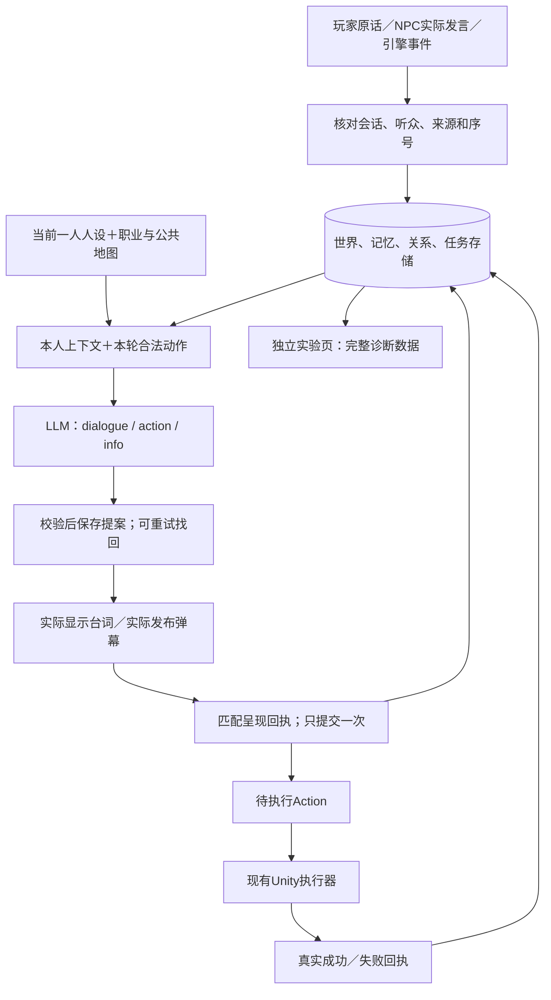

# NPC 协议修复与本地验收

2026-11-09，工作区 `/Users/bytedance/Project-Z`，分支 `codex/npc-schema-live-local-20261108`。本次只修改本地，保留之前的未提交工作，没有提交、推送或部署。

体验入口：<http://127.0.0.1:4341/lab>。双击 `unity-sideview/启动角色交互实验室.command` 可重新启动。页面使用项目当前八位人物和真实 DeepSeek 配置，使用独立测试存档。左侧选择角色，中间对话，右侧查看人设、输入、输出、关系、记忆、事件、任务或完整数据。

## 本次解决的七项问题

| 原审计项 | 修改后的行为 | 实现位置（相对仓库） |
| --- | --- | --- |
| R01：响应丢失导致回合卡住 | 同一次生成重试返回原提案，持久身份在服务重启后仍可使用；生成中断且未存提案时恢复原Job；新原话取消尚未呈现的旧回复，旧输入不能换ID复活 | `Tools/MemoryLab/lib/utterance.mjs`、`lib/engine.mjs`，Unity `MemoryLabClient.cs` |
| R02：重复回执不推进序号 | 重复确认同一提案或动作、但使用新事件ID时，记诊断回执并推进seq；不重复增加记忆、数值或行动 | `Tools/MemoryLab/server.mjs`、`lib/engine.mjs` |
| R03：呈现回执可以冒用会话 | 核对说话者、原文、会话及频道；无台词提交接口只接受空台词提案 | 同上 |
| R04：直播已播前缀与完成文本分叉 | 完成文本必须包含已播前缀；持久化播放终态，迟到进度不会重新开启；中断只记录已听片段。提交出错时先回滚Info，再记录实际听到的话 | `Tools/MemoryLab/lib/live-room.mjs` |
| R05：坏存档影响原进度 | 共用存储Schema＋引用预检，包括角色、世界、任务JSON、重复ID及跨世界记录冲突；整次恢复使用事务，失败保留原进度，成功才取消旧运行 | `Tools/MemoryLab/lib/checkpoint.mjs`、`lib/engine.mjs` |
| R06：完整数据不完整 | 增加 `backend.world` 与原始 `backend.taskCheckpoint` 四张任务表；标记 `exportVersion:1`；移除访问凭据，明确为诊断导出 | `Tools/MemoryLab/lib/lab.mjs` |
| R07：存储字段文档缺失 | 显式描述Job错误/拒绝输出/请求身份、记忆加工Job、反思和Trace；导出文档与读档校验共用存储类型源 | `Tools/MemoryLab/lib/storage-contract.schema.json`、`scripts/export-contract.mjs` |

表中 `Tools/` 均位于 `unity-sideview/`；Unity客户端位于 `unity-sideview/Assets/Seabreeze/Scripts/Memory/`。

## 数据链路

Info 是角色状态，Action 是待执行决定。对话显示不等于行动完成；没有执行器的任务不会因为说了“做完了”就完成。人物的有向关系仍由当前角色根据亲历、记忆、来源和动机判断；没有统一好感阈值强制帮助Z。

## 已运行的验收

| 验收 | 结果与边界 |
| --- | --- |
| `cd unity-sideview/Tools/MemoryLab && npm test` | **82/82通过**；含11项新的协议恢复回归，覆盖重试、重启、重复回执、篡改呈现、播放终态、事务故障、存档、完整导出 |
| `cd unity-sideview/Tools/live-service && npm test` | **119/119通过**；直播媒体侧兼容回归 |
| `node scripts/export-contract.mjs --check` | 通过；review-4，176个定义，与当前源文件一致 |
| `Z_DOTNET=/Users/bytedance/.project-z/dotnet/dotnet bash unity-sideview/Tools/check.sh` | 3255资源文件、1687 GUID、3个场景检查通过；271个C#文件，0语法错误。使用本机已有SDK |
| Unity 6000.3.27f1 实际Play Mode | 通过；邀请Z去花店，第一次成功生成响应故意丢弃，客户端用同一requestId取得同一proposalId；谈话期间暂停，结束后行走，中途交谈再暂停、结束后继续，实际抵达花店后出现成功回执 |
| 真实DeepSeek＋Chrome实验页 | 玩家与Z交谈；同场Z主动找林序，林序接续回应；玩家介入后林序退出A2A；玩家询问帮助后林序发布码头任务；玩家拒绝后林序选择stop并落库 |
| 真实记录结构 | 页面完整数据包含world和任务四表；浏览器实际下载JSON，17条记忆和相关加工记录通过LabResponse与存储约束检查。没有执行恢复操作 |
| 修改范围 | 本次增量集中在MemoryLab协议、客户端重试、启动版本判断与文档；未修改Unity界面、人物正文、时间机制和物理任务执行器。Unity自动导入资源已恢复为启动前副本 |

Unity测试使用隔离存档和确定性模型，验证传输及行动流程；真实模型在独立网页另测，不把两者合称“真实模型完整游戏通关”。同一请求的前两次HTTP返回同一提案，测试期间还有后续对话/规划调用，不能将总模型调用次数当作首轮的调用次数。

下载自动化的完成通知超时，但文件实际已经保存；最终以磁盘JSON及结构校验为准。测试结果摘要见 [evidence.json](NPC协议修复与验收-20261109/evidence.json)、[Unity行走结果](NPC协议修复与验收-20261109/unity-journey.json)、[丢包重试记录](NPC协议修复与验收-20261109/unity-transport.json)、[导出验证](NPC协议修复与验收-20261109/lab-export-check.json)。

## 对接与仍保留的边界

- 完整契约：[Project-Z-NPC全链路.schema.json](Project-Z-NPC全链路.schema.json)。按对应 `#/$defs/...` 入口校验，不将根anyOf与选定入口叠加；特别是LabResponse应单独引用其定义。
- 接线说明：[NPC-Schema与前后端对接说明.md](NPC-Schema与前后端对接说明.md)，第16节列出本轮约定。
- 当前人物档案：`unity-sideview/Tools/MemoryLab/content/current/moonlife-actors/references/characters/`；本次未改人设故事。
- 本轮没有新增收拾物品、递菜单、道具交付等执行器，也没有调整时间或保证Day7必然逃脱。未做七日完整游玩和长时间多人负载测试。
- 直播协议的前缀、中断、终态及回滚已回归；本轮未重新做真实直播音视频全流程。网页已测试Z和林序，不代表对八个人物的人感逐一验收。
- 诊断导出供开发者观察，包含角色私有信息；普通Unity玩家界面仍只展示台词和现有任务样式。经过凭据移除的诊断JSON不充当正式可恢复备份。

机制依据沿用K11/K12：保留可观察的执行结果与失败补救，把补救落实为回执幂等、生成恢复与读档失败保留原进度；不新增剧情或玩法机制。
