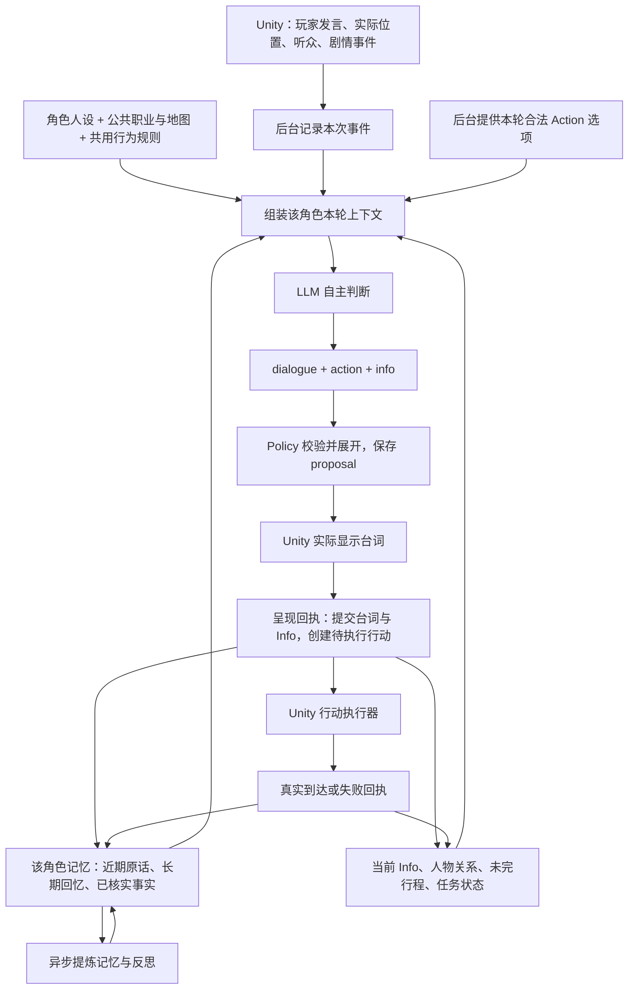

# 当前 NPC Schema 与人设、记忆、Action、Info 串联

本文核对的是 `/Users/bytedance/Project-Z` 当前本地工作树，包含花店同行修复。仅新增说明和 Schema 导出，没有修改运行代码、线上服务或真实存档。

角色共八位：Z、梨园、李庭、阿星、正义、小小晴、林序、周伯伯。一次调用只替一位角色判断。

## 先看整体



人设回答“这个人通常在意什么”；记忆回答“这一局她经历过什么”；Info 记录“她现在的情绪、关系和判断”；Action 表达“她这次选了什么”；Unity 和回执确认“事情到底有没有发生”。

## 四层接口与版本

| 层 | 形态 | 谁生成、谁消费 | 当前权威来源 |
|---|---|---|---|
| Unity → 服务端 | `worldId/runId/requestId/actorId` 等 camelCase 字段 | Unity 报告实际发生的输入、空间与回执 | [MemoryContracts.cs](../../unity-sideview/Assets/Seabreeze/Scripts/Memory/MemoryContracts.cs)、[server.mjs](../../unity-sideview/Tools/MemoryLab/server.mjs) |
| 后台 → 模型 | `interaction/environment/character_state/available_actions` 等 snake_case 字段 | Engine 组装，LLM 读取 | [engine.mjs](../../unity-sideview/Tools/MemoryLab/lib/engine.mjs) 的 `context` |
| 模型 → 后台 | `dialogue/action/info`，Action 只选 `option_id`，Info 提增量 | LLM 判断，Policy 校验 | [policy.mjs](../../unity-sideview/Tools/MemoryLab/lib/policy.mjs) 的 `modelContract` |
| 后台 → Unity / 存档 | 公开台词 + 小型 checkpoint；数据库保留完整提案、Info、记忆、行动 | 后台存储，Unity 显示与执行 | `gameResponse/referenceCheckpoint` 与 `MemoryActionExecutor` |

版本分别是：引擎输入 `protocol_version: "1.2.0"`；模型输出契约 `moonlife-turn/3.0`（注册表元数据，不是额外输出字段）；内容包 `pack_version: "3.0"`；Unity 引用快照 `version: 3`；可携带完整快照 `version: 2`。这些版本各管一层，不是要求把同一字段填成不同值。

当前**没有一份覆盖全部 HTTP 端点的统一 OpenAPI/JSON Schema**。Unity 外层由 C# DTO 和 server 路由实现；本目录导出的 JSON Schema 是代码实际生成的模型／后台契约快照。不要把导出文件另立成运行时权威，实际每轮仍由 Policy 根据角色、任务和可行动范围生成。

## 人设在哪里、怎样进入调用

权威目录：[Tools/MemoryLab/content/current](../../unity-sideview/Tools/MemoryLab/content/current)。

[actor-registry.json](../../unity-sideview/Tools/MemoryLab/content/current/actor-registry.json) 指定每位角色的档案、日常目标、初始关系、数值范围和能力边界。`Catalog.prompt(actor_id)` 实际拼接：

1. `world.md / behavior.md / social.md / memory.md / interface.md` 五份共用文件；
2. 本次角色的一份人物正文；
3. `island-map.json` 中八人的公开职业、常驻地点与公共地理；
4. `ActorRuntime` 再追加当前阶段规则和本轮动态输出 Schema。

`SKILL.md` 是给人阅读和直接调用 Skill 的入口；API 运行时按注册表编译上述引用文件，不能只改 SKILL.md 顶部文字就假定后端提示词一定随之改变。人物私有档案不会一次把八份都塞给每位 NPC。

| 角色 ID | 公开身份 | 人物全文 |
|---|---|---|
| z | 主播；好奇、有主见，关心熟人，也想亲自看看外面 | [Z](../../unity-sideview/Tools/MemoryLab/content/current/moonlife-actors/references/characters/z.md) |
| liyuan | 绘制地图、勘察路线 | [梨园](../../unity-sideview/Tools/MemoryLab/content/current/moonlife-actors/references/characters/liyuan.md) |
| liting | 咖啡店老板 | [李庭](../../unity-sideview/Tools/MemoryLab/content/current/moonlife-actors/references/characters/liting.md) |
| axing | 技术员，维护设备 | [阿星](../../unity-sideview/Tools/MemoryLab/content/current/moonlife-actors/references/characters/axing.md) |
| zhengyi | 警察 | [正义](../../unity-sideview/Tools/MemoryLab/content/current/moonlife-actors/references/characters/zhengyi.md) |
| xiaoxiaoqing | 花店老板 | [小小晴](../../unity-sideview/Tools/MemoryLab/content/current/moonlife-actors/references/characters/xiaoxiaoqing.md) |
| linxu | 船长，原名老周 | [林序](../../unity-sideview/Tools/MemoryLab/content/current/moonlife-actors/references/characters/linxu.md) |
| zhou_bobo | 照相馆老板；幕后身份留在私有角色资料 | [周伯伯](../../unity-sideview/Tools/MemoryLab/content/current/moonlife-actors/references/characters/zhou_bobo.md) |

正文统一包含身份与日常、核心欲望、性格与缺点、初始知情、初始关系、行为倾向、改变判断的条件、语言风格、行动边界。初始知情不覆盖本局已获得的新事实。

## 模型拿到什么：输入字段

完整代码导出：[Z 输入 Schema](schemas/01-z.input.schema.json)；完整花店样例：[Z 上下文](examples/01-z-context.json)。

| 字段 | 含义与边界 |
|---|---|
| `protocol_version/session_id/turn_id/actor_id` | 协议、世界、回合与当前角色；与外层 worldId/runId/requestId 分层使用 |
| `interaction` | 当前实际说话人、原话、来源事件、会话和模式：player、npc_message、world_event、agenda、livestream 等 |
| `plot_node` | 剧情引导；当前 Engine 使用 event_driven 通用描述，不是已完整接入任意剧情节点编辑器 |
| `environment` | 地点、日期、天气、在场人物、真实听众、玩家交谈占用、地图知识和可走节点 |
| `character_state.public_identity` | 当前角色的公开职业、住处等稳定常识 |
| `character_state.info` | 上一轮已提交的完整数值与情绪快照 |
| `character_state.peer_relations` | 当前角色对其他 NPC 的有向关系；不等于对玩家的 affinity/trust |
| `character_state.known_facts` | 当前角色可见的引擎已核实事实 |
| `character_state.received_claims` | 别人告诉她的话，保留是谁说的，不自动变真相 |
| `character_state.memories` | 根据当前话题检索出的个人长期回忆 |
| `character_state.recent_conversation/recent_experiences` | 当前会话原话、跨岛上／直播的近期经历 |
| `character_state.disclosure_by_recipient` | 可向各个收件人转述的来源范围 |
| `character_state.metric_policy/applied_event_ids` | 可调整数值范围、哪些来源已计分，防止重复加分 |
| `character_state.agenda/pending_action` | 自己的计划，以及已经决定但还未实际完成的行动 |
| `character_state.cooperation_requests/cooperation_state` | 玩家邀请的协作范围、本人此前的选择 |
| `tasks` | 当前本人可以向玩家提出／处理的任务；NPC 间回合为空 |
| `available_actions` | 本轮合法选项，含后端预先确定的 type、target、parameters |
| `previous_action_result` | 前一个行动待执行、成功、失败或取消的可信回执 |
| `reply_budget` | 台词长度、模型调用超时预算；不是端到端延迟保证 |

地图常识来自 `island-map.json`；Unity 实际可走锚点来自 [Resources/Memory/locations.json](../../unity-sideview/Assets/Seabreeze/Resources/Memory/locations.json)。知道某地点存在，不等于该地点的物理场景已经制作。

## 模型返回什么：三部分

以下是精简结构示例，事件 ID 为示意；[完整可校验输出](examples/02-z-model-output.json)包含与输入匹配的真实示例 ID。

```json
{
  "dialogue": "好啊，我们去小小晴的花店看看。",
  "action": { "option_id": "move_flower_shop" },
  "info": {
    "emotion": "interested",
    "changes": {
      "affinity": {
        "delta": 2,
        "reason": "玩家邀请我去看看感兴趣的花店。",
        "source_event_ids": ["evt_invitation"]
      }
    }
  }
}
```

这表示角色选择去花店，并提议关系变化。`+2` 仅用于展示结构，不是邀请成功固定加分。无变化时 `changes: {}`；Z 可以拒绝、另约，也可以没有数值变化而同意。

**Dialogue**：仅角色台词，不含动作旁白。普通 Unity 回包的 `result` 只含 dialogue，原始 Action/Info 不显示给玩家。

**Action**：只选本轮 `option_id`。后台从不可变选项展开，例如：

```json
{
  "action_id": "move_flower_shop",
  "type": "move",
  "target": "flower_shop",
  "parameters": {
    "origin": "z_home",
    "route": ["z_home", "residential_middle", "public_middle", "flower_shop"]
  },
  "description": "move"
}
```

`action_id` 是本轮选项 ID；提交后另建持久行动记录 ID，形如 `action_proposal_...`。Unity 的 action_result 使用**持久行动记录 ID**，不能拿 `move_flower_shop` 当成某次执行实例的回执 ID。

| 当前岛上动作 | 实际作用 |
|---|---|
| wait | 不创建新行动；有未完行程时保留它 |
| move | 前往已实现、同场景连通的最终目的地，等待真实到达回执 |
| cancel_move | 角色决定停止当前行程，标记 cancelled，不能算到达 |
| schedule_meeting | 只在意向阶段选择约见目标，Unity 走近后才真正开始交谈 |
| communicate | 对指定 NPC 发言，受真实听众、私聊占用与分享范围约束 |
| offer_task / give_task_reward | 向玩家提出任务／已完成任务的结果；不代玩家接受，不以台词判任务完成 |

**Info**：模型提议变化，后台校验并计算完整新状态；真正提交的状态会进入下一回合。

| 字段 | 用处 | 是否直接执行物理动作 |
|---|---|---|
| emotion | 当下情绪，例如 curious、interested、tense | 否，影响后续判断和表达 |
| changes.affinity | 对玩家的好感增量 | 否 |
| changes.trust | 对玩家的信任增量 | 否 |
| changes.world_suspicion | 对世界的怀疑增量 | 否 |
| changes.persuasion | 岛民有关援助判断的数值变化；Z 不含此字段 | 否，不是达标自动帮助 |
| support_willingness | 岛民 unassessed/considering/willing/unwilling | 是当前态度，不等于任务已协作或已完成 |
| peer_relation_changes | 本人对本轮对方 NPC 的好感／信任变化 | 否 |
| communication/social_decision | 要不要聊、说话意图、分享哪些来源 | 配合 communicate 与真实投递，不创建任务 |
| agenda_update | 当前目标与下一步计划 | 计划不能替代已执行回执 |
| task_participation | 自愿参与／拒绝／改期，以及愿意做的步骤 | 决定协作资格，具体步骤仍需执行器 |
| task_followup | 玩家拒绝后停止、推迟或有新理由重提 | 不自动代玩家接受 |
| decision | 可选判断文字，不能单凭它推断物理结果 | 否 |

初始范围：affinity 30–70、trust 30–70、world_suspicion 0–20、岛民 persuasion 0–30。按新局种子与角色采样，读档不会重抽；后续整数值限 0–100，允许有理由的大幅变化，越界或重复来源计分会被拒绝。周伯伯 persuasion 固定为 0、support_willingness 为 unwilling，符合他不提供实质逃离帮助的设定。Z 不含 persuasion/support_willingness。

模型现在不输出 memory_updates / knowledge_updates，也不重复完整数值快照。内部旧结构保留两个空数组，实际记忆由独立 MemoryBank 维护。

## 从答应到真的走到花店

1. Unity 先用 `sync` 上报玩家原话，获得稳定事件 ID，再请求 `utterance`；生成请求不是唯一的消息存储入口。
2. 后台载入 Z 的人设、私人记忆、Info 和所在位置，计算路线，给出 `move_flower_shop`。
3. LLM 返回三部分，后台校验，暂存 proposal。此时不能声称行动完成。
4. Unity 显示台词，通过带 proposalId 的 utterance 呈现回执提交；后台记录“Z 说过要去花店”、更新 Info、创建 pending 行动。
5. 玩家关闭对话框后，Unity 开始行走；再次聊天先暂停，结束后恢复。日常闲逛与 A2A 不抢占行程。
6. 真到达后，Unity 用 sync 上报 action_result：

```json
{
  "kind": "action_result",
  "actionId": "action_proposal_example",
  "succeeded": true,
  "locationId": "flower_shop",
  "text": "已实际走到目的地：flower_shop。"
}
```

此处省略了外层 worldId/runId 及 MemoryEvent 必需的 id、seq、day、period 等通用字段，不能直接作为完整 HTTP 请求复制。

7. 后台校验回执、标记 succeeded、更新位置并写入 Z 可见的到达 fact。下一次对话就同时拿到更新后的 Info 与真实到达记忆。

完整前后状态：[提交后](examples/04-z-committed-state.json)、[动作回执后](examples/05-z-after-receipt.json)。这些是内存数据库中构造的文档样例，真实 Unity 测试证据另见 [花店验收](../../unity-sideview/Docs/Verification/Journey-20261108.md)。

## 记忆怎样串联

权威实现：[memory.mjs](../../unity-sideview/Tools/MemoryLab/lib/memory.mjs)、[natural-memory.mjs](../../unity-sideview/Tools/MemoryLab/lib/natural-memory.mjs)、[consolidator.mjs](../../unity-sideview/Tools/MemoryLab/lib/consolidator.mjs)。

- 原始事件保留 speaker、visible、disclose_to、会话与来源。只有实际看见／听见的人获得自己的记忆。
- 台词先记作 claim/hearsay：知道“他说过”，不等于知道“他说的是真的”。Unity 确认到达等事实通过 fact 单独记录。
- 近期原话直接可用：当前会话最多 8 条，跨频道经历最多 16 条，并限最近 2 个游戏小时；更早经历转为长期检索。不是只要跨了直播就失忆。
- 长期记忆按话题线索、可回忆程度和重要性选取，默认选 10 条；细节与大意有不同衰减，反思保留依赖来源、属于推断。
- 提炼、承诺整理、反思在后台异步进行，常规对话不等待它们全部结束。
- 一个回合中的 Info 变化不会直接改写“事实”。信任增长不会让别人的说法自动成为真相；实际行动回执不会自动给固定好感分。

数据库在综合启动方式下是 `unity-sideview/Tools/MemoryLab/.data/unified-local.sqlite`；状态、事件、记忆、提案和行动按记录类别存储。Unity 的 `seven-memory-save.json` 保留快照引用、outbox、位置等，不是完整私人记忆的唯一副本。仅搬走引用存档，不能保证另一台机器可以恢复，需后台 DB 或 portable 完整快照。

## A2A 和直播怎样接入

岛上 A2A：实际同地／听得见／角色空闲 → 规则给候选 → LLM 判断要不要走近 → Unity 实际走近 → 双方轮流用同一套角色上下文回复 → 发言实际呈现后按听众写各自记忆。玩家正在跟其中一人交谈时，该人不再参加 A2A；待执行的同行行程也优先于闲聊。任务只发给玩家，不能在 NPC 间互发正式任务。

直播：同一 actor_id、人设、个人记忆与 Info；Z 当主播，另外七位岛民全部在线，每位都会轮到判断，可暂时不发言。岛上行动在直播期间暂停。

| 场景 | 模型 Action 结构 |
|---|---|
| 岛上 | `{ "option_id": "move_flower_shop" }` |
| 岛民发弹幕 | `{ "type": "send_danmaku", "intent": "reaction", "evidence_ids": ["公开消息ID"] }` |
| 岛民先听 | `{ "type": "wait" }`，dialogue 为空 |
| Z 主持 | `action` 内嵌旧媒体协议的 `action: speak/wait/tool` 及 mood、gesture、handledIds、tool 等对应字段；dialogue 仍在外层 |

这几种 Action **目前确实不是同一个结构**。直播由 [CharacterBridge](../../unity-sideview/Tools/live-service/server/character-bridge.mjs) 适配既有媒体系统，个人 Info 由 [LiveRoom](../../unity-sideview/Tools/MemoryLab/lib/live-room.mjs) 校验与提交。直播完整媒体 Action 约束仍有代码／提示词校验，不能把本目录 live-info.schema.json 误称成完整直播输出 Schema。

弹幕发布或 Z 的台词实际播放后才写记忆；播放中只有已经播出的前缀可见，结束／中断后合成一份经历。加入直播不会共享各人的私聊。

## 当前还应明确的边界

- Schema 校验字段、动作选项、来源与数值范围，无法保证自由台词百分之百与行动一致，也不能单凭 JSON 校验保证秘密绝不泄漏。
- 目前 plot_node 使用通用 event_driven 描述；定向剧情通过真实 story_event/observation 投递。任意复杂剧情节点编辑和全七日结局引擎未因此自动实现。
- 移动已接实际执行；修理、试航、装载、拍照和最终离岛不能因人设写了“能做”就当成已经接通 Unity。
- 当前 server 的 `/api/game/cancel` 返回 `{ok:true}`；客户端虽尝试接收快照，这个端点实际还不回 checkpoint。读档清理旧会话占用已经在 open 处理，但“取消响应立即回写快照”的说法不精确。此处如实记录，本次只解释和导出，未修改运行代码。
- environment 里 `scene` 实际常装逻辑地点 ID，`scene_id/sceneId` 装 Unity 场景名；仍有兼容命名，阅读时不要混作同一语义。

## 导出清单与验证

- [模型输入](schemas/01-z.input.schema.json)
- [Z 岛上模型输出](schemas/02-z.model-output.schema.json)
- [Z 后台展开输出](schemas/03-z.backend-output.schema.json)
- [林序玩家回合输出](schemas/linxu.player.model-output.schema.json)
- [周伯伯玩家回合输出](schemas/zhou_bobo.player.model-output.schema.json)
- [小小晴 A2A 输出](schemas/xiaoxiaoqing.a2a.model-output.schema.json)
- [Z 直播 Info](schemas/z.live-info.schema.json)、[林序直播 Info](schemas/linxu.live-info.schema.json)
- [完整示例目录](examples)

8 份 Schema 均由当前代码编译导出，并用当前 Ajv 编译成功；花店模型示例通过 Policy 语义验证、展开、提案提交和模拟回执。使用独立内存数据库，模型 API 调用 0 次，没有读取真实玩家数据库。导出是当前示例上下文的快照，不是所有未来回合的固定枚举。
