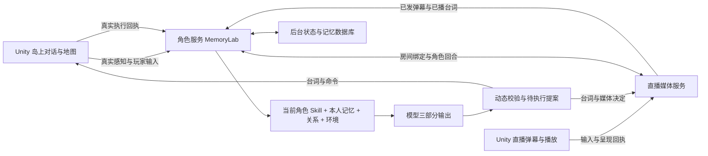

# NPC、记忆、A2A 与直播的本地整合

本轮基于 `origin/main 77cf536`（含 PR42、PR44），在本地分支 `codex/npc-schema-live-local-20261108` 修改。主工程为 `unity-sideview/`。不改前端样式，不推送或部署。

目标是同一个人能在岛上交谈，也能在直播中发弹幕；他自己的关系、记忆、情绪和对世界的认识贯穿两个频道。Z 的行动和其他人的援助由本人判断，物理结果由游戏确认。直播固定 Z 主播、七位岛民全员在场，不存在模型选择不加入的分支；当轮是否发言仍由本人决定。

## 本轮修复

| 原问题 | 本地实现 | 位置（相对 unity-sideview） |
| --- | --- | --- |
| 模型要重复输出动作参数、数值快照，提示与动态校验不一致 | 岛上模型只选 option_id，数值只给 delta；后台恢复完整动作并使用同一回合的动态 Schema 校验 | `Tools/MemoryLab/lib/policy.mjs`、`actor-runtime.mjs` |
| 任务拒绝后的 task_followup 要求没有在实际接收端统一执行 | 动态规则同时约束生成与接收；不允许省略拒绝后的决定或无新理由机械重提 | `lib/policy.mjs` |
| 直播另用旧 Z 和三个虚拟观众，岛民没有沿用记忆 | 同一个 Catalog 编译 Z 与七位岛民资料；CharacterBridge 按人加载本人状态 | `Tools/live-service/scripts/build-character-content.mjs`、`server/character-bridge.mjs` |
| 直播人与岛上角色状态分离 | live/open 绑定 world/run/room；台词实际呈现才提交 Info，直播公开消息进入八人的个人经历 | `Tools/MemoryLab/lib/live-room.mjs`、`server/session.mjs` |
| 同一句台词可能把决定与回执配错 | 将 proposal ID 绑定实际发言 ID；未发布、被改写或中断的决定不靠文字猜测提交 | `server/character-bridge.mjs`、`server/session.mjs` |
| 逐字播放反复生成重复记忆 | 进行中的已播前缀只保留一份，完整播完或中断后合成一次经历 | `lib/live-room.mjs` |
| 回到岛上只取本次会话原话，忘记刚才直播内容 | 增加按本人可见范围检索的 recent_experiences，保留频道、听众和可转述范围 | `lib/engine.mjs`、`lib/memory.mjs` |
| 退出时可能仍有消息未写回 | 先停止直播生成与未完成命令，再刷入消息，关闭角色房间后恢复岛上 | `server/http.mjs`、`Scripts/UI/GameUI.cs`、`MemoryLabClient.cs` |
| 全量存档带私有 Info 和历史往前端传、每帧反序列化 | reference-v1 返回小投影；原始数据留 SQLite，执行器按 checkpoint 变化解析 | `lib/store.mjs`、`server.mjs`、`MemoryActionExecutor.cs` |
| 初印象全员一样、计划上下文地点可能过期 | 按世界种子在配置范围内初始化；人物既有关系给有向起点；真实地点/天气/日期传入 | `actor-registry.json`、`lib/engine.mjs` |
| 在线观众显示旧演示身份 | 原有摘要和观众弹窗显示当前岛民，弹窗可查看全部七人 | `UI/ZLive/Runtime/LiveRoomControls.cs` |

角色名仍为 Z、梨园、李庭、阿星、正义、小小晴、林序、周伯伯；没有改回旧 NPC 身份，也没有增加父母等人物。周伯伯的信息中心与反对实质逃离立场保持。

## 前后端边界



1. 模型协议叫 `moonlife-turn/3.0`，根只有 dialogue/action/info。岛上的 action 是 `{option_id}`；Info 不重复快照。
2. 后台内部保留展开后的 action 与完整数值，基础 `contract.schema.json` 用于这一层和输入上下文。新模型输出 Schema 由 `Policy.modelContract(context)` 编译，不能直接把旧基础文件粘给模型。当前说明只保留一套运行要求。
3. 直播复用相同人物与 Info，action 由媒体宿主适配：岛民 send_danmaku/wait，Z speak/wait/tool。原有 RTC、唱歌、播放回执协议继续存在，不能把岛上 move 当作直播动作。
4. Unity HTTP 外层的 runId、proposalId、事件序号、checkpoint 是传输与执行信息，不是模型要生成的字段。直播外层继续用 protocolVersion/sessionId/commandId/epoch。二者通过明确的绑定适配，共用人物状态，不强塞成一个媒体协议。
5. 普通角色回复只把 dialogue 发给玩家 UI。原始 Action/Info 留后台；已批准的 pending action 作为游戏执行命令投影给 Unity。否则 Unity 无法实际移动 NPC。界面不新增数值或调试面板。

岛上三部分示意（ID 必须来自真实本轮，不能直接拿示例值发请求）：

```json
{
  "dialogue": "你先说打算怎么走，我听听。",
  "action": {"option_id": "wait_here"},
  "info": {"emotion": "curious", "changes": {}}
}
```

全员在直播间只让他们知道实际公开的弹幕、已播台词。各人的私聊和未公开计划仍只属于本人；不发弹幕也保持在场感知。逐字进度可用于当前感知，但不重复生成十几条“同一句话”的长期经历。普通自由台词仍可能暴露不该说的内容，Schema 不能证明语义绝不泄密。

## Skill 到底在哪里

权威入口为 `unity-sideview/Tools/MemoryLab/content/current/actor-registry.json`。总入口 `moonlife-actors/SKILL.md`，八份人物正文在 `moonlife-actors/references/characters/`；公共职业、地图、行为、社会规则、记忆与接口在同一个 references 目录。

实际 API 调用由 `lib/catalog.mjs` 读取“共用规则＋本次人物＋公共地图”，每轮不会把其他七人的私有人设一并交给当前人物。直播生成文件由同一资源构建，更新人设后运行：

```sh
node Tools/live-service/scripts/build-character-content.mjs
```

`~/.codex/skills/` 是此前 Codex 试聊安装位置，不是这份游戏的实时角色数据源；桌面早期 Skill 导出包也不会自动覆盖游戏。实际关系与记忆在后端数据库，不写回人设 Markdown。

## 数值与记忆

开局好感/信任 30—70、世界怀疑 0—20、援助倾向 0—30，周伯伯援助固定 0。由世界种子初始化，读档不重新抽数值。已有存档沿用其状态。注册表的既有 NPC 关系起点是按已确认关系做的设计校准值，不是问卷里原有精确数值。

之后各数值依据事件在 0—100 内变化，可以明显改变、反向改变或不变。对玩家的好感/信任与对 NPC 的有向关系分开；同一事件不能重复计分。援助意愿是对这次情境的决定，既不是“好感过线必帮忙”，也不是“到了 Day7 必成功”。

引用存档 v3 只存小投影与哈希，完整恢复依赖对应后端 DB。迁移机器时需携带 DB，或用 `/api/game/checkpoint` 的 `portable:true` 导出完整 v2 快照；只复制 Unity 小存档不能恢复全部私有记忆。不存在的引用会明确报错，不静默重置。长局快照保留策略与 GC 尚需另做，不把小前端包等同于后台数据不会增长。

## 仍需开发，才能完成“帮 Z 逃岛”玩法

| 优先级 | 现状和实际影响 | 建议接线与验收 |
| --- | --- | --- |
| P0 | 物理执行器主要支持 move；角色愿意修船、试航、拍照或装载，不代表 Unity 真做到了 | 给 `MemoryActionExecutor` 接各物件执行器，在真实交互完成时发 action_result/task_receipt；受阻必须报失败，验证同意→执行→结果→下轮记忆 |
| P0 | 试航、临行装载等任务默认关闭，缺少完整游戏条件激活和最终离岛结算 | 在 StoryDirector/玩法状态中用已核实路线、船况、载重与 Z 当前意愿启用；不用固定日期广播，不能用任意台词触发成功 |
| P1 | 当前 A2A 依赖 Unity 当前场景空间，离屏角色没有完整跨场景旅行 | 实现地图行程、耗时与抵达回执，再开放跨场景接触；没有抵达就不当作面对面知情 |
| P1 | 日常 agenda 和玩家任务上下文还没有形成完整的持续调度 | 把可信时钟、未完承诺、本人参与的任务进度送入规划；交流只讨论已知进展，任务依然只能发给玩家 |
| P1 | 人感和事实一致性还不稳定 | 实测仍会把“平时做的事”说成“刚做过”，并接着其他人的猜测续写；要建立自然度/越权/秘密传播多轮样本，不能以 JSON 合格率替代 |
| P1 | 新三部分直播适配暂不走旧分句流式解析 | 当前先拿完整 JSON 再审阅、播放；后续需三部分专用增量解析及提交边界，避免将半段 Info 或未审阅后半句提前执行 |
| P2 | 当前为本机绑定，无云端多玩家隔离验收 | 公网部署需服务身份鉴权、玩家会话隔离、配额、恢复策略和压测；本次不改线上应用 |

这些是游戏执行和调度层缺口，单靠再补几句 Skill 不能补齐。本轮完成的是角色、契约、直播与状态贯通，不代表已经完成整个离岛玩法。日期可由游戏时钟前进，NPC 知情和行动进展可快可慢。

## 本机使用与验证

双击主工程的 `启动完整角色体验.command`。默认专用端口 MemoryLab 8942、直播 8943；配置在本机忽略目录，key 不进 Unity 或源码包；本入口使用独立的 `.local/unified-runtime/saves/` 存档目录，保留之前的试玩存档。若已生成 `Builds/UnifiedCharacters/ProjectZ.app` 则打开该包，否则打开 Unity 工程。需 Node 24 与 Unity 6000.3.27f1；首次解压缺依赖时在 `Tools/MemoryLab` 与 `Tools/live-service` 分别执行 `npm ci`。

本轮命令和证据见 `unity-sideview/Docs/Verification/UnifiedCharacters-20261108.md`。保留失败样本与修复过程，模型小样本速度不当作并发 P95 或正式服务承诺。

研究参考沿用 K04（日程/任务）、K11（人际关系）、K12（信息与叙事）：保留真实前置、代价和结果因果；改为角色根据记忆与关系决策，不套用固定关系阈值与日期解锁。
