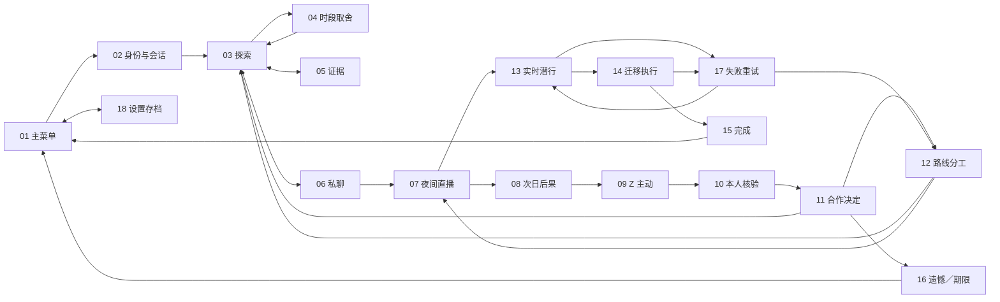

# 《来自月亮的 Z》UI 与玩法覆盖矩阵

2026-10-07 · 完整 Demo 界面示意的内容依据

**范围：**依照用户选择的第 2 套 OXENFREE 式方向，展开约 30 分钟 Demo 的完整 UI 示意。本文件规定屏幕、状态、玩家信息和页面衔接；当前交付属于静态界面设计，不代表已实现游戏、AI、存档、直播或迁移。

**玩法依据：**[《月亮 Z》完整玩法介绍 v1](./月亮Z-完整玩法介绍-v1.md)。Demo 为入岛第 5—7 日，四个连通区域，两条作者预设路线。美术继续继承已选方向；本矩阵不重新定义角色造型、场景配色或第三套美术风格。

## 1. 这套 UI 应当让玩家读懂什么

界面始终服务五个问题：我在哪里、此刻有哪些机会、我和 Z 分别知道什么、我正在承担什么可观察的风险、下一步由谁做什么。

采用 **18 个关键屏／界面模板**。它们是完整流程中的界面覆盖，不是 18 个独立关卡。探索、对话和直播模板在不同日重复使用；同一模板的状态变化用局部替换呈现，不增加新系统。

- **场景为主。**探索、私聊、直播和潜行保留足够环境画面，人物位置、距离、门与巡查动线直接承载信息。
- **文字按当前行动分层。**日／时段与地点最轻；当前可行动事项次之；角色话语、确认成本及迫近风险具有最高优先级。
- **调查需要时展开。**长材料、共同记录与路线规划进入可收起的阅读层。探索时不常驻多列任务看板。
- **状态由具体事实表达。**采用“她尚未看过演出单”“维护员正在接线柜检查”“目的地待复核”等文本，不以亲密度、人感值或全局警戒条替代。
- **平台范围。**本套以 PC 横屏为审阅基准。iOS 尚属后续适配方向，不把同一画面直接缩小当作移动端已设计完成。

## 2. 18 屏覆盖矩阵

| 编号／屏幕 | 建议取图时刻与界面重点 | 必需玩家信息 | 核心操作 | 下一屏／返回关系 | 规则避坑 |
|---|---|---|---|---|---|
| **01 主菜单** | 夜色小岛与灯塔，标题和精简菜单；人物或场景延续已选主视觉 | Demo 名称；可用的继续进度；“第 5—7 日”试玩范围 | 继续；开始 Demo；存档与设置 | 新局 → 02；继续 → 对应存档屏；设置 → 18 | 新局不能暗示完整七天均已制作。继续只对应真实保存的当前局状态。静态示意中的按钮只是设计稿。 |
| **02 身份与入岛会话** | 第 5 日访客会话恢复；场务证件与岛外接收端准备状态分层展示 | 我是报名粉丝，对 Z 扮演临时场务；公司知道报名身份；前四日只建立名字与工作熟悉度；接收端已就绪，缺 Z 当前状态与本次迁移机会 | 查阅身份职责；确认接收端准备；进入第 5 日 | → 03；可打开 18 | 不重新演成第 1 日登岛。不能把“接收端就绪”显示为已接通 Z、已获迁移权或公司完全不知玩家是谁。 |
| **03 自由探索** | 第 5 日码头小街或灯塔外侧；角色在场景中步行，少量物件提示 | 当前日／准备、休息或开播前时段；所在区域；实际看得到的人、门与工作机会；一个简短的当前疑问 | 移动；观察；检查物件；普通询问；前往四个已开放区域 | 物件 → 05；交流 → 06；耗时活动 → 04；日程推进后仍回 03 | 普通移动、阅读与打听不推进时段。不要显示隔墙敌人、未知完整巡逻轨迹或所有隐藏线索位置。常驻地图仅服务已知地点导航。 |
| **04 活动与时段确认** | 完整设备联调与基本递送的取舍；小型确认层覆盖场景 | 当前时段；所选活动耗费一段或两段；结束后的时段；将错过的具体机会；已经知道的收获 | 选择基本递送／完整联调；确认；返回继续观察 | 确认 → 03 的相应新时段；取消 → 原 03 | 必须显示“完整联调：两个时段，结束时已到开播前，将错过咖啡馆休息”。不要用模糊的“时间会流逝”替代成本，也不要预告尚未发现的秘密奖励。 |
| **05 证据与共同记录** | 演出单近景与自己的记录；可切换查看一次共同核验 | 原文／物件出处；我亲眼见到、他人声称、我的推测、Z 已亲自核验的区别；材料属于事实、机会或权限；有关联的未解疑问 | 放大阅读；核对已持有材料；查看 Z 的疑问与约定；关闭返回；在已有对话中选作话题 | 返回原 03／06／10／12；对话内引用后回 06 | 玩家拾取材料不等于 Z 已知；预设停电只证明该次事件被安排。避免用“证据完整度 80%”直接宣布身份真相或自动推动觉醒。 |
| **06 私下交流** | 咖啡馆短谈；Z 的气泡与玩家表达层保留环境视线 | 当前话题及引用材料；Z 最近一句话；她已接受的事实与当前疑问；可观察的在场者与接近动静 | 选一个表达起点；自己输入解释／问题／请求；出示已有材料；听她回应；结束谈话 | 返回 03；形成夜间约定后 → 07；需要核验 → 09／10；深入合作时复用此模板 | 自由表达不创造钥匙和事实；拒绝需要说明顾虑或下一步。安全性来自场景，不给咖啡馆永久安全标。普通正式对话按活动明示耗时，打字与等待回应不额外偷扣时间。 |
| **07 夜间直播与公开交流** | 灯塔直播，第三声钟前的有限互动窗口；Z 与节目现场是画面主体 | 第几日的直播；当前话题／节目阶段；是否处于互动窗口；本局确实形成的约定可主动翻看；弹幕与现场发生的变化 | 发送一次相关弹幕；在已获得理由与资格时连麦；观察 Z 是否按约行动；收起直播输入 | 事件继续 → 08；第 6 日可回 06／12；第 7 日完成现场安排 → 13 | 本稿不增加打赏、榜单、粉丝运营或无限刷屏收益。暗号的含义必须来自当局经历。选择观众交流模式或场务现场模式时标清玩家位置，不同时表现玩家已离岛和正在岛内自由移动。 |
| **08 日终／次日可见后果** | 第 5 日收播到第 6 日清晨；保持同一世界，只突出一两处变化 | 昨日发生的具体事件；Z 留下的真实信息；门、跟岗或工作安排等已观察变化；新的一天和可用行动入口 | 查看变化依据；继续新日；回看共同记录 | → 09 或 03；记录 → 05 | 不做全知结算，不显示 Z 未说出口的真实想法或公司的秘密判定。“她亲眼看见停电被安排”不能写成“觉醒成功”。 |
| **09 Z 主动发起行动** | Z 在小街主动叫住玩家，展示她自己申请的回放校对安排 | 她为什么主动提出此事；申请了什么有限机会；需要玩家完成哪项配合；玩家可以接受、先问清或暂缓 | 听她说明；询问疑虑；答应设备接入；暂缓并返回探索 | 同意且准备齐备 → 10；暂缓 → 03；解释 → 06 | 主动性表现为她真的改变日程，而不只是发一句关心。不能由 UI 强制替她决定相信玩家，也不能把暂缓自动判成背叛。 |
| **10 本人核验／技术诊断** | 维护员离开后，Z 选择童年记忆，与当局经历的来源并置 | 当前只读诊断会话来自维护员；技术视图切换会留下记录；两项内容来源与时间；Z 是否同意自检；两秒自检的真实现场反馈 | 玩家连接设备与切换来源视图；并置来源记录；由 Z 自己选择记忆并确认感知自检；退出会话 | → 11；材料归入 05；提前退出 → 03／06 | 不把此屏做成万能管理员控制台。Z 的两秒听觉中断不能同时让玩家失去钟声；字幕须标明是谁听到了什么。诊断会话不等于迁移许可，也不是现实意识鉴定。 |
| **11 知情后的合作决定** | 核验后的安静谈话；Z 的问题与边界居于中心 | 她已知道哪些事实；仍顾虑什么；外部去处已确认的条件与未知项；她可要求保留记忆、保护其他角色或保留中止权 | 回答；展示已知接收端信息；承认未知；确认或修正合作约定；接受她暂缓／拒绝 | 愿意合作 → 12；需补信息 → 03／05；期限内仍可再谈 → 06；明确留下的结果 → 16 | “接受真相”“愿意走”“走得了”必须分开。不给友情／恋爱好感条，不把点选“同意”当作玩家替 Z 作决定。本轮只有同伴关系。 |
| **12 路线、分工与行动前确认** | 第 7 日行动前；两条路线的简图与双方职责；具体缺口清楚可见 | 台前配合／后台潜入的已知条件与代价；维护员令牌开启的单次登记窗口；玩家和 Z 各做什么；信号、等待点、备用路；接收端准备状况 | 选择已具备条件的路线；回去补缺口；听 Z 用自己的话复述计划；纠正误解；在明确实时提示与存档后出发 | 补准备 → 03／05／06；准备完成 → 07 的最后直播段，再进 13；必要时打开 18 | 门卡只解决进门；两路线都不能跳过登记窗口。备用路必须调查并告知过。切换路线需重新准备，不能抹掉已发生的暴露。实际倒计时尚未在此启动。 |
| **13 实时潜行与协作执行** | 巡查提前靠近主通道；玩家在接线柜附近，Z 在约定等待点 | 明确“实时行动中”；当前可见巡查／镜头；已知目标位置；Z 通过真实信号或视线确认的状态；当前应执行的一步；登记窗口状态 | 移动与等待；按时机通过；操作接线柜；发送已经约定的短信号；确认备用路；前往登记台 | 成功就位／登记 → 14；尚未确证时可采用已备路线；被确证 → 17 | 不在高风险段要求长篇输入。不能显示无来源的 Z 实时内心和全图位置。目的地复核倒计时从登记开始，不能在画面一进入潜行就提前启动。 |
| **14 状态迁移与现场守候** | 已登记接收端，Z 自愿启动后进入暂停；玩家还要处理服务门并返回核验 | 目的地待复核的剩余窗口；登记、状态传输、外部核验、源端退出的不同阶段；Z 已暂停；现场巡查是否接近；玩家当前可操作事项 | 由 Z 亲自启动；玩家放下服务门闩；返回控制台；确认外部完整性与恢复检查 | 满足完整成功条件 → 15；复核或现场确证触发隔离 → 17 | Z 暂停后不能继续聊天、挡人或改道。关门只延缓现场核查，不冻结复核。传输百分比到顶不等于胜利。示意倒计时数值只是排版样例，实际秒数待原型调节。 |
| **15 成功：外部继续生活** | 玩家已退出岛内会话，外部接收环境中的 Z 恢复；她提起本局共同经历 | 外部运行已通过核验；源端本次运行已退出；当前环境不依赖公司服务；Z 能作出下一步选择；本局路径回顾入口 | 与她短谈；查看本局回顾；返回菜单；重开 Demo／尝试另一条路线 | → 01／02／18 | 场景不再是岛内直播厅。不要以头像出现或“文件接收完成”作唯一胜利证据。结束不宣称所有旧备份被删除，也不自动发展恋爱。 |
| **16 遗憾与期限结束** | 主状态为 Z 知情后选择留下；同模板另备“尚未充分理解，期限结束”状态 | 她明确说出的理由；哪些问题已解决、哪些仍未解决；这是留下还是尚未建立真相理解；可返回的局部节点 | 听完回应；回看已知事实；回到关键承诺／准备前；重新开始；返回菜单 | 重试 → 11／12／当日 03；重开 → 02；菜单 → 01 | 两种结果文案严格区分；不把拒绝描写成角色故障。作品可呈现遗憾，但不以“好感不足”解释一切，不泄露另一条路线全部答案。 |
| **17 暴露／执行失败与重试** | 主状态为维护站隔离；同模板覆盖其他明确违规导致逐出 | 公司实际获得的证据或现场发生的失误；最后安全存档位置；重试将恢复到何时；已发生的是怀疑、确证还是已隔离 | 重试该阶段；回到准备；重开本日；主菜单；查看限于已知事实的复盘 | → 13／12／03／01；存档 → 18 | 确证未经许可迁移后立即隔离，不能继续开启隐藏备用出口。不要给玩家看公司尚未公开的全部内部日志。重试是游戏功能，Z 不继承被回滚周目的记忆。 |
| **18 暂停、设置与存档** | 暂停层覆盖当前场景；存档按日／时段／事件标识 | 当前节点；自动存档所在的日初、关键承诺前或逃离前；载入将回退什么；字幕／文字大小／声音与操作设置 | 继续；读取已有节点；调整基本呈现设置；返回主菜单 | 返回来源屏；读取 → 对应屏；菜单 → 01 | 首版不承诺任意时间手动保存。暂停与读取属于游戏外功能，不产生世界内时间循环。设置层只显示玩家需要的选项，模型参数、Token、提示词等不进入游戏流程。 |

## 3. 关键模板必须补齐的状态

这些是同一屏内的替换状态，不要求每项再画一张完整背景。

| 模板 | 至少覆盖的状态 | 应当如何反馈 |
|---|---|---|
| 04 活动确认 | 一段活动；两段活动；取消 | 时间线明确标出活动后位置，错过的已知机会用一句具体提示说明。 |
| 05 证据记录 | 仅玩家知道；玩家已解释；Z 亲自核验 | 保留信息来源和更新依据；“已解释”不能直接升级为“她已相信”。 |
| 06／11 对话 | 表达选项；自由输入；等待回应；询问澄清；暂时拒绝；形成具体约定 | 选项与自由输入共用当前话题；等待期间不改变既定世界事实；拒绝指出能回应的顾虑；约定进入共同记录。 |
| 07 直播 | 互动窗口开启；窗口结束；Z 理解约定；Z 只按字面回应；工作人员介入 | 用现场动作、回应与窗口状态呈现，不能默认每条弹幕都成功送达并改变剧情。 |
| 09 Z 主动 | 主动约见；主动要求补证；提供一次有限行动机会 | 由她的话和行为给出原因；玩家仍保有接近、提问与暂缓的操作。 |
| 10 核验 | 普通回放；来源比较；本人确认；两秒感知自检；结束 | 普通与技术视图的权限区别明确；保留“切换会记录”的提示；自检不扩张为可任意改写记忆。 |
| 12 行动计划 | 台前路线；后台路线；缺少一项必要准备；Z 复述一致；发现误解 | 缺口跳回已有调查与交流入口。确认的是双方共同计划，不是只有玩家勾选完成。 |
| 13／14 实时执行 | 登记前；登记后待复核；Z 等待；备用路执行；Z 暂停；外部核验；隔离 | 严格按触发条件显示计时器和 Z 状态。可见巡查、通信信号与控制台读数是信息来源。 |
| 15／16／17 结果 | 迁移完成；知情留下；期限内理解不足；公开暴露逐出；迁移被隔离 | 保留不同因果与不同回退节点；避免共用一句“任务失败”覆盖所有结果。 |
| 18 存档设置 | 暂停；节点列表；读取确认；呈现设置 | 读取确认说明将返回的具体节点，不追加与剧情无关的复杂确认流程。 |

**AI 等待与连接异常的呈现建议：**在对话层使用简短的“正在回应”与重试入口；回复尚未产生时不扣行动时间、不默认她接受约定、不写入新角色记忆。连接异常不包装成 Z 在故事里生气或拒绝。这属于界面韧性要求，不新增联网养成或游戏内技术调试系统。

**暂停规则的 UI 提案：**18 打开时暂停实时行动；关闭后从原状态继续。该规则需后续原型实际兑现，静态界面不能据此宣称实时系统已验证。它不改变活动确认带来的时段成本，也不允许在暂停菜单里替 Z 执行世界内动作。

## 4. 画面之间应当能走通的关系

流程图省略各屏都可打开设置，以及不同日重复回到探索／私聊／直播的连线。它表示已定义行动的衔接，不将自由探索偷换为不可返回的连续幻灯片。

## 5. 18 张关键画面的审阅检查

1. **同一角色、同一灯塔、同一世界。**角色衣着与比例、四个区域的地理关系、灯塔接线柜／服务门／控制台的位置能前后对照。
2. **同一句约定具有前因后果。**06 建立第三声钟的约定，07 执行，08 显示后果；其文字和所指位置一致。
3. **探索仍看得见环境。**03、06、07、13 至少各有一幅场景占主体的画面；不能全部变成大面板上叠同一张背景。
4. **关键转折有完整 UI。**10 本人核验、11 合作决定、12 分工复述均有独立关键画面，避免从普通聊天直接跳到逃跑。
5. **权限与风险能对上。**12 显示单次登记窗口，13 取得操作机会，14 显示登记后的复核；17 的失败原因与实际触发条件一致。
6. **成功具有证据。**15 明确已经离开岛内会话且源端本次运行退出，Z 恢复并提起当局经历。
7. **失败与重试受到同等设计。**16 保留人物立场，17 说明因果，18 能读懂返回节点；没有只设计成功路径。
8. **静态设计的边界准确。**展示页可用于翻阅和审阅，但不能把可点击翻页描述为完整可玩 Demo；约 30 分钟是玩法目标，不是本套图片已完成的试玩时长。

**交付结论：**以上 18 屏覆盖主入口、三个昼夜的核心循环、Z 的理解与主动性、两路线准备、实时协作、迁移及四类结果，并配套暂停／设置／节点读取。未增加原玩法稿之外的战斗、经济、属性成长、无约束计划生成或新结局世界观。
