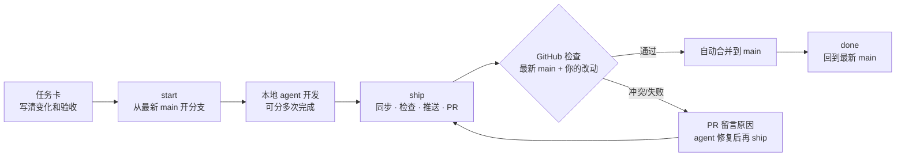

# Z 项目协作上手

每个人在自己的电脑上让 agent 开发；GitHub 机器人按顺序合并通过检查的 PR。你只需要会说“开工”和“交付”。



## 首次接入（约 30 分钟）

| 步骤 | 你要做什么 | 完成标志 |
| --- | --- | --- |
| 1. 接受邀请 | 把 GitHub 用户名发给维护者，接受仓库邀请 | 能打开仓库的 **Issues** 和 **Pull requests** |
| 2. 安装工具 | 安装 [GitHub Desktop](https://desktop.github.com/)、[Node.js 22 LTS](https://nodejs.org/)、[.NET 8 SDK](https://dotnet.microsoft.com/download/dotnet/8.0) 和 [GitHub CLI](https://cli.github.com/)；需要改场景或试玩时，再用 Unity Hub 安装 **6000.3.27f1 Apple Silicon** | 安装完成 |
| 3. 下载仓库 | GitHub Desktop → **File → Clone repository → URL**，填 `https://github.com/Yiiime/Project-Z.git` | 电脑里有 `Z-from-Moon` 文件夹 |
| 4. 登录 GitHub | 在 Codex 打开该文件夹，发送下方“首次接入”提示词；浏览器出现 GitHub 授权页时自己登录确认 | `tools/team/z doctor` 显示有写权限 |

首次接入提示词：

```text
这是 Z 项目的仓库。请读取 AGENTS.md 和 docs/team/START-HERE.md，帮我完成首次接入。
先检查 Git、Node.js、.NET 8、GitHub CLI 和 Unity；缺少的告诉我怎么装，不要静默安装。
需要 GitHub 登录时运行 gh auth login --hostname github.com --git-protocol https --web，让我在浏览器确认。
Git 署名使用我的 GitHub 用户名和 GitHub noreply 邮箱。最后运行 tools/team/z doctor 并告诉我结果。
```

## 每次开发：复制这三句话

| 时机 | 发给自己的 agent |
| --- | --- |
| 开工 | `做 Z 项目任务 #<编号>。先读 AGENTS.md 和任务卡，复述目标、修改范围和验收；我确认后运行 tools/team/z start <英文短名> 再开发。` |
| 中途暂停 | `先保存进度：检查改动，写中文提交，并在任务卡“进度与交接”写清已完成、未完成和下一步。不要创建 PR。` |
| 交付 | `完成并交付：检查 diff，必要时在 Unity 试玩；用 PR 模板写说明，然后运行 tools/team/z ship。告诉我 PR 链接和未验证部分。` |

PR 页面出现 `Project Z / Ready` 的进度：

| 状态 | 意思 | 你要做什么 |
| --- | --- | --- |
| 排队中 / 检查中 | 机器人正在按顺序处理 | 等待，可以先做别的 |
| 通过 | 已检查最新 main 和你的改动 | 机器人会自动合并 |
| 冲突 | 你和别人改了同一处 | 对 agent 说：`运行 tools/team/z sync，解决冲突后重新 ship` |
| 未通过 | 检查发现问题 | 对 agent 说：`修复 PR 的自动检查失败，然后重新 ship` |

合并后对 agent 说：`运行 tools/team/z done`。

## 少冲突的三条约定

| 约定 | 原因 |
| --- | --- |
| 一个任务一张卡，一次只改一件事 | 小 PR 更容易检查和撤回 |
| 改 `Boot.unity`、角色 Prefab、`Z_Standing.controller`、`ProjectSettings/`、`Packages/` 前先在任务卡写明 | Unity 场景和二进制资源很难自动合并 |
| 同一个文件要多人改时，拆成“先后两张卡” | 后一个任务从合并后的 main 开始 |

## 维护者

仓库 owner 是 `Yiiime`。新增同学时运行：

```bash
tools/team/setup-github.sh <同学1> <同学2> <同学3> <同学4> <同学5>
```

脚本会保持 squash 合并、自动删除分支、`hold` / `recheck` 标签和 `main` 保护，并邀请协作者。`.github/`、`tools/team/` 和 `unity/Tools/check.sh` 的修改需要维护者手动确认合并。

云端检查覆盖 C# 核心规则、桥接服务、Unity C# 语法和资源引用。Unity 编辑器编译、实际运行、画面和手感仍需在 Unity 里试玩确认。
