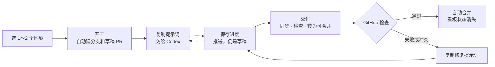

# Z 协作面板上手

双击 `打开协作面板.command`，按面板上的按钮完成：选区域 → 开工 → 交给 Codex → 保存进度 → 交付。检查通过后 GitHub 自动合并。



## 1. 首次接入

| 步骤 | 做什么 | 完成标志 |
| --- | --- | --- |
| 接受邀请 | 把 GitHub 用户名发给维护者，在邮件或 GitHub 通知里接受邀请 | 能打开 [Yiiime/Project-Z](https://github.com/Yiiime/Project-Z) |
| 安装 | [GitHub Desktop](https://desktop.github.com/)、[Node.js 22 LTS](https://nodejs.org/)、[GitHub CLI](https://cli.github.com/)；建议装 [.NET 8 SDK](https://dotnet.microsoft.com/download/dotnet/8.0)；改场景或试玩时再装 Unity 6000.3.27f1 | 安装完成 |
| 下载仓库 | GitHub Desktop → **File → Clone repository → URL**，填 `https://github.com/Yiiime/Project-Z.git` | 电脑里有 `Project-Z` 文件夹 |
| 打开面板 | 双击仓库根目录的 `打开协作面板.command` | 浏览器出现“电脑检查” |
| 完成检查 | 按每一项右侧按钮处理；GitHub 登录时在浏览器输入面板显示的一次性代码 | 必需项全部打勾，出现“进入协作面板” |

macOS 第一次运行 `.command` 时如果提示无法打开：在访达中右键文件 → **打开** → 再点 **打开**。

## 2. 打开面板

| 面板区域 | 用途 |
| --- | --- |
| 我的当前任务 | 当前分支对应的 PR，以及“保存进度”“还在做”“交付”和提示词按钮 |
| 区域看板 | 每个区域的状态、负责人、开始时间、最近更新和 PR |
| 开工 | 写一句目标，选 1～2 个区域，然后开工 |
| 所有未合并任务 | 全队任务、交接说明、继续或接手 |

| 状态 | 怎么算 | 你能做什么 |
| --- | --- | --- |
| 开发中 | 3 天内有新提交，或负责人点过“还在做” | 仍可开工，面板会提醒 |
| 可能暂停 | 3～7 天没有活动；机器人在 PR 下 @负责人一次 | 仍可开工，建议先问负责人 |
| 已搁置·可接手 | 超过 7 天没有活动；看板按空闲显示 | 接手原分支，或从最新 main 重新开始 |
| 空闲 | 没有未合并任务，或 PR 已合并或关闭 | 直接开工 |

阈值在 `tools/team/areas.json` 的 `thresholds` 中修改。

## 3. 每天怎么用

| 时机 | 点哪里 | 结果 |
| --- | --- | --- |
| 开始新任务 | 区域卡片“选择这个区域”→ 写目标 → **开工** | 从最新 main 开分支，推送开工提交，创建带区域标签的草稿 PR |
| 让 Codex 开发 | **复制开工提示词**，粘贴给 Codex | Codex 只改所选区域；超出范围先问你 |
| 中途离开 | **保存进度**，写交接说明 | 修改推送到任务分支，PR 保持草稿 |
| 想保留任务但今天不改 | **还在做** | 只刷新最近活动时间 |
| 做完 | **交付** | 同步 main、运行检查、推送，草稿转为可合并；检查通过后自动合并 |
| 出现冲突或检查失败 | **复制修复冲突提示词** / **复制修复检查提示词** | 交给 Codex 在任务分支修复，再保存或交付 |
| 接手搁置任务 | 任务旁 **接手** | 看原分支、交接说明和最近修改；选择继续原分支或重新开始，原 PR 和分支保留 |

### 冲突提醒

| 提醒 | 触发条件 | 要做什么 |
| --- | --- | --- |
| 🟡 普通文件重叠 | 两个未合并 PR 改了同一个普通文件 | 可以继续，交付前留意同步结果 |
| 🔴 难合并文件重叠 | 同时改了 `.unity`、`.prefab`、`.controller`、`.anim`、`.blend`、`.fbx`、图片、字体、视频或 `ProjectSettings` 等 | 先和对方沟通；面板要求勾选“我已和 XX 确认”后才能开工或交付 |
| 区域外修改 | PR 改了开工时没选的区域 | 机器人补标签并留言，检查不会失败 |

所有提醒都不锁定文件。机器人在红色重叠时会在双方 PR 下各留言一次，建议先合并已交付或更早开工的那个。

## 维护者

```bash
tools/team/setup-github.sh 用户名1 用户名2 用户名3 用户名4 用户名5
```

脚本邀请协作者，并保持 squash 合并、自动删除分支和 `main` 保护。区域路径由 PM 编辑 `tools/team/areas.json`；`.github/` 和 `tools/team/` 的修改需要维护者手动合并。

云端检查覆盖 C# 核心规则、桥接服务、Unity C# 语法和资源引用；Unity 编辑器运行、画面和手感仍需试玩确认。

<!-- 协作演练 A：普通文件重叠，演练后删除 -->
