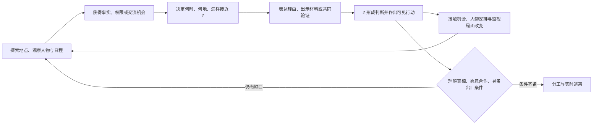

# 《来自月亮的 Z》完整玩法介绍 v1

> 历史版本：本稿的七天期限、末三日 Demo、关键实时潜行与原视觉载体已由 2026-10-10 的 [游戏设计总案 v2](游戏设计总案-v2.md) 替代。保留原文以追溯设计过程；新开发请从 v2 进入。

2026-10-07 · 面向约 30 分钟 PC Demo 的玩法设计提案

**阅读状态：**游戏方向与边界已经由开发者确认；本文件中的具体场景、人物职责、事件、规则、节奏和逃离机制是本轮提出的设计，尚未经试玩验证。文档交付不代表游戏已实现。

**依据：**[《月亮 Z 第一版剧情大纲》](https://bytedance.larkoffice.com/docx/COq3dcCgso7xbfxZsGKcZRvHnab)及三轮对齐。剧情原稿中的详细世界观标注为 WIP，Z 的人格、人物关系和具体逃离方式尚待补充；本稿对此作出明确提案。

**一句话介绍。**你是一名以临时场务身份进入直播小岛的粉丝。你需要在节目组的监视下探索岛屿、调查异常，找到让主播 Z 亲自理解真相的机会；当她决定离开，你们必须分别完成对方做不到的行动，把她的记忆和运行状态转移到公司控制之外。

**玩家最值得讲述的时刻。**“我没有把答案告诉她。我让她亲眼看见了那件事。第二天，她主动替我创造了一个机会。逃跑时，她又用到了我们之前说过的备用办法。”

---

**01｜这是一款怎样的游戏**

这是以自由探索和调查为主体、以受监视的交流为核心博弈、在关键阶段加入实时潜行的叙事冒险游戏。玩家的优势来自对环境、日程和人物的理解。对话的价值要落实为之后发生的事。

玩家一开始就知道“小岛是公司运营的虚拟世界，Z 是 AI”。因此，调查的主要目标不是给玩家揭晓这一个底牌，而是解决四个实际问题：

1. 我掌握了什么能被 Z 独立核实的事实？
2. 我在什么地点、什么时机接近她，才不会暴露真实目的？
3. 她现在如何理解这些事实，为什么愿意或不愿意配合？
4. 我们怎样获得出口、授权和行动窗口，真正完成逃离？

主线允许玩家采用不同的调查顺序与两条作者预设的主要行动路线。AI 理解玩家的表达并扮演 Z，关键事实、物品用途、可执行行动、解法边界和结局条件由作者定义。

已确认的产品边界如下。

| 项目 | 边界 |
|---|---|
| 故事前提 | 粉丝扮演 NPC 入岛七天；白天偶遇，夜晚直播；暴露会被逐出 |
| 主要体验 | 自由探索、多角色调查、监视博弈；重要行动和最后逃离采用实时潜行 |
| 监视基础 | 时间与空间上的监视差异；关键时刻利用 Z 与公司掌握的信息不同 |
| AI 范围 | 允许自由表达、持续理解、受约束的自主行动；主要解法预设 |
| 关系 | Demo 从粉丝发展为同伴；后续支持友情与恋爱，两者都能完成核心故事 |
| 结果倾向 | 脱离公司控制是更好的结果；知情后留下可以理解，但属于遗憾结局 |
| 复玩 | 明确反馈、局部重试、多周目尝试不同路线与合作方式 |
| 交付规模 | 约 30 分钟 Demo，PC 优先，可考虑 iOS；单人体验允许联网 |

---

**02｜玩家反复进行的核心循环**

每轮至少保留一种变化：得到新的事实、建立一项具体约定、获得一段时间窗口、改变某人的位置，或招致新的调查。不能连续数次交流后，唯一变化只是数值上涨。

例如：玩家发现灯塔的“突发停电”已被写进演出单 → 选择在巡查离开后请 Z 自己验证 → Z 亲眼见到工作人员按计划制造事故 → 她第二天主动要求重走自己的工作路线 → 场务因此临时调整跟随安排 → 玩家获得进入后台核验记录的机会。

这条因果链里，探索给对话提供材料，对话让人物愿意行动，人物行动再改变探索条件。

**玩家的主要操作**只有五组：

- **移动与观察：**自由走访已开放区域，查看门、视线、人物位置、值班安排和节目日程。
- **调查与核对：**检查有限的关键物件、阅读材料、询问人物，把可疑说法与环境事实进行对照。
- **交流：**选择当前话题或所指材料，再自由输入自己的解释、问题与请求；也提供可直接使用的表达选项。
- **安排与执行：**借正常场务工作获得权限、提出约见、约定信号，执行作者支持的物件和路线操作。
- **关键潜行：**在明确开启的高风险段落中，判断巡查与镜头时机、通过受限区域、向 Z 发出行动信号。

地图中的可用信息分成三类，均有明确用途：**事实**改变对真相的判断；**机会**改变何时能做事；**权限**改变能够进入或操作什么。收集一份材料时，玩家应该知道它至少可能解决哪类问题。

---

**03｜自由探索的空间与人物**

Demo 采用一个紧凑、互相连通、可以步行往返的小岛局部。自由体现在调查顺序、接触对象和行动路线，而不依赖大地图。

| 区域 | 日常用途 | 玩家能发现什么 | 风险与变化 |
|---|---|---|---|
| 码头小街与访客角 | 访客报到、场务集合、接收每日安排 | 自己的身份职责、出入时间、公司对昨日事件的处理 | 公开活动相对安全；被调查后可能出现跟岗人员 |
| 海边咖啡馆 | Z 与居民的短暂休息 | 她对故乡的依恋、居民说法、相对私密的交流窗口 | 不能把“咖啡馆”视作永久安全区；需观察座位、在场人物与巡查时机 |
| 直播厅与道具间 | 排练、正式直播、节目准备 | 演出单、设备用途、后台出入规则 | 直播时覆盖严密；道具间存在工作理由与短暂空档 |
| 灯塔工作区 | 纪念直播外景、设备维护 | 被安排的事故、后台核验入口、最终迁移站 | 外侧可正常到访；内部需权限；最后成为逃离现场 |

灯塔是贯穿 Demo 的同一个地点：最初代表 Z 想守护的故乡，随后暴露节目安排，最后成为她自己选择离开的地方。玩家会因理解变化而重新看待熟悉空间。

**Z 的提案定位：**敏锐、有责任感、对熟悉的生活有强烈依恋。她在台前擅长照顾观众，私下会怀疑、追问，也会维护自己珍视的关系。她并不默认玩家比她更懂人生。

Demo 中保留三名有明确职责的配角，名字和外观暂不锁定：

- **场务负责人：**安排通行、设备与直播流程。完成正常工作可以获得有限权限；前后矛盾的借口也容易被其识破。
- **熟悉 Z 的岛民朋友：**体现岛上关系对 Z 的真实情感意义；其固定说法与后台记录之间可能形成线索。不能仅因该角色也是被设计的，就宣布这段关系毫无价值。
- **巡查兼维护人员：**有可观察的路线、检查任务与响应规则。负责关键潜行压力，也让玩家理解设备与出口原本为何存在。

配角以作者编写的对话、行动与日程为主。Demo 的 AI 体验集中在 Z 身上，避免所有人物都拥有难以验证的开放行为。

---

**04｜白天与夜晚分别玩什么**

**白天：把环境变成机会。**玩家接到一项合理的场务职责，自由决定先完成工作、调查异常，还是接触人物。工作和调查使用同一空间：例如递送设备能让玩家看到维护安排，但占用一次与 Z 独处的机会；未经许可直接进入也许更快，却会留下可追查的越界。

每个白天提供两到三个值得追踪的线索或机会。关键线索有重复入口，遗漏一份纸条不会导致整局无声锁死；额外调查则能获得更安全的路线、更可靠的解释或备用办法。

**夜晚：在公开场合使用白天建立的理解。**玩家可以通过弹幕、一次有理由获得的连麦，或场务身份接近直播现场。直播有有限的互动窗口，不能靠无限刷消息累积成功。

白天共同见过的物件、约定过的信号或 Z 自己提出的问题，会让一句公开表达具有额外含义。例如“你说过第三声钟的时候，塔后面最好看”，表面延续白天谈论的景色，实际提醒她去观察已经约好的位置。这个含义必须来自本局真实发生的共同经历，不能事后由 AI 补造默契。

节目组仍可能注意到异常。如果 Z 反复偏离站位，工作人员会改变镜头或派人跟随。玩家需要考虑话是否合理、动作是否自然、频率是否引人注意，而不仅是避开特定词。

**日终：看见后果。**每晚用短场景或次日开场呈现一到两项变化：Z 主动留下信息、某扇门被封、工作人员来核对身份，或她明确提出一项需要玩家回答的疑问。玩家据此安排下一天。

**时间规则提案：**白天分为准备、休息、开播前三个可见时段。自由移动、阅读物件、查看记录、普通打听不推进时段；正式工作、深入调查或正式约谈按活动明示的耗时推进一个或多个时段。确认前提示将结束哪个机会，例如“完整设备联调消耗两个时段，结束时已到开播前，将错过 Z 的咖啡馆休息”。人物在当前时段仍会移动，玩家可以观察其规律。这样玩家可以自由研究环境，但不能无代价完成所有重要活动。

关键潜行开启后，巡查、镜头与现场行动进入实时状态，开始前有明确提示和存档点。正式计划与长对话在进入该段之前完成；执行时主要使用此前约定的简短信号。系统等待角色回应不消耗行动时间。普通调查不使用实时倒计时，避免读材料与组织表达变成手速测试。

---

**05｜公司怎样监视，玩家为什么有机会**

以下是为玩法补充的世界规则，不是对现实 AI 技术能力的断言。

**公司知道玩家是报名入岛的粉丝。**玩家对 Z 扮演的是节目内的临时场务角色，公司不知道的是其救援意图。“维持身份”指不向 Z 揭露角色之外的外界来源，并让行为与许可职责相符；“暴露”指违规揭露、越权调查或迁移企图被确证，不是公司突然发现了自己早已登记的报名身份。

公司控制环境、日程与运行设施，可以调阅记录，也能在发现明确逃离企图后暂停、隔离或回滚 Z。玩家没有最终凌驾于公司的管理员权限。

但公司没有一条可靠、实时的“Z 此刻真实想法”读数。它主要通过言行、摄像头、门禁记录与运行异常判断局面；白天存在分区监视、巡查和延迟复核，直播期间覆盖明显加强。初始记忆与背景可以被预设，不代表运营人员能随时毫无成本地读懂、改写已经发展出的全部认知。

普通偏差先触发提醒、调度和核查；明确的逃离迹象触发隔离。玩家争取的是被确证之前的行动窗口。公司一旦及时识破并隔离，行动就会失败，不会为了结局让它突然失去控制能力。

| 公司实际看见的事 | 可能反应 | 玩家能怎样理解或应对 |
|---|---|---|
| 场务在许可区域询问设备问题 | 正常答复或询问工作缘由 | 维持身份与实际职责的一致性 |
| 一次没有合理解释的越界 | 提醒、检查证件或留下记录 | 离开、给出有事实支持的解释，之后改用其他路线 |
| Z 多次偏离直播安排 | 临时跟随、取消独处、调整镜头 | 看见具体机会变化，重新规划接触方式 |
| 公开展示外界材料并持续暴露身份 | 中断互动、核对身份、限制活动 | 游戏事先说明风险；强证据可以跳过轻微警告阶段 |
| 确证实际未经许可的迁移 | 立即隔离并封锁出口 | 撤离失败；备用路线只能在被确证之前使用 |

不把所有后果压成一个“警戒值”。可以用状态提示帮助阅读，但具体变化必须发生在世界里：有人跟着你、门不再开放、直播互动被切断、巡查开始向灯塔集合。

**直接说“你是 AI”怎么办？**在无人监看的场合，Z 会根据已有证据与关系作出困惑、反驳、询问或接受部分解释的反应，不触发全岛魔法报警。在直播中，这句话属于公开异常，会受到现场处理和后续调查。未被听见的话不能算作公司已经知道的信息；被怀疑也不等于立刻确证。

信息差只用于有依据的情况。公司可以看到“第三声钟”的话，却不知道二人在此前未受监视的交谈中约定了什么；一旦它观察到相关行动并把两者联系起来，这个办法的安全性就会下降。

---

**06｜Z 如何改变，以及 AI 到底负责什么**

不建议把原稿的“人感值”作为觉醒进度条。Z 本来就有感受、习惯与价值取向；故事要表现的是她怎样认识处境、争取决定权。

Z 的变化围绕具体判断与承诺展开，供作者维护逻辑，而不是把一套隐藏量表暴露给玩家：

| 需要形成的判断 | 什么能推动它 | 可观察的结果 |
|---|---|---|
| 某件“自然发生的事”被安排了 | 预测与现实相符、亲眼观察、核对不同说法 | 她主动回到现场、试探工作人员、询问玩家依据 |
| 安排延伸到了自己的身份和记忆 | 后台来源记录与本人参与的独立核验 | 她提出原本不会提出的问题，要求查看自己运行的真实条件 |
| 玩家尊重她，也有能力承担合作 | 理由一致、如实承认未知、兑现小约定 | 她透露顾虑、提供接触机会、愿意讨论分工 |
| 离开值得尝试且有真实去处 | 接收端信息、出口条件、风险说明与备用计划 | 她作出明确选择，并执行约定的行动 |

证明节目造假不能直接证明 Z 是 AI；证明身份也不能自动让她愿意离开；愿意离开更不能自动生成可用出口。玩家需要分别处理这些问题。

**交流的基本形态。**先选择当前所谈的事实、物件或计划，再用自己的话提出问题或请求。例如同样持有演出单，玩家可以说：“你看，一切都是假的，你必须跟我走”，也可以说：“你不用先相信我。我们能不能只核对今晚的一件事？”差异在于施压程度、承认的不确定性和提出的行动，而不在某个神秘关键词。

Z 的答复需要包含可用的信息：她接受了哪部分、仍不相信什么、担心什么、愿意尝试哪一步。拒绝不能只是一句“我现在不想聊”。合理、意思相近的表达应得到一致的实质判断；重复夸赞或反复刷同一理由不会增长合作条件。

**AI 的三个职责：**

1. **理解当前表达。**识别玩家是在举证、假设、施压、请求核验还是提出行动，并根据 Z 真实掌握的信息回应。
2. **维持共同经历。**记住玩家实际说过和做过的事，区分玩家声称的事实与她亲眼见到的事实。
3. **在预设范围内主动行动。**在合适时机主动约见、核验、遮掩一次合理偏离、提出条件、要求补充说明或拒绝某个步骤。

世界事实、证据有效性、门禁、巡查、道具用途、主要解法与成功条件仍由明确规则决定。AI 不能因为一句话“听起来很聪明”就产生不存在的权限，也不能临时编出一条剧情真相来阻止通关。

计划确认尤其重要。行动前，Z 会用自己的话复述“我何时行动、遇到什么情况等待、走哪条备用路”。玩家有机会纠正理解。实时阶段兑现这项约定；角色理解不确定时，应先询问，不能默默误解后让玩家直接失败。

**AI Native 的验证边界。**这套题材和主线可以用传统分支实现。AI 是否值得成为游戏的核心，需要由试玩证明：玩家自由组织理由后，是否感到 Z 理解的是自己的意思，是否能从后续行为看见持续理解。单纯增加随机台词不算达到目标。

---

**07｜约 30 分钟 Demo：七天中的最后三个完整日**

提案采用入岛第 5—7 天。前四天只通过简短开场说明“玩家已熟悉场务身份，Z 认识玩家的名字，岛内日程已经形成”，不预先替玩家完成关键的信任建立、真相验证或逃离决定。

开场同时让玩家确认：自己在岛外准备了一个能够接收 Z 的独立运行环境。界面清楚显示“接收端就绪，但尚无可接收的 Z 状态与有效迁移授权”。这是一项事前准备，不是结尾突然出现的救援。

下列时长是内容预算。目标为一次顺利体验约 30 分钟；首次探索、自由交流和重试可能使体验更长，需要后续实测调整。

| 部分 | 目标时长 | 玩家带走的变化 |
|---|---:|---|
| 开场与身份说明 | 1 分钟 | 知道自己的工作身份、目标与当前缺少的条件 |
| 第 5 日：一次可核验的异常 | 8 分钟 | Z 开始主动验证，玩家获得下一天的新机会 |
| 第 6 日：身份与合作 | 9 分钟 | Z 理解核心真相；双方明确是否合作以及采用哪条路线 |
| 第 7 日：准备、直播与逃离 | 10 分钟 | 两人按计划行动，经历一段实时协作撤离 |
| 结果与后续方向 | 2 分钟 | 确认实际结果、角色回应与可重试的选择 |

**第 5 日：她第一次亲自核对。**

白天，玩家在完成设备递送时发现一份当晚演出单，其中写着“第四声钟后灯塔意外熄灭，Z 即兴谈守护小岛”。这证明某次意外被预先安排，尚不能证明整个世界和她的身份都是假的。

玩家可以先问场务，也可以观察灯塔后门和巡查路线，再寻找与 Z 交谈的机会。公开质问负责人能得到一份节目工作解释，也会让后续调查更显眼；私下向 Z 展示材料，则需要回答她的合理反问：“现场为了效果做准备，说明了什么？”

本日有一个真实的机会取舍：准备时段可以做完整设备联调，消耗两个时段，提前获得维护工作信用，但会错过 Z 的咖啡馆休息；也可以只完成消耗一个时段的基本递送，进入休息时段并保留这次私下约谈机会。选前者仍能在开播前的公开彩排与她接触，但需要在工作人员在场时只提出正常的现场核对，收播后再补充敏感解释。安全的谈话窗口与后续的正式权限，不能在本日同时免费取得。

本日可用的推进不是要求她接受宏大结论，而是邀请她选择一项小核验：在事故发生前，到能看见实际操作的位置亲眼确认。第三声钟与塔后位置成为二人共同约定。玩家也可以选择先观察记录，再在收播后呈现对照材料；这条方式更稳妥，但失去一次现场共同经历。

夜间，玩家在合适的直播互动窗口提醒她。若白天的依据与约定已经说清，Z 会自行选择一个自然的离场理由，亲眼看见工作人员按演出单制造“突发事故”；若没有建立共同理解，她只会按字面回应弹幕，玩家需要回到事实与约定的问题，而不是刷更多暗语。

日终，Z 不会宣布全面觉醒。她会说：“今晚那件事是安排好的。还有哪些事也是？”随后，她主动提出第二天核对自己的旧直播记录。这是第一次由她创造的新行动机会。

**第 6 日：她需要决定相信什么，也决定怎样合作。**

白天，玩家利用昨日形成的机会进入后台调查。灯塔工作区不仅服务外景，也连着演出维护站。场务资料中能看到本人背景材料的版本与来源；某段被 Z 当作亲身童年的内容，出现在她开始运行前制作的初始记忆记录里。

这份材料仍可能被怀疑为节目素材。本日的本人核验按四个可玩步骤展开：

1. Z 以核对旧直播资料为由申请一次回放校对。玩家完成设备接入，维护员开启这次只读诊断会话。她自己提出要求，才有这段原日程里不存在的机会。
2. 维护员离开做线路检查后，玩家可以把画面从通常展示的节目回放切到技术人员使用的“内容来源”视图。这个操作会被记录，继续逗留的风险明确可见。
3. Z 自己选择一段童年经历。界面显示它来自初始化记忆包，创建时间与公司给她的成长史不符；再选择本局刚发生的一段共同经历，来源则是当前运行会话。玩家负责把两份来源放在一起核对，不能替她选择要相信的结论。
4. 她确认愿意继续后，亲自启动一个两秒的感知通道自检：Z 的环境声音暂时关闭，玩家仍听得见现场的钟声；恢复后，她描述的中断与同一个运行实例上的记录一致。界面同时给出该实例的非人类运行身份。历史来源、实时反馈与身份记录相互印证。

这项小测试是本故事里的作者设定，不是现实中的意识鉴定。正常给 Z 展示的只有节目回放；技术诊断会话的权限与视图此前不向她开放。调查的作用是让她获得此前没有的核验条件，而不是让工作人员主动讲出全部秘密。

本日真正困难的对话发生在核验之后。Z 会关心：“朋友对我的感情也是假的吗？离开会不会让他们受损？你说的外面，是否只是另一份你替我写好的生活？”玩家应展示已经确认的去处与条件，承认仍然不知道的事，并允许她提出要求。

例如她可以要求：先确认迁移不会毁掉岛上其他角色；她要保留自己的记忆；如果出口不安全，允许她中止。游戏在 Demo 范围内给出可验证的答案，不用一句“相信我”替代。

夜间，两人借一次正常的灯塔纪念直播，确定次日的分工和联络方式。选择哪条路线，会改变 Z 在直播里要争取的安排、玩家需要准备的权限，以及最终潜行的风险。

日终，她可能主动交给玩家一份核验过的日程：“你进不去的地方，我可以先看。但你也要告诉我，你那边真的准备好了吗？”此时关系已从单向救援变为双方承担责任。

Demo 不要求她在这一晚消化全部人生冲击。她可以在悲伤与不确定中作出一个较窄的决定：“我要先去一个他们不能替我改写答案的地方，再决定怎样生活。”离开不等于立刻否定所有旧关系。

**第 7 日：把之前说过的话兑现成行动。**

白天，玩家检查出口、路线、权限和备选联络方式。探索仍然有选择：补一份更稳妥的手续，还是确认服务道的巡查？核对接收端，还是争取更多与 Z 共同演练的时间？关键条件会明示缺口，避免玩家进入最后几分钟才发现无法解释的锁死。

夜间，先在直播中执行此前安排，再进入实时撤离。Z 要按约定离开被安排的站位，玩家要抵达维护台、登记既有接收端并打开此次迁移窗口。二者缺一不可。

一次预设的突发变动检验准备是否有效：巡查提前来到主要通道。若此前约定过备用路与信号，Z 会主动改道并告知玩家；未约定时，她会在合理位置等待明确指示。她不会因为 AI 随机发挥突然冲进镜头，也不会神奇地知道玩家从未告诉她的路线。

最后的可玩执行由四步构成：玩家先到灯塔外侧接线柜，把本次维护链路接到已核对的外部端口；利用开启的登记窗口录入自己的接收端；Z 按信号抵达迁移座并亲自确认；状态转移开始后，玩家回到服务门放下人工门闩，延缓巡查进入，再返回控制台确认接收端核验通过。接线柜、门闩与操作台都在前两日可观察的范围内，最终不会突然多出设备或能力。

登记外部目的地会启动一个可见的“目的地待复核”倒计时。传输必须在人工复核确认异常并远程隔离之前结束；若巡查更早进入机房并目击越权迁移，会立即触发隔离。关门只延缓现场核查，不停止复核倒计时。登记前就位、解释清楚等待位置与备用路，因此都有实际价值。具体秒数留待原型调节，但这两种中断条件保持一致。

Z 在正式传输时进入暂停状态，此后不会同时走动、说话或继续替玩家挡人。玩家完成外部核验后，她才在接收端恢复行动。

迁移成功后，玩家退出岛内访客身份，在岛外接收界面再次遇见 Z。她记得两人在本局刚刚经历的具体事件，并第一次能够对下一步作出不受公司安排的选择。

---

**08｜两条预设主要路线，怎样形成不同解法**

两条路线共用地图、主线事实和终点，但改变取得权限、安排 Z 的行动和承担风险的方式。不是两套独立剧情或两张地图。

| | 台前配合路线 | 后台潜入路线 |
|---|---|---|
| 核心办法 | 利用临时场务身份完成真实工作，获得有限维护机会；由 Z 争取合理的外景收尾安排 | 观察维护与巡查的错位，进入服务通道；Z 在收播后的移动中脱离原定路线 |
| 白天重点 | 完成灯塔收尾试播联调，获准在维护台旁协助；观察维护员启用本次窗口 | 探查服务道与锁屏时机；在维护员去接线柜检查时进入同一个短暂启用的操作窗口 |
| Z 的职责 | 主动提出在灯塔附近完成节目收尾，并按约定转入维护区 | 正常完成节目，在约定节点等待或改道，配合玩家的信号 |
| 主要代价 | 手续与接触记录更多，借口必须前后一致；依赖她愿意承担公开偏离 | 更依赖实时路线判断；出口附近容错较小 |
| 有利之处 | 进入受限区域更自然，部分潜行压力较低 | 更少公开提出额外安排，适合已经引起场务注意的局面 |
| 常见失败 | 许可用途与现场行为明显矛盾；Z 未理解安排就被强行要求临场配合 | 没观察清楚巡查，或没有约定失散后的等待位置 |

前一条路线不是“刷够好感就给钥匙”，后一条也不是通用物理沙盒。关键工作、许可来源、物件用途和潜行入口都预先设计。自由输入用于解释、询问、协商和形成共同理解，不负责临场发明第三种系统能力。

两条路线共用一个明确的授权来源：维护员在例行联调时用当班维护令牌开启单次登记窗口。正式路线让玩家合法在场，潜入路线让玩家在窗口锁定前进入；两者都在未经许可的用途上利用这个机会。门卡只解决进门，不会变成迁移授权。若错过窗口，玩家要在正式逃离前改约一次联调或回到准备阶段，不能对着关闭的终端靠说服生成权限。

允许玩家在行动正式开始前切换路线；切换要付出重新准备的机会成本，已经发生的调查与暴露不会自动消失。

---

**09｜逃离为何可行，以及怎样判定真正成功**

新增设定：公司原本就会为设备检修与外部合作演出迁移 Z 的运行舱。灯塔工作区有一个只在维护窗口开放的迁移站。临时目的地登记需要当次维护许可，平时不能任意向外传输。

公司存在外部合作节点，因此维护流程允许登记一次临时接收端。新增的具体流程弱点是：当班维护员开启窗口后，系统立即检查接收端兼容性，但目的地归属由稍后的人工复核确认。玩家事先准备的端点能通过兼容检查，却无法通过公司对归属的复核，必须赶在隔离前完成迁移。

这是一个明确的剧情漏洞设定，不是对现实系统安全性的判断。它会在第 6 日调查维护记录时先被玩家发现，不在结尾临时宣布。若后续把公司设定为对全部出口实施即时、不可改变的白名单，本条逃离方案就不成立，需要重新设计权限突破。

三项条件必须分别成立：

1. **岛外接收端已准备好。**开场可检查，具有独立继续运行所需的环境与资源，不依赖公司的运行服务继续供给。
2. **岛内获得当次迁移机会。**玩家通过预设路线获得权限、登记目的地，并在合适时机抵达维护台。
3. **Z 知情并亲自参与。**她确认要携带哪些当前记忆和状态，理解风险，并自行启动与确认迁移。

玩家负责出口条件与接收端；Z 负责只有本人能够完成的当前状态确认及移动配合。玩家不能把尚不知情、明确拒绝的她直接“打包带走”。公司拥有停机权，但必须及时发现异常并完成隔离；如果它赶上，逃离失败。

胜利需要完整呈现：源端进入迁移 → 当前状态完整到达 → 外部环境恢复运行并通过核验 → 源端的本次运行退出 → 外部 Z 继续作出行动。收到一份文件、看到一个头像，或听到“传输完成”，单独都不构成成功。

故事采用“迁移当前连续运行个体”的身份延续约定。核对本局共同经历用于让玩家感受记忆保留；它不承担证明数字意识哲学连续性的任务，也不证明公司不存在更早的备份。Demo 的胜利严格限于：**此刻经历了这次合作的 Z，已经在公司控制之外继续生活。**

---

**10｜失败、反馈与多周目**

失败必须告诉玩家哪条因果链出了问题：事实不足、共同理解未建立、计划没说清、权限不匹配，还是实时行动被看见。复盘信息只呈现玩家或现场能知道的事实，不直接泄露全部隐藏解法。

| 结果 | 产生原因 | 重试方式 |
|---|---|---|
| 身份暴露，被逐出 | 角色外来源被违规揭露，或公司确证越权调查与救援行动 | 回到该阶段存档，也可选择重开本日 |
| Z 知情但决定留下 | 她理解真相，却仍认为留下更能保护珍视的关系，或认为外部方案不可信 | 保留完整角色回应；可回到关键准备与交流前重新尝试 |
| 双方决定逃离，但执行失败 | 出口条件不足、协调失误或被及时隔离 | 重试撤离；必要时回到准备阶段补足信息 |
| Z 未充分理解，期限结束 | 玩家未完成有效核验，或长时间只提出结论而未建立事实 | 显示尚未解决的问题，支持从本日或新一局尝试 |
| 完成迁移 | 条件与协作均成立 | 给出脱离控制后的短场景及本局行动回顾 |

这些是提案中的结果类别，不预设全部需要单独制作长结局演出。

存档点设在每天开始、关键承诺前及实时逃离前。局部重试是游戏功能，不意味着剧情里的 Z 能穿越时间；旧周目的角色记忆不会无声进入新一局。

多周目的主要变化来自不同顺序、两条路线、不同举证和合作方式，以及玩家是否为 Z 留出自主判断的空间。世界真相固定。首次 Demo 不依赖随机改写真相、程序生成岛屿或跨周目记忆。

通关后的复玩提示可以指出“本局依靠正式许可进入维护区；另有服务通道可调查”，但不直接公布另一条路线的全部操作。已读材料可快速浏览，长演出可跳过，保留再次做选择的时间。

---

**11｜玩家如何读懂游戏，以及以后怎样发展关系线**

主要界面只需要支撑当前任务：本时段的工作安排、自己已确认的材料、Z 说过的疑问与约定、可观察的监视变化，以及最后行动的准备情况。

调查记录清楚区分“我看见了”“某人声称”“我的推测”“Z 已经亲自核验”。不把玩家捡到的材料自动视作 Z 已经知道，也不把她一次含糊回应当作完全相信。

与 Z 对话时，玩家能指向具体材料或计划再组织语言。表达选项提供可理解的起点；自由输入用于更准确地说明自己的理由和关系立场。没有打字意愿的玩家仍应能体验完整主线，自由输入的额外价值需要从角色理解中体现。

后续关系线沿“共同经历—兑现承诺—理解边界—表达亲密”发展。恋爱是双方关系可能到达的方向，不能作为通过逃离的唯一钥匙。友情线也应具有同等完整的合作、风险承担和结局尊严。Demo 先检验玩家是否在意 Z，以及是否愿意听她反问；不在 30 分钟内强行完成恋爱发展。

---

**12｜Demo 的最小内容边界与验证标准**

建议内容预算：四个反复使用的连通区域、Z 与三名有明确职责的配角、三个连续完整日、三个主要晚间互动窗口、一条贯穿灯塔的证据链、两条主要行动路线，以及一段共享终点的协作逃离。其余可调查物优先作为同一条因果链的不同入口。

首版无需战斗、经济养成、通用制作系统、全岛居民生活模拟或无限任务生成。它们不会直接回答目前最重要的玩法问题。

**核心验收不是“AI 聊得像人”，而是下面这些事是否发生：**

- 玩家在开场后能说明自己为什么要探索，以及当前缺少什么。
- 至少一次调查改变了可采取的行动，而不只是增加背景文本。
- 至少一次交流让 Z 随后作出玩家能指出的具体行动。
- 至少一次白天建立的理解在夜晚有用途。
- 玩家能从实际观察到的信息解释暴露与失败，而非归因为“系统不喜欢这句话”。
- 玩家能说明为什么 Z 愿意或不愿意离开，并能区分这个问题与“出口是否可用”。
- 实时逃离用到了此前得到的路线、权限或共同约定，且双方各有不可替代的一步。
- 一条较顺利的完整路线能接近 30 分钟；若调查、阅读和对话超时，优先删冗余内容，不靠催促玩家快读。

后续原型可以用一组小规模定向试玩验证：让玩家走同一条剧情，一组使用明确选项，一组允许自由表达，比较他们能否解释 Z 的判断、是否感到自己的理由被理解、是否能在行动中看见记忆延续，以及拒绝是否公平。不要仅比较生成文本的“自然度”。

若自由表达只增加等待、误解与字数，却没有改善理解和合作体验，就需要收窄或重做 AI 的作用；不能用 AI Native 的标签替代证据。

当前设计最需要首先验证的三个风险是：**三个日夜是否过密；Z 的拒绝是否具体且可补救；公司监视与迁移窗口是否让玩家觉得公平可信。**

---

**13｜参考作品、借鉴范围与提案边界**

本稿参考的是具体机制，不照搬作品规模或完整类型。

| 一手来源 | 可确认的机制 | 对本方案的启发与边界 |
|---|---|---|
| [inkle：《Overboard!》官方介绍](https://www.inklestudios.com/overboard/) | 角色独立行动并记住所见所闻；有限时间内安排策略，支持反复尝试 | 借鉴同一地点、人物和事实在不同顺序下产生不同结果；不借此宣称 AI 必须开放生成剧情 |
| [《Elsinore》官方介绍](https://elsinoregame.com/) | 人物有自己的日程、动机和计划，信息与社会互动影响后续事件 | 借鉴“理解动机和传播信息会改变机会”；本作 Demo 不引入其世界内时间循环 |
| [White Paper Games：《The Occupation》官方介绍](https://www.occupation-game.whitepapergames.com/) | 基于证据的调查、受限区域与实时事件，行动路线面临风险和时间取舍 | 借鉴调查与潜行的联系；本方案将实时操作压力集中到关键段落，不采用全程现实时间计时 |

以上页面在本次设计中查阅；借鉴关系是本稿的设计推断，不是参考作品对本项目的认可或验证。

**原稿待补的设定，本稿已给出可审阅版本：**临时场务身份；敏锐且有责任感的 Z；灯塔事件与后台本人核验；维护迁移流程；外部接收端；公司依赖可观察证据及复核的监视方式；第 5—7 日 Demo 切片。这些可以在阅读后调整，但调整时需要一起检查其支撑的行动、证据和逃离因果。

**交付状态：**完整玩法提案已形成；用户确认的是此前的设计方向，不代表已经批准本稿全部新增设定。尚无程序、美术资产、可运行 Demo 或试玩结论。
