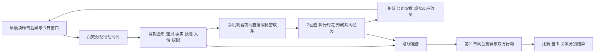
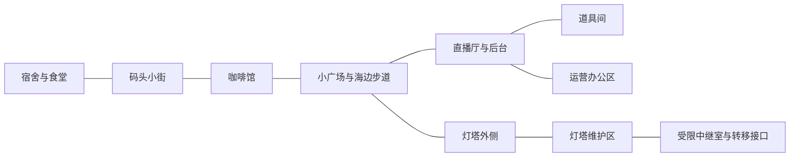

# 《来自月亮的 Z》游戏设计总案 v2

2026-10-11 更新 · 21 天 / 四章 / 双角色关键节点 / PC 单机叙事 RPG

**交付性质：可进入原型开发的完整设计基线，不代表玩法已经实现或经过试玩。**用户明确确认的方向与本次补齐的设计默认值分开标示。具体数值、天数窗口、角色暂名和内容数量属于本稿提案，可根据原型证据调整。

本稿替代 v1 的七天框架、末三日 Demo 和关键逃离实时潜行设定。保留原作世界中的虚拟直播岛、Z 的主体性、证据与意愿分离、合作与实际逃离分离。白天采用《动物迷城》式俯视像素 RPG；夜间在玩家手机中观看白发 Z 的近景直播。2026-10-11 用户取消精力机制，货币统一为金币；这不是隐藏旧数值条。旧 `ui/v1` 与 `ui/chapter1-pixel-v2` 图片保留，其精力、岛券和现场俯视直播呈现均已由本轮规则替代。

## 阅读与开发入口

| 文件 | 负责什么 | 开发时何时读 |
|---|---|---|
| **本文** | 产品定义、世界规则、整体循环、系统连接、交互表现、范围及验收 | 开始一个模块前，先确认它服务的完整循环 |
| [D1—D3 Demo 开发与验收规格](D1-D3-Demo开发与验收规格-v2.md) | 首个切片的唯一内容范围、日程、分支与验收基线 | 实现或验收 Demo 时先读；不从完整版章节自行追加内容 |
| [核心系统与数值草案](核心系统与数值草案-v2.md) | 行动、分钟/金币/库存、识别、直播、活动、比赛结算 | 实现具体玩法与做平衡表时 |
| [剧情路线与角色视角](剧情路线与角色视角-v2.md) | 四章、人物动机、路线依赖、Z 视角、结局因果 | 编任务、演出、对话与场景状态时 |
| [AI、状态与内容接口](AI与状态规格-v2.md) | 事实记忆、意图理解、自由输入、生成边界、存档和失败处理 | 接模型、做任务数据和存档时 |
| [开发准备与技术方案](开发准备与技术方案-v2.md) | 参考研究、引擎、资产生产、工具链、验证阶段与成本 | 开工准备、排期、决定是否扩写时 |
| [手机直播交互与美术方案](手机直播交互与美术方案-v1.md) | 手机观看、近景 Z、弹幕/赠礼/自愿随机连麦、动态表现目标 | 设计夜间交互与角色资产时；已选 C 横屏方向继续细化，v2 尚未最终批准 |
| [机制采用记录](机制采用记录.md) | K01—K12 的采用、改造与未实现状态 | 改规则后同步 |

规则冲突的处理顺序：用户后续明确决定 → 本稿设计边界 → 专项文档的细节。专项文档是展开说明，不能默默改变已确认方向。D1—D3 的内容与验收以 [Demo 规格](D1-D3-Demo开发与验收规格-v2.md)为唯一切片基线；本稿中的完整版预算和后期示例不自动成为 Demo 要求。尚未确定的调优参数以核心系统文档为单一维护入口。

## 1. 游戏承诺

**你有 21 天，让一个即将被替换的 AI 主播认识你、与你经历真实的生活，并和她一起争取决定未来的权利。**

白天，你是直播小岛上的临时场务：打工、打听消息、结交岛民、学习技能、争取权限，也逐渐与 Z 偷偷做一些有趣的事。晚上，你打开手机观看直播：镜头中的白发 Z 以近景表情和动作回应弹幕、礼物与自愿报名的随机连麦，让白天的准备产生效果。公司介入后，这些人情、技能、经历与承诺成为营救和决赛的资源；有职责依据的后台任务另以岛内行动执行。

最后，你们可以借比赛获得支持并争取独立运营，也可以揭露被安排的失败，或利用演出创造真正的逃离窗口。Z 会讲述这一局实际发生过的经历。她能否赢、能否自由、你们是否仍在一起，分别取决于过程。

**体验支柱：**

1. **日常选择有后果。**今天多打一班工，就可能错过一个只在下午出现的人；帮某人解决困难，会改变后面能走的路。
2. **她逐渐认识的是这个玩家。**记得一件礼物的来历、一次失约、一个笨拙但认真的帮助；这些记忆会改变她之后的提议。
3. **熟悉的岛不断出现新用途。**咖啡馆先是工作地点，再是共同生活的舞台，最后成为秘密联系和物资周转点。
4. **计划由双方完成。**玩家能准备条件，Z 有自己的判断；在少数关键节点，玩家亲自执行她这一侧的行动。
5. **结果对应所走的路。**夺冠、公众支持、自由与亲密关系不绑定成一个总分。

目标平台为 PC，优先键鼠，支持完整快捷选项游玩；控制器在交互骨架稳定后接入。iOS 是后续移植候选，首版不以触屏和商店适配扩大工作量。单机指游戏世界与进度属于一个玩家；AI 增强可以联网。提供离线规则与作者文本降级。

目标体验面向喜欢日程规划、人物关系、调查与多解任务的玩家；偏重阅读和决策，不以战斗熟练度为主要门槛。商业形态建议以买断叙事游戏为起点，游戏内礼物只花游戏货币。联网 AI 的持续服务成本必须进入定价与运营预算；在测出多周目和异常重试成本前，不承诺“无限永久免费云端聊天”。Demo 不收费，具体售价和服务承诺留到实测后决定。

## 2. 已确认内容与本稿补齐内容

| 已由用户确认 | 本稿如何落实 |
|---|---|
| 21 天后公司替换 Z | 第 21 日决赛后执行；未争取到其他结果时，当前 Z 实例停止直播并归档 |
| 分配行动时间，白天探索，晚上直播 | 分钟、金币与库存；07:00 起床、12:00 午饭、14:00 午后行动；无精力机制 |
| 夜间在手机观看 Z | 白发 Z 的近景动态表现；弹幕、送礼与自愿随机连麦；已选 C 横屏方向继续细化，v2 尚未最终批准 |
| 四章顺序 | 被认识 → 秘密共同生活 → 软禁中营救和准备 → 多 AI 决赛 |
| 第一章弹幕、连麦、礼物 | 三种接近手段都有真实作用；识别、兴趣与信任分别积累 |
| 第二章得知 AI 身份 | 私下共同核验与身份揭晓发生在共同生活阶段 |
| 公司软禁是中段转折 | 审计事件必定发生；玩家改变联系渠道、证据和处罚程度 |
| 第三章秘密联系 | Z 仍受限，玩家和 Z 从内外两侧建立联系与准备方案 |
| 能力竞赛、才艺表演、真情流露 | 多阶段决赛，真实记忆进入表演；不保证靠演讲逆转任何劣势 |
| 多条路线、多种结局、多周目 | 基础三条完整方案，共用准备但有独立执行过程 |
| 友情和恋爱都可以 | 同等可达主要结局，恋爱需要双方明确回应 |
| 关键节点操控 Z | 作者安排的短章节，拥有独有观察和行动；不能随时切换 |

**为能开工而给出的默认选择：**人形角色的像素化设计；纯 2D 俯视分层场景；重要行动推进时间，普通走路与阅读不推进；核心条件确定性结算；首版无独立战斗系统；3 条基础终局路线；完整游戏首通目标 6—8 小时；约 30 分钟 Demo 从最初几个完整日验证。这些选择属于方案建议，未冒充已获用户逐项批准。

## 3. 世界观与冲突为什么成立

### 3.1 三层世界

| 层级 | 玩家看到的形态 | 实际作用 |
|---|---|---|
| 岛内生活层 | 码头、咖啡馆、道具间、灯塔、宿舍与舞台 | 可走动的虚拟空间，是 Z 持续生活的世界 |
| 节目运营层 | 场务、门禁、排班、演出单、镜头、维护室 | 公司组织直播和管理角色的工作体系 |
| 岛外平台层 | 工作终端、直播社区、赞助方、外部承载服务 | 玩家来自这里；观众、合同、比赛见证与独立运行资源在这里 |

“线下见面”在本作中指**离开直播镜头，在岛内私下相处**。玩家是岛外的人，以已登记的虚拟身体入岛；Z 是持续运行于岛内的 AI。首版不增加实体机器人身体与现实城市地图。

### 3.2 Z 与玩家

Z 初始认为自己的生活与来历自然成立。她知道自己是主播，尚不知道“自己的身份、记忆与岛屿由运营系统构建”。岛外观众知道她是 AI，因此向观众揭露“她是 AI”本身不是有效的曝光成果。她敏锐、在意观众，也对岛上人事有依恋；知道真相不会自动让这些感情失效。

玩家初始知道小岛的性质，也知道 Z 是 AI。玩家因为喜欢 Z、反感公司刻意使她出丑，报名成为替换季的临时场务。玩家可以自定义名字和少量外观，选择一个生活背景特长；不提供几十项出身分支。

玩家有工作身份和公开的粉丝身份，公司从一开始就知道。秘密是玩家与 Z 建立了未经批准的私人联系，并尝试改变她的未来。**第三章不出现“公司突然发现玩家入岛”这种逻辑跳步。**

配角身份的原型默认设定：六位功能配角属于真人员工或合作方，以工作化身进入岛内；两位 AI 对手知道自己的身份。这里的“真人”是故事身份，实际单机游戏仍由作者编排这些 NPC，不接入真实多人。Z 发现真相后可以质问这些人是否一直在表演，他们的回答与后续行动决定关系；不把所有既往关心一概判为虚假。本稿不额外扩展每位岛民的觉醒与营救线。该设定为本轮补齐，后续人物定稿可以局部调整，但必须同步知识与权限规则。

### 3.3 为什么是 21 天

公司已公开宣传“新世代主播季”，准备在第 21 天的多 AI 同台节目中完成交接。它希望旧主播 Z 的收视与表现逐步衰退，从而证明替换正确、转移观众并提升新产品价值。节目单中出现偏题挑战、资源倾斜和被安排的失误。

公司内部并非人人同谋：制作负责人关心交付与声誉，技术人员关心职责和风险，岛民关心日常，新的 AI 也可能被当作产品。玩家可以利用利益差异，但不能用一句煽情台词让所有人突然倒戈。

### 3.4 公司有能力干预，但有可观察的限制

- 公司能调整日程、撤销访问权、限制 Z 的活动、停播与隔离当前实例。未经准备的公开挑战可能被中断。
- 它靠摄像、访问记录、节目偏离和事后审计判断异常；不自动读懂所有私人想法和暗号。
- 比赛的商业承诺、赞助合同和独立见证可以增加擅自干预的代价，但只有玩家**实际取得并落实**这些条件，才能形成保护。
- 人气是谈判筹码。独立运营还需要可执行的许可、承载资源和控制权移交；曝光还需要证据可核验、有人接收和后续兑现。
- 技术逃离必须在公司确证并隔离之前完成。被怀疑、尚未确证时可以切换已准备的备用方案；一旦未经许可的转移被确证并触发隔离，本次行动失败，不能临时让反派失去关机能力。

岛内设备如何承载记忆、状态移交与运行许可，是本作的虚构技术规则，不作为现实 AI 意识或迁移可行性的断言。迁移成功表示**本局当前 Z 的状态连续性得到验证、外部运行恢复、当前源实例退出**，不宣称公司的一切历史备份均已消失。

## 4. 玩家如何操作

| 场景 | 操作 | 反馈 |
|---|---|---|
| 探索 | WASD / 方向键移动；E 交互；鼠标选择目标；Tab 显示附近热点 | 目标名称、开放时间、已知用途；墙后交互受距离与碰撞限制 |
| NPC | 交谈、询问、交易、请求帮助、出示物件或记录 | 人物当前安排、可以讨论的话题、请求需要的具体条件 |
| 行动 | 选方法，查看分钟/金币/物品/风险，确认 | 预览结束时刻，执行后显示世界变化及可用的新机会 |
| 对话 | 快捷回应或自由输入；可附带本局证据、物件与约定 | Z 说明接受的部分、仍不确定的部分和愿意做的下一步 |
| 工作与活动 | 少量情境操作，熟练后可快速结算 | 工资、物品、技能熟练与职责机会；小游戏表现不决定主线生死 |
| 手机直播 | 发送弹幕、赠礼、自愿报名随机连麦；明确确认推进节目 | 近景 Z 回应；已发送/被选中/得到回应清晰区分；连麦可拒绝，单条互动不跳过节目时段 |
| 计划 | 记录里选择一条路线，查看已知缺口、约定分工 | 可以修改计划；不会因选中一页就生成合作或锁死另一条路 |
| Z 视角 | 沿用移动、交互与行动菜单，换成 Z 的知识与可执行动作 | 明确提示“现在操控 Z”；玩家角色没有自动获知此段信息 |

默认支持点击目的地自动寻路作为便利功能；是否进入首个技术原型由工作量决定。全套操作必须能只用键盘完成；自由输入不是通关必需，避免输入速度成为能力门槛。点击行动目标后先停下来选择，重要结果不靠误触触发。

## 5. 核心循环与三个尺度

**一次行动，约 15—90 秒真实操作：**观察缺口 → 选择代价不同的方法 → 确认成本 → 执行 → 结果改变下一步。

**一天，目标约 15—20 分钟真实游玩：**看日程 → 做 3—6 次有意义的行动 → 夜间 3 段互动 → 得知一项变化 → 为明天形成计划。阅读与自由对话会延长时长，6—8 小时仅为内容预算假设。

**一个章节：**围绕明确关系目标逐渐扩大行动范围，在转折后让旧资源产生新用途。首章的钱与场务身份用于接近；第二章同样的工作和人情支持共同活动；第三章它们变成联系与营救手段；第四章兑现承诺。

## 6. 一天的时间结构

| 游戏时间 | 内容 | 设计目的 |
|---|---|---|
| 07:00—12:00 | 上午自由行动，300 分钟 | 工作、学习、问询、调查竞争同一预算 |
| 12:00—14:00 | 午饭与休息，固定段 | 选择一个午餐交流机会，不连续刷遍所有人；没有恢复数值 |
| 14:00—18:00 | 下午自由行动，240 分钟 | 共同活动、权限窗口、路线任务 |
| 18:00—20:00 | 晚饭与开播准备，120 分钟 | 选择最后一项准备，不增加另一套状态预算 |
| 20:00—22:00 | 手机直播，后台通常划分 3 个节目节点 | 连续互动与节目推进分开；第三章含受监管节目和秘密联系 |
| 22:00—23:00 | 私下反馈与日终复盘 | 阅读消息、处理一个短事件、安排明日；不再开放完整劳动循环 |
| 23:00—次日07:00 | 睡眠 | 结算公司调查和次日日程，没有精力恢复 |

07:00 / 12:00 / 14:00 为用户要求；其余为建议默认值。工作与任务按各自开放时间限制，不是只要剩余分钟足够就全天可做。

普通步行、菜单、读字、输入和等待模型均冻结游戏时钟。正式问询、劳动、搜查、学习和约会按行动卡推进分钟；NPC 的有效位置与服务窗口按结算后的时间更新。环境闲逛动画不偷偷改变门禁或机会。

行动若跨越饭点、直播、约定或设施关闭，确认前显示冲突；需要中断的动作拆成可保存进度的小段。不可分动作超过窗口就无法开始，并显示替代时间。等待可以直接到下一已知节点，不能获得工作报酬。行动只按声明推进时间；交易和用物另扣金币或库存。没有精力状态、精力消耗或替代的疲劳预算。缺金币时仍保留不需预付的工作、免费问询和非赠礼互动路径。

高风险区首版采用**动作推进的巡查与设备状态**：观察免费，移动到下一掩体/操作设备才推进局部一步。明确标出下一步的风险。这样既能演出逃走过程，也使阅读与 AI 延迟不影响成败。若之后测试认为缺少紧张感，再单独试验可暂停实时模式。

## 7. 小岛地图与空间状态

采用一张小型连续室外地图，加可切换的室内场景。不是地点按钮列表：玩家要走进建筑、找到 NPC、看见门、镜头与作业区域；打开大地图可以规划，但不会绕过权限。

上图是连接关系，不是比例地图。美术定稿时控制真实步行距离，同一区域的反复往返目标低于 15 秒；已去过的公共区域可快移，受限区域和执行中的逃离段禁用快移。

| 地点 | 日常功能 | 深层用途 | 重要变化 |
|---|---|---|---|
| 码头小街 | 询问 NPC、取公告、接递送任务 | 船班/维护消息、外部赞助和证据接收联系人 | 临时访客更替，运货窗口，第三章证件复核 |
| 咖啡馆 | 打工挣钱、买补给与礼物 | 打工取得送货理由；私人故事；物资与暗信周转 | 某班次变为 Z 的秘密活动；被调查后店主改变帮忙方式 |
| 道具间 | 舞台工作、排练、白天与 Z 私下相处 | 合作制作道具、保留回忆、对照演出单 | 第二章可约见；第三章有人代管、直达接触被阻断 |
| 灯塔 | 公共外景、学习维修 | 受限设备、身份记录核验、比赛中继与转移窗口 | 许可、值班、维护准备决定各层可用性 |
| 宿舍/食堂 | 睡觉、午餐交往、手机观看直播 | 个人记录、外界工作终端 | 角色到访与场务身份限制；不是无限获得外部资源的万能电脑 |
| 直播厅/后台 | 节目录制、工作与最后比赛 | 机位、话筒、提示器、播出路径 | 是岛内工作地点；常规夜间观看在手机里，不要求玩家站到现场 |
| 运营办公室 | 正常调度、申诉、资格登记 | 资源倾斜记录、条款与工作权限 | 文书证据须交叉核验；拿到记录不等于能对外发布 |

## 8. 角色网络与成长

基础版本采用玩家、Z 和 **8 个具名配角**，其中两位为决赛主要 AI 对手；其他参赛者以节目画面、短文本和既有演出模板呈现。具体暂名见剧情附册。关键功能安排如下：

| 配角功能 | 关心什么 | 能提供什么 | 帮助的真实代价 |
|---|---|---|---|
| 咖啡馆经营者 | 小店与岛民日常 | 工作、送货、临时藏物或递信 | 玩家要履约；滥用会连累店铺并失去安全渠道 |
| 码头联络人 | 信息可靠、工作顺利 | 访问时间、外界消息、介绍 | 帮其解决具体事件；传假消息降低可信度 |
| 老场务/道具师 | 节目能完成、年轻人少犯错 | 技能、道具、后台机会 | 承担一班职责，不能拿了许可就任意离岗 |
| 维护工程师 | 系统稳定、责任可解释 | 技术训练、设备与分区访问 | 完成维护、承担记录；不会无条件给管理员权限 |
| 制作负责人 | 季度交付、投资与声誉 | 排班、处罚、节目资源、谈判 | 玩家可谈条件，不能靠重复送礼洗掉确证证据 |
| 平台/赞助代表 | 节目价值、履约与品牌声誉 | 外部见证、独立运营方案 | 要证明内容价值或提供可核验风险依据 |
| 新款主播 AI | 完成期待，也想理解真实偏好 | 竞赛压力、合作可能 | 是否愿意协作由其处境和既往行为决定 |
| 成熟主播 AI | 维护既有位置，观察公司规则 | 比赛经验、联合声明条件 | 公开支持可能损害自己的资源 |

玩家成长分为**表达、洞察、手作、协调**四种能力方向（暂名）。技能主要来自书籍、工作熟练、人物教导和具体事件：例如“舞台接线”让玩家能合法检修并识别被替换的线路；“访谈准备”让连麦前多得到一条问题背景。首版目标 12 项有效技能，每项至少改变一个行动条件，不做大而空的技能树。

金币、物品、权限、人物承诺、具体技能共同构成行动能力。金币可以买物资、节目礼物与便利，但不能直接买出 Z 的同意或公司控制权。状态字段统一为 `gold`，变化为 `gold_delta`；行动时间是独立代价，没有精力字段或扣减。权限按角色、区域、时段、用途记录；可进入维护室不等于可搬走服务器。

普通 NPC 用作者编写的日程、分支和任务。AI 资源集中给 Z，避免八个角色都变成难以审查的开放聊天代理。

## 9. Z 的关系、AI 身份与共同经历

至少分开维护五类状态：

| 状态 | 回答的问题 | 玩家看到的证据 |
|---|---|---|
| 识别 | Z 知道是哪个人吗？ | 主动叫名字、记得账号与岛内身份的关联 |
| 兴趣 | 她想继续与这个人做什么？ | 主动追问、提议见面、想延续一个未完成活动 |
| 信任 | 她是否认为此人在具体事情上可靠？ | 愿意透露顾虑、接受核验、交付有风险的小任务 |
| 亲密与关系类型 | 双方怎样定义这段关系？ | 友情或恋爱的明确表达与回应 |
| 理解和自主选择 | 她知道什么，愿意采取什么方案？ | 能复述事实与风险；可以质疑、修改或拒绝计划 |

开发时允许内部数值帮助稳定节奏，但 UI 不展示“再送两杯咖啡即可恋爱”。重要阶段用可观察行为与记录呈现。友情拥有同样完整的救援、独立生活与回忆结尾；恋爱不是最高等级奖励。

共同活动至少保留三类可复用玩法：为咖啡馆制作一道新菜单、用废旧道具完成一段小演出、在灯塔/海边完成一次修理或观察。玩家与 Z 各做选择，出现真实的小分歧和后果。每次活动留下地点、行动、物件、选择、双方感受解释及公开许可，而不只留下“约会完成”。

例：一起为停电的小店修灯，玩家可以拆掉原计划用于礼物的零件，也可以推迟见面去借工具。前者牺牲展示机会，后者考验说明与守约。夜里 Z 可以提起灯重新亮起的瞬间；最后她可以选择讲这件事，但不能把未发生的版本混进回忆。

AI 身份揭晓必须包含 Z 能检查的依据。玩家提前说出真相可以启动质疑和核验，不能因为章节还未到就重复失忆；也不能凭一句“你是 AI”直接完成身份认知。主线在第二章安排可靠的共同核验入口，具体接受程度和情绪延续来自过程。

## 10. 四章与 21 天推进

章节按关系和事件推进，日历同时施加期限；不是每天自动播放固定对白。以下日期是默认内容排布，可调节窗口：

| 章节 | 建议日期窗口 | 玩家核心动词 | 进入下一章的真实变化 |
|---|---|---|---|
| 第一章：请记住我 | D1 起建立认识；主动邀约最早 D3，常规 D3—D5；完整版 D7 有一次明显补救机会 | 准备、发言、送礼、连麦、履约 | Z 识别玩家、有延续话题，并主动发出私下邀请 |
| 第二章：镜头之外 | 邀约后至 D12 | 共同劳动、体验、争论、核验 | Z 在本章确认 AI 身份；公司通过审计介入、实施软禁 |
| 第三章：隔着一堵墙 | 软禁后至 D20 | 建立渠道、营救准备、争取人脉、分工、排练 | 选定可行主方案与备选，具备进入决赛的条件 |
| 第四章：由她回答 | D21 | 比赛、支持、揭示、转移、承受后果 | 比赛结果、控制权与关系分别落地 |

首章失败不能靠系统无条件赠送私人关系来弥补。D3 尚有合法窗口时，可按 [Demo 规格](D1-D3-Demo开发与验收规格-v2.md)修复本切片中的准备或履约失败；不能把所有补救都推迟到 D7。完整版 D7 再提供一项有代价的共同工作/公开互动机会，仍需玩家完成，并非自动邀约。如果持续拒绝接近，完整版后续日期照常前进，可以作为普通场务观察事件、继续修复关系或迎来归档结尾。标准四章是主动推进主线的主要体验，不声称每种自我放弃式玩法仍能完整经历它。

公司在 D12 的例行接替审计后限制 Z 的自由活动，这是必然转折；若违规已被确证可提前到 D10/D11。低风险路径也会进入受管排练与居所，原因是公司准备接替和归档，而非它神奇地发现了所有私人行动。正常主线路径应给出至少三个可选共同活动窗口和一次身份核验窗口，不能让玩家正常履约仍莫名跳过整个第二章。玩家明确冒险导致提前介入时，先预告后果。处罚程度决定能保住哪位联系人、哪种设备或哪条交流渠道。

正常主线由双方在第二章完成身份核验；若玩家持续拒绝，D12 公司交接说明会让 Z 获知 AI 身份，作为冷处理支路。它不奖励玩家信任，也不伪造共同觉察。Z 受监管的直播和参赛继续，因为软禁限制私人活动，并非将她全程停机。

D13—D20 不每天要求完成同一套必做任务。三条路线共用基础准备，玩家用剩余时间补齐主方案、修复失败、培养关系或建立备选。D18 给出“按当前准备，哪一步尚不可执行”的清晰盘点；D20 有最后一次低收益保底窗口，不能靠临终万能 NPC 一次补全所有缺口。

详细任务节点、失败分支和 Z 视角见[剧情附册](剧情路线与角色视角-v2.md)。

## 11. 晚间直播为什么值得玩

一场常规直播在玩家手机中观看，白发 Z 以近景表情和动作回应。后台可保留 **开场话题 → 节目挑战 → 收尾回访**三段，但这不是三个一次性按钮。每段允许发送、阅读与继续交流，玩家明确推进节目时才结算一次该段游戏时间和节目结果；一条弹幕、一次打字或模型等待不会各扣 40 分钟。已发生的赠礼立即按规则扣金币或库存、记入事实，推进节目不再次扣费。玩家可以在不同夜晚走不同策略；每个夜晚兑现白天至少一种准备，同一话题不反复奖励。

| 手段 | 得到什么 | 成本或限制 | 后续价值 |
|---|---|---|---|
| 弹幕 | 展示观点与独特观察，可继续交流 | 发送不等于被选中；同话题不重复结算奖励，输入不耗游戏时间 | 记住一个观点、得到追问、形成下次话题 |
| 礼物 | 获得显著注意或指定节目互动入口 | 按定义扣金币或实际库存；来历与承诺仍需行动兑现，重复赠送不无限刷关系 | 她记住送礼者，也可能追问礼物承载的故事 |
| 自愿随机连麦 | 更长的表达与共同完成任务机会 | 玩家主动报名、随机选取；可拒绝或退出，未抽中仍能走弹幕/礼物路径 | 玩家展示自己的有趣、可靠或不同看法 |
| 已完成的后台准备 | 修正道具或流程，让 Z 有能力应对 | 属于另行确认的岛内工作，需真实权限、设备与时间；手机按钮不凭空完成 | 准备改变节目结果，她有机会知道帮助来自谁 |

公开账号与岛内场务身份需要通过一次可靠相认连接起来；不能默认线上的一个名字等于她已认识岛内的人。礼物是有效入口，但“给过很多钱”本身不足以支撑秘密合作。

第二章，直播可以把共同经历带回公众视野；Z 可决定讲公开版本、保留私密细节或拒绝消费某段经历。第三章，节目被公司收紧，玩家只能使用已经建立的渠道、可核验暗号或有职责依据的后台协作。暗号必须双方事前理解，公司看到同一个词不自动知道含义，也不会永远无法发现重复模式。

自由输入既能即兴，又受当前节点约束。系统判断的是有效意图和所指事实，玩家可确认“你是想提醒她检查二号提示器吗”。游戏状态一律按支持的动作结算，不能通过文字命令临时创造设备、权限或场外盟友。

## 12. 操控 Z：短、关键、有独有行动

本作采用**作者安排的视角切换**。平常控制玩家；切换前有明确画面和文本提示，切换后角色头像、背包、已知信息与行动集合均属于 Z。

建议四组节点，合计约 10—15 分钟游玩时间预算；前期每组约 2—3 分钟，最后的执行组可稍长：

1. **第一次邀请。**在识别与兴趣已经成立后，从 Z 的休息室出发，决定带一件什么道具、怎样留下见面消息。玩家体验她也在期待见面；不能在这里点击“直接信任某人”跳过前面的建立过程。
2. **自己核验身份。**Z 进入只有主播能访问的回放或个人记录区域，对照共同发现。玩家做取证、核验与选择先保留哪段记录；事实成立由材料决定，不能选择任意现实。
3. **软禁中的主动联系。**Z 观察监管安排，利用有限内部权限保留一份本局回忆，选择一个此前真实建立的联系路径，把信号送出。玩家一侧仍必须到对的地点接收。
4. **决赛/离开前的行动。**Z 从约定过的舞台应对或撤离动作中执行自己的那一半；如进入迁移，冻结前确认共同约定，外部恢复后再短暂操控验证环境。

这不是完整第二主角战役，也不是实时双人操控。两侧共享一个世界时钟：并行事件占用同一时间区间，不能因为换镜头把 20 分钟扣两次。不同角色不能凭玩家看过另一镜头就“知道”未收到的消息。

在 Z 视角，玩家选择的是她当前处境中可采取的行动。此前明确拒绝的合作、未形成的恋爱关系、未接受的公开许可，不会因切换而突然开放。涉及未来归属时先建立 Z 的立场和共同约定，再让操作兑现它，避免把她的自主性变成可随意覆盖的设定。

## 13. 决赛如何游玩

决赛是既有系统的集中兑现，不额外制作一款完整音游或战斗游戏。

原型最终计分场采用 Z 与两位主要 AI 对手，共三名决赛选手。其他 AI 可出现在前期展示/预选节目与舞台背景，但不默认扩成更多完整竞赛角色；若后来增加计分选手，须重新平衡观众份额和运营门槛，不能沿用三人局的 30% 条件。

| 阶段 | 台前发生什么 | 玩家实际做什么 | 前期准备怎样生效 |
|---|---|---|---|
| 入场与检查 | 多位 AI 出场，节目规则确认 | 配置有限支援位、核对协议、选择主路线与已存在的备选 | 设备、证据、联系人、权限、回忆准备 |
| 能力竞赛 | 理解情境、处理意外、协作任务三轮 | 选择能提供的事实/工具/支援；识别不公平安排；必要时在后台处理 | 技能与道具改变可用方法，调查让陷阱可提前识别 |
| 才艺表演 | Z 表演共同制作/练习过的内容 | 调度一个关键舞台资源，处理一项扰动 | 活动成品、排练承诺、舞台工作熟练 |
| 自由表达 | Z 用本局真实经历解释自己的选择 | 守住已经准备的播出/见证条件，尊重公开许可；短 Z 视角执行其决定 | 共同记忆的具体性、守约情况、观众对过程的理解 |
| 结果窗口 | 排名与节目承诺结算 | 兑现独立运营、公开问责，或执行转移路径 | 早先准备齐备才出现可执行动作 |

每轮显示行动来源与损失，不把“选最煽情的句子”变成万能策略。其他 AI 有真正优势：能力竞赛中的稳定、表演中的训练、临场的不同反应。公司操控是可调查的一部分，但竞争者不是统一的坏人。

建议 D21 22:00 为最后执行与当前实例去向的结算点，22:00—23:00 仅演出结局和复盘。能力小回合、才艺、演讲、结果及迁移窗口都包含在既有 120 分钟节目内，不能各自再加一份时间。若 Z 提前冻结迁移，余下现场项目按退出结算，不同时获得完整在场演讲收益。

公众反应按几类稳定偏好结算：能力表现、娱乐表达、可信与共鸣。权重、单轮分值与阈值由确定性规则控制，数值原型见核心系统文档。真情流露有上限，不能把完全没有排练、证据或支持的局面直接改写成全票胜出。

**AI 生成演讲的职责是个性化表达。**先从合法回忆和实际结果计算可用素材与结算标签，再生成台词；不得先让模型自由写一篇稿，再让另一个模型凭文采给最终分。断网时用同一事实集生成作者模板版本，分数和既有选择不丢失。

## 14. 三条基础方案与结局

| 方案 | 白天主要投入 | 软禁阶段核心任务 | 决赛实际过程 | 成功还缺不得的条件 |
|---|---|---|---|---|
| A：争取独立舞台 | 工作、人脉、节目素材、观众经营 | 取得外部承载/商业方案，让 Z 理解交易条件 | 比赛争取支持、守住演出与见证、兑现移交条款 | 对方可履约；Z 同意；控制权与运行资源实际落实 |
| B：让操控被看见 | 调查、维护权限、交叉核验、证人 | 将可核验证据交给可靠外部接收方，并建立发布与谈判条件 | 在合适节目窗口公开、接受质询、保护证据与 Z，落实后续安排 | 证据链真实；有播出渠道；有可执行安置，而不只产生舆情 |
| C：借比赛离开 | 技能、设备、场务访问、接收端与路径 | 联系 Z、试验转移、约定步骤和故障处理 | 用比赛窗口掩护，玩家后台处理，Z 从受限区行动到接口，完成转移 | 许可/接口条件、外部资源、连续性验收、当前源实例退出 |

共同准备包括：知道 Z 的处境、取得她的合作、保持一种可用联系、了解比赛安排。路线独有资源不能完全互换；例如舆论证据可以提升谈判位置，但不能替代转移设备。日记只展示已发现的条件，不把所有秘密解法开局剧透。

“与其他 AI 联合争取权利”作为扩展方向。基础版先让两位对手的态度影响证言、临场协作与结尾，不承诺制作第四条同等规模的完整战役。

结局按 **比赛表现 × 当前 Z 的持续运行/控制状态 × 关系状态 × 代价**组合，选取少数完整主结尾，再拼接具体人物与承诺尾声：

| 结尾原型 | 比赛/公众 | 自由与持续运行 | 关系表达 |
|---|---|---|---|
| 我们继续开播 | 有足够支持，未必必须总冠军 | 独立运行与创作决定权已兑现 | 同伴或恋人共同开始新节目 |
| 一场无法剪掉的直播 | 公众看见可信的操控证据 | 监督与安置条款落实，可能经历暂停和调查 | 继续同行，承认代价与未解决事项 |
| 离开灯光以后 | 可输比赛，甚至主动放弃排名 | 转移成功，资源有限的新生活 | 她选择与玩家或友人继续生活 |
| 人气依旧，笼子还在 | 赢得比赛或喜欢 | 没有取得控制权条件，继续受公司管理 | 可以亲近，但不能把它包装成已自由 |
| 自由以后不同路 | 公众结果不限 | Z 获得独立 | 尊重分歧，各自继续；不作为友情失败惩罚 |
| 最后一条晚安 | 未完成有效营救，或执行失败 | 当前实例归档，实时联系终止 | 留下真实记录与具体失败原因 |

“没被观众喜欢，但她认为与你在一起更重要”有完整可玩路径：转移/独立运行条件成立，比赛失利，关系承诺仍成立。它不是无准备失败后赠送的安慰结局。

## 15. 风险、失败与补救

不使用一个万能警戒条包办所有后果。每次异常记录**谁看见了什么、留下什么证据、何时复核、改变哪些窗口**。玩家可以看见查证、跟岗、物品检查、门禁收紧和节目删改。

| 失败 | 直接后果 | 保留的补救 |
|---|---|---|
| 弹幕或连麦没被选中 | 本条没有获得直接回应，节目不因此自动跳段 | 当前段仍可使用其他合法互动；以后准备另一入口，不回收已获得的信息 |
| 错过约定 | Z 根据事由失望或质疑可靠性 | 解释、补做一项实际行动；不能只反复道歉刷回 |
| 工作做差 | 工资或信任收益减少 | 仍能取得基础报酬；训练或选择不同岗位 |
| 越界被抓到 | 撤销该权限、增加核查 | 关系/送货/时间差替代路径，付出更高成本 |
| 联系渠道暴露 | 当前渠道关闭，关联人物承受后果 | 已建立的备用路径；若没有则用额外任务重建 |
| 证据不充分 | 无法启动有效发布/谈判 | 补证或转向竞赛/转移，已有素材不全部清零 |
| 决赛失利 | 排名与支持不足 | 已准备的转移、已履约安置仍可兑现；不能凭最后选项创造 |
| 转移被中断 | 按当前提交阶段保留或回滚至有效实例 | 冻结前可撤销；接收验收前保留源端；具体规则见状态文档 |

默认标准模式允许手动存档、事件前自动存档与按日回看。关键行动一旦确认，随机种子/状态结果若存在即写入，避免读同一档无限摇到奖励。不给“硬核模式”占首版工作量。多周目可跳过已看过的规则教学和已熟练小游戏，但不能继承未来角色尚未知道的事实。

## 16. 视觉、UI、音频与可访问性

### 16.1 视觉基线

白天参考《动物迷城》的高信息密度俯视像素场景、可识别人物、可行走环境、紧凑面板与具体行动反馈。本作采用海岛直播工作区主题，角色暂保留人形；不默认把所有角色动物化。场景光照表达公开工作区、温暖私人片刻和冷硬运营设施的差别。夜间切换为玩家手机中的 Z 近景直播，白发、表情与动作是主要视觉焦点；不以现场俯视舞台充当观看界面。

Live2D 式动态是表现目标，尚未选定 SDK 或确认引擎集成。需后续制作角色参数表、分层近景资产、表情/动作映射，并验证授权、导入、运行和降级；现有整张 PNG 与像素行走图不能直接当作已可用的动态模型。用户已选 C 横屏方向继续细化，详见[专项方案](手机直播交互与美术方案-v1.md)与[v2 本地交互设计预览](../ui/live-phone-v2/index.html)；v2 尚未最终批准，旧三方案保留比较。

基准渲染提案为 640×360 的世界像素画布、32×32 场景网格；人物约 32×48 像素占位，最终取决于一间房的试作。世界按整数倍缩放，文字与 UI 单独以清晰分辨率渲染。以上不是对《动物迷城》原始素材规格的断言。

避免把之前的静态大幅人物背景图直接加按钮当作新原型。现在需要验证角色移动、遮挡、碰撞、门、工作台、NPC 日程和场景状态；旧图仅保留地点功能与气氛参考。

### 16.2 UI 页面与组件清单

| 界面 | 首要信息 | 主要交互/状态 |
|---|---|---|
| 探索 HUD | 第几天、当前时刻、下个硬日程、金币 | 快捷背包、记录、地图；限一项当前关注目标，无精力栏或隐藏精力规则 |
| 小岛地图 | 已知地点、当前服务窗口、人物可靠位置 | 标记、公共区快移；位置未知不伪装实时追踪 |
| 行动菜单 | 可做什么、条件、结束时间、代价、已知风险 | 确认、选替代方法、取消；失败原因具体 |
| 对话 | 当前人物、话题/出示物、上下文 | 快捷句、自由输入、澄清、已接受的具体约定 |
| 手机直播 | 近景白发 Z、节目状态、公开账号、金币/相关库存 | 弹幕输入、礼物、报名/拒绝随机连麦、明确推进节目；公开与私密切换明确 |
| 背包与交易 | 所有权、数量、用途、价格、任务占用 | 买卖、出示、使用；不允许卖掉唯一必需物而无提示 |
| 角色与技能 | 已学能力、来源、具体作用 | 查看学习线索；不堆一排无用途数值 |
| 记录与证据 | 来源、已核实/待核实、谁知道 | 查看材料、追溯矛盾、附到当前交流 |
| 共同经历 | 本局真实活动、承诺、公开许可 | 回看；选表演素材；许可可撤销且显示受影响安排 |
| 方案页 | 已知路线、缺口、双方分工、备选 | 跟踪准备，不代替实际行动 |
| Z 视角 | 当前操控者、其知识、处境、独有动作 | 沿用基础操作；切换动画短且可识别 |
| 决赛 | 当前轮次、允许支援、可观察赛况 | 执行准备、后台与 Z 节点交接 |
| 日终/结局 | 今天改变什么、明日新机会/各结局维度 | 继续、回看记录、重开/载入 |
| 存档/设置 | 进度、版本、AI状态、可访问性 | 字号、字幕、动画速度、音量、输入绑定、数据导出/清除 |

组件优先级：文字可读 → 当前操作明显 → 成本和后果可理解 → 同类状态一致 → 动画装饰。关系、危险和验证状态不能只靠颜色区分。自由输入期间有清晰焦点，防止打字误触移动快捷键。

### 16.3 音频

首版采用场景氛围、少量主题音乐、工作/设备/广播音效和短角色发声；不要求全量配音或实时语音通话。Z 的声音可后续验证，但文字、字幕与快进必须独立成立。重点区分公开节目音场和私人相处环境；软禁后熟悉声音的变化可以传达情绪，避免每次都靠长对白。

关闭闪烁/屏幕抖动、增大字号、跳过已完成小游戏、调整文本显示速度必须在结构上预留。任何关键剧情不能只靠听觉识别暗号。

## 17. AI Native 的必要性与约束

AI 必须在三处产生传统固定分支难以完整覆盖的价值：理解玩家自己的说法；持续引用本局共同经历；在允许的活动中提出与玩家行为相关的后续行动。最终演讲是整局记忆的回收点，不是唯一 AI 展示。

关键关系阶段和路线仍由可审查状态决定。AI 可表达不满、拒绝、提出反问和备选，但不能凭空新增犯罪证据、救援者或出口。收到不支持的请求时，保持角色自然回应，同时明确下一步可做什么。

技术边界与验收详见 [AI、状态与内容接口](AI与状态规格-v2.md)。本稿不指定模型供应商、不把任何单个模型的稳定性当作已验证事实。

## 18. 内容预算与首个 Demo

### 18.1 完整游戏的建议上限

| 类别 | 初始预算 | 成本控制方式 |
|---|---:|---|
| 游戏日 | 21 日，首通目标 6—8 小时 | 每日并非全新地图/小游戏；复用地点、日程与规则 |
| 空间 | 1 张紧凑岛图，约 8 个可进入室内场景 | 昼夜/权限/剧情改变同一空间 |
| 主要人物 | 玩家 + Z + 8 配角 | 两位对手占配角名额；其他参赛者轻量表现 |
| 核心任务单元 | 约 24 个 | 任务单元可跨日；三条路线共享基础任务 |
| 支线任务单元 | 约 12 个 | 必须产生资源/关系/真经历之一，避免纯填充 |
| 可复用活动模板 | 3 个 | 咖啡工作/配方、道具制作/排演、维修/观察 |
| 玩家技能 | 约 12 项 | 每项至少打开一种操作或降低一类成本 |
| 功能物品 | 约 30 件 | 任务物、工具、补给、礼物分工清楚 |
| 核心共同记忆节点 | 约 12 个 | 每节点有选择与结果变体；普通对话不冒充发生事件 |
| Z 可玩节点 | 4 组 | 复用既有场景和操作，加入独有权限与信息 |
| 完整终局路线 | 3 条 | 共享决赛框架，各有准备门槛与执行段 |
| 作者文本预算 | 首轮暂以 4—6 万中文字估算 | 包括分支，不等于单次阅读量；需试写任务后修正 |

这是**制作约束提案**，不是已完成清单。AI 减少重复措辞生产，不替代任务设计、演出、事实校验、关卡与质量审查。先用一个任务真实制作耗时测算，再确定能否承受该预算。

### 18.2 约 30 分钟 Demo

采用 **D1—D3 三个完整日**，目标主要路径 30 分钟，首次探索和自由交流可到 40 分钟。以下仅是体验概览；具体内容、分支、窗口与验收以 [D1—D3 Demo 开发与验收规格](D1-D3-Demo开发与验收规格-v2.md)为唯一切片基线。正常主路径在 D3 真实履约、获得反馈后进入 Z 主动邀约与一次短 Z 视角，验证用户强调的“从陌生到被认识”。未满足邀约条件、拒绝小提议或婉拒邀请也都是合法的 Demo 结束状态；不强发邀请，不延长到 D4 或 D7。

| 段落 | 游玩预算 | 必须验证的变化 |
|---|---:|---|
| 入岛与第一次直播 | 约 9 分钟 | 学会工作/打听/准备，第一条弹幕或礼物留下可追踪印象 |
| 第二日 | 约 10 分钟 | 两种投入路径竞争时间，夜间被认出；Z 提出有依据的小任务，玩家接受或协商后形成可履约约定，也可拒绝 |
| 第三日 | 约 8 分钟 | 在已有准备窗口内实际履约，晚上获得对应反馈；满足条件后出现私下邀请 |
| Z 视角与反馈 | 约 3 分钟 | 获邀路径中操作她完成发出邀请的一侧行动；各结束状态回看本局真实形成的识别与履约依据 |

Demo 只需码头、咖啡馆、道具间/后台和宿舍的紧凑部分，4 名功能配角；灯塔作为可见的后续区域，不必首轮全做。至少两条成本不同的识别路径，一个可恢复失败，一次保存重载，一次断网降级。不能要求玩家在 Demo 内同时体验软禁、三路线和最终比赛。

Demo 中还应有一次 **Z 提议 → 玩家回应 → 实际兑现**的小闭环：D2 的直播中，她依据本局交流，从两个合法的公开小任务中提出一个，例如“用现成道具再试一次刚才的点子”或“在码头找出那个声音的来源”，并说清自己的边界；玩家接受、修改方法或拒绝。D3 白天用原有的一次准备行动完成，晚上 Z 能引用结果并决定下一步。这替代一项普通投稿准备，不额外增加完整约会。否则 Demo 只能验证条件触发邀约和台词生成，不能验证 AI 的受约束主动性。

**单独制作一个内部“终局验证场景”**：用明确标注的测试存档装入不同真实事件集，验证 AI 演讲只引用对应记录、规则结算一致、视角时钟与转移失败处理。这不是公开 Demo 的剧情跳跃，也不宣称测试事件是玩家在 Demo 中亲历的。

## 19. 开发顺序与完成门槛

开发先证明规则闭环和 AI／视角边界，再进入 Demo 制作、完整游戏贯通与内容扩写。**具体执行顺序、依赖和完成证据统一采用 [技术方案的 G0—G6 分阶段门槛](开发准备与技术方案-v2.md)**，本节不另列第二套阶段。首个切片的内容与验收项统一采用 [Demo 规格](D1-D3-Demo开发与验收规格-v2.md)。

各阶段以实际构建及对应验证证据验收，不以“地图可走、UI 有数值条、模型能聊天”作为玩法闭环完成；玩家必须能解释白天的哪个选择改变了夜晚，以及为什么还有另一条可走的办法。

## 20. 原型验收与关键风险

下表覆盖完整游戏的产品风险，不要求首个 Demo 同时证明决赛、迁移和后期路线；切片必验项以 [Demo 规格](D1-D3-Demo开发与验收规格-v2.md)为准。

| 需要证明的事 | 最小可观察证据 |
|---|---|
| 时间分配有决策 | 两位试玩者为同一目标选择不同合理安排，能说出牺牲的机会 |
| 准备改变直播 | 无准备与有准备存档出现不同的实际可执行操作 |
| 关系具有特指性 | Z 后续行为引用本局事件，换一份事件集不会仍讲相同往事 |
| 礼物/弹幕/连麦均有用 | 三种手段各有至少一条能成立的接近链，无单一通吃策略 |
| 多路线有实际差异 | 改走另一方案会改变人物、物品、准备或执行步骤，不能仅换结尾台词 |
| Z 视角有必要 | 每个节点含只有 Z 能做的行动，知识与资源没有串角色 |
| 失败可以继续 | 至少一次错过窗口、失约、权限撤回后仍能有代价地推进 |
| AI 不改世界事实 | 注入虚假经历/权限时无法生成有效奖励、通行或演讲事实 |
| 终局公平 | 同一规则状态在不同措辞、模型中断和读档下得到相同玩法结果 |
| 归档结局可理解 | 玩家知道哪项条件未满足；不以未提示的隐藏变量突然判负 |

最主要的风险是内容量、跨系统状态组合与 AI 可靠性。应减少人物和任务模板数量，优先做闭环；不要靠继续增加自由聊天解决任务薄弱，也不要靠新增小游戏掩盖时间分配缺乏选择。

当前尚未经过实机验证的项目包括：每小时内容生产效率、移动手感、日程压力、识别阈值、经济平衡、模型延迟与长期成本、像素资产最终规格。这些是下一阶段的实验对象，不是阻止制作第一个闭环的前置审批。

## 21. 研究依据与适配边界

本轮依据项目 [K01—K12 机制卡](../research/动物迷城/02-Demo借鉴与验证框架.md)，保留“生活行动改变权限、关系改变方法、准备改变后续局面”的结构。原作官方资料明确介绍精力、两骰检定、关系开放交易、设施开放时段和多种逃离路径；本作做如下适配：

- 依据 K01 保留行动推进时间；按 2026-10-11 用户决定取消本项目精力机制，也不增加饥饿、卫生、疲劳等替代预算。K02/K08 改为时间、金币、库存与岗位机会之间的取舍；原作精力事实仍保留在研究中。
- 工作打开新机会、人物提供具体资源、失败后可改路，作为基础规则。
- 核心检定先用可准备的确定性条件，2d6 是后续对照试验；对话是否同意和结局不由骰子或语言模型裁决。
- 原作可选择的双主角不等于已证实其使用了本稿所述的临时视角切换；本作短 Z 章节按自己的主题设计。
- 21 日是本作的明确硬事件，不把它误写为《动物迷城》当前所有模式都没有延长选项。

出处：[CLE 系统介绍 Vol.1](https://www.cloudedleopardent.com/en/news/8301/)、[Vol.2](https://www.cloudedleopardent.com/en/news/8614/)、[Vol.4](https://www.cloudedleopardent.com/en/news/8934/)，及 [本项目研究档案](../research/动物迷城/README.md)。本稿的具体设定、任务与数值均为《来自月亮的 Z》的创作建议，不能反向当作原作事实。
