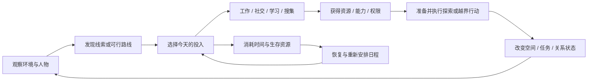
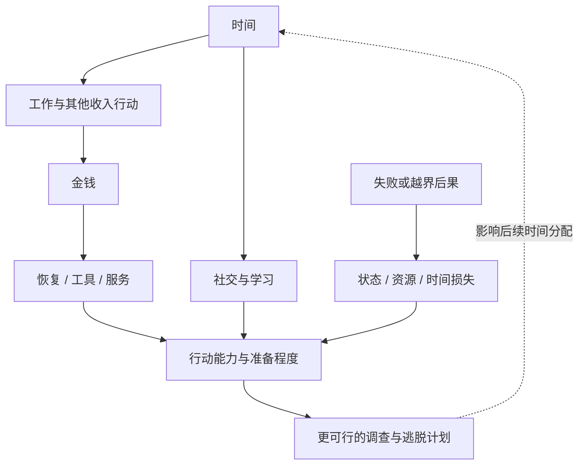
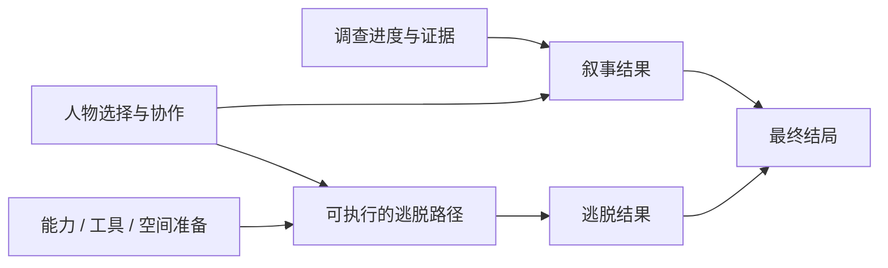

# 《动物迷城》玩法与机制研究

研究日期：2026-10-10。用途：为未来游戏 Demo 提供可追溯的机制参考。包含玩法和部分越狱路线剧透。

本报告是公开资料研究，未启动游戏、未完成实机通关、未逆向代码。研究以正式版及 2026 年官方更新为主；旧攻略用于理解机制链条，不能直接作为当前版本的数值规格。文中“设计分析”是研究者的解释，“借鉴建议”是待验证提案。官方宣传中的内容规模不等于本次实测时长。

资料同时包含 PC 更新与主机发行说明，不证明各平台补丁同步。具体复现应以选定平台、构建号、主角和模式为准。

## 1. 最重要的判断

《动物迷城》的主要参考价值是：**让玩家在一个可逐渐理解的封闭社会中，把生活、关系、成长与空间知识转化为逃脱能力。**

可以将其理解为“有限空间探索 × 按行动计时 × 社交型角色成长 × 多路线逃脱 × 作者编写的悬疑叙事”。地图范围有限，但同一人物、物品、工作和房间会在不同目标与时段下产生新价值。

制作人确实把限制空间作为控制开发规模的手段，也明确提到《极乐迪斯科》《女神异闻录 5》《樱花大战》的影响。资料支持的是经过精细编排的开放选择，不能据此宣称存在能任意推演的社会模拟或生成式 AI 世界。[制作人访谈](https://www.chuapp.com/?a=index&c=Article&id=290708)

**未来希望高度借鉴时，最值得保真的单位是一段“准备—行动—后果”的因果链。**仅复现数值面板、骰子动画、动物角色或监狱日程，未必能复现玩家的筹划感。

## 2. 游戏身份与版本基线

| 项目 | 核实结果 | 对研究的影响 |
|---|---|---|
| 开发与发行 | 上海 Metal Head Games 开发；PC 发行商为 Spiral Up Games | 区分开发者解释与发行商宣传 |
| 作品类型 | 单人、剧情驱动的越狱 RPG，含探索、关系经营、角色构筑与战斗 | 不宜按纯生存沙盒或纯视觉小说理解 |
| 2023 年抢先体验 | 核心是狐狸托马斯线 | 当年攻略缺少后来加入的主角和系统修订 |
| 2025 年 7 月正式版 | 狐狸托马斯与黑豹鲍勃两位可玩主角 | 两条主线不能用一套流程和结局表概括 |
| 主角目标 | 托马斯因调查而被陷害，需要查证并脱身；鲍勃带着卧底调查任务入狱 | 身份改变信息来源、剧情冲突和行动风格 |
| 内容规模 | 商店标注 47 名囚犯、三个帮派、100 多个手工任务及多路线/多结局 | 是完整作品规模，不是合理的首个 Demo 规模 |
| 2026 年更新 | 冠军模式、部分简单模式的第 21 日延时道具，以及后续灰猫 DLC 开发信息 | 不能把 2023 或 2025 年的模式规则直接当作当前全部规则 |

发行时间按官方公告通常写作抢先体验 2023-11-03、正式版 2025-07-18；Steam 地区显示可能为前一天。英文商店的 500,000+ words 与中文宣传的百万字使用不同计数单位，不应直接比大小。资料中也存在 47/48 名囚犯的口径差异，本报告采用当前官方商店的 47，且不把它当作所有 NPC 的总数。[Steam 商店](https://store.steampowered.com/app/1735700/Back_to_the_Dawn/)

模式更新的来源、平台适用范围和读取限制见[开发与体验证据](notes/开发与体验证据.md)。灰猫在本研究采用的公告中属于开发中的后续内容，不计入已研究的可玩主角。

## 3. 玩家实际在做什么

以下是按功能归纳的典型体验，不是逐日通关攻略，也不保证每位玩家按同一顺序经历。

| 阶段 | 玩家当前问题 | 常见行动 | 形成的知识或能力 |
|---|---|---|---|
| 熟悉制度 | 哪些事必须做？谁会伤害我？ | 认识点名、工作、用餐、活动和宵禁；接触室友与狱警 | 制度边界、基础日程、可用服务 |
| 维持生活 | 怎样支付通讯、食物和活动成本？ | 工作、交易、选择消费、恢复状态 | 一套可维持的生活预算 |
| 形成计划 | 谁掌握线索？哪个地方可能通出去？ | 谈话、调查、读书、试探限制 | 人物与设施的用途，路线前置条件 |
| 投资准备 | 现在该提升什么、结识谁？ | 关系经营、解锁技能、申请工作、收集工具 | 更好的行动成功率、进入权限与可用路径 |
| 执行越界 | 何时能进入禁区？失败能否承受？ | 夜间探索、拆卸/制作、潜入、检定或战斗 | 空间状态与任务进度发生实际变化 |
| 收束结果 | 已经能逃，是否解决了真正的问题？ | 完成调查、处理人物选择、执行某条逃脱路径 | 逃脱结果和故事结果共同构成结局 |

这里最重要的区别是：**生存得不错、查明真相、具备逃离条件、实际逃离，是四种不同进度。**不能把它们合并成一个主线百分比。

## 4. 三层核心循环



**短循环：**观察一个障碍，比较代价，准备后行动，获得明确反馈。例如“今天尝试这个检定”与“先补状态、换工具再来”是不同决策。

**日循环：**在制度安排中分配工作、成长、人际和调查；白天所得会影响晚间能做什么，夜间耗费又反过来影响次日。

**全局循环：**在剧情时间与事件窗口内，把零散准备组织成一条可执行的逃脱计划。复玩既包含系统允许的继承，也包含玩家自己记住的地图、人物和条件。

以上循环是对资料的设计归纳。其基础机制分别见官方系统系列与[机制证据](notes/机制证据.md)。

## 5. 时间：把选择变成有代价的行动

### 5.1 必须分开的三种时间

| 时间层 | 作用 | 创作时要回答的问题 |
|---|---|---|
| 剧情天数 | 组织主线、事件出现和全局压力 | 为什么目标不能无限拖延？ |
| 一天中的时间/时段 | 改变 NPC 位置、开放设施、可做的工作与活动 | 同一地点在不同时间有什么不同用途？ |
| 单次行动耗时 | 把一次谈话、学习、劳动或调查转换为机会成本 | 玩家点击前是否知道失去什么机会？ |

2023 年抢先体验攻略与预览交叉描述：普通移动和待机不推进时间；送礼不耗时也见于当时攻略。不能把“行动计时”理解为全部 UI 操作、阅读与步行都按现实秒数扣时，更不能直接推导成连续实时潜行。当前每种行动的耗时及例外仍需在目标版本逐项实测。[工作与时间规则，2023](https://gl.ali213.net/html/2023-11/1212757.html)、[玩法预览](https://turnbasedlovers.com/review/back-to-the-dawn-preview-impressions/)

精确点名、开工与关门时间在资料间有差异；本报告不拼接一张看似准确的跨版本日程表。稳定可用的结构是：制度规定的集体安排，工作/自由活动窗口，以及宵禁后的受限行动。

### 5.2 21 天既是压力，也限制内容规模

制作人解释，日程承担了角色故事和场景变化的组织功能，有限天数也让手工内容可收束。这意味着作者能为“第几天、哪个时段、谁已知道什么”设计有意义的反馈。它与无限重复的日常模拟具有不同的内容需求。[制作人访谈](https://www.chuapp.com/?a=index&c=Article&id=290708)

2026 年冠军版公告为托马斯“新伊甸模式”和鲍勃“白道模式”加入土拨鼠徽章：携带徽章在第 21 日睡前可选择让次日仍为第 21 日。这是特定模式的延时机制，不能理解为所有模式取消时限，也不能推导出世界状态重置、此前错过的窗口恢复、所有支线截止取消或自动生成新剧情。[官方公告](https://steamcommunity.com/games/1735700/announcements/detail/491589650677235738)、[开发者同文公告](https://www.bilibili.com/opus/1167217492234338306)

**设计分析：**首次探索需要容错，熟练挑战需要压力，两者可以通过规则模式分开。复刻时先决定要保留哪种体验，不能只照抄“21 天”。

## 6. 生存与经济：资源如何互相转换

官方区分精力、专注、健康、心态、饱腹和金钱。健康低于 30 时力量/敏捷约减半，心态低于 30 时智力/魅力约减半；长期饥饿又会侵蚀身体与精神状态。专注可用于失败后的重掷，恢复资源需要时间、物品或消费。[基础系统官方说明](https://www.cloudedleopardent.com/zh-hans/news/8295/)

| 资源 | 玩家为什么在乎 | 设计分析：与其他系统的联系 |
|---|---|---|
| 时间 | 决定还做得了多少事 | 是劳动、恢复、关系和任务共同争夺的预算 |
| 精力 | 决定能否继续行动 | 多做一件事可能意味着必须提前休息 |
| 健康与心态 | 影响角色有效能力 | 状态受损可以提高后续行动风险，产生连续后果 |
| 饱腹 | 保持基本状态 | 用餐是日程节点，也可能成为社交机会 |
| 专注 | 给重要尝试增加补救机会 | 是否重掷，是对未来风险的预算选择 |
| 金钱 | 购买服务、物品与活动机会 | 工作把时间转成钱，钱再换成恢复或准备效率 |
| 表现分 | 对制度内资源的访问资格 | 官方制度本身可以成为逃脱准备的工具 |
| 声望 | 社会地位和部分内容的门槛 | 与个人好感不同，代表群体环境中的资格 |

还要区分**日常资源与战斗资源**：日常健康 Body 表示身体状况，精力 Stamina 支付工作、搜索等行动；战斗另有生命 Health 和能量 Energy，前者承受伤害，后者支付攻击/招式。社区战斗资料明确，无论胜负，战斗中失去的生命会反馈到日常健康。因此不能用同一条“体力”把四者合并，也不能把赢得战斗视为恢复到战前状态。[战斗资料](https://backtothedawn.wiki.gg/wiki/Fighting)



**借鉴时的风险：**如果全部消耗都可以用一种赚钱方式轻易解决，时间和状态系统会失去策略价值；如果补给过于苛刻，玩家会陷入“失败—虚弱—更易失败”的困局。Demo 需要同时验证两端，不能仅验证各条数值会增减。

## 7. 成长：能力来自生活路径

官方成长系统区分四项属性、专长、技能、装备和临时增益。每项属性各有 10 个专长，激活消耗对应属性经验，后续激活成本递增。技能从特定行为、阅读和娱乐等活动中发现，启用需要技能点，技能点也由对应属性经验取得。因此，“发现什么能力”和“把成长预算分给什么能力”是两次决策。声望与表现分又打开不同内容。[成长系统官方说明](https://www.cloudedleopardent.com/zh-hans/news/8703/)

| 层次 | 实际功能 | 设计上不要混淆 |
|---|---|---|
| 力量、敏捷、智力、魅力 | 提供不同类型行动的能力基础 | 不等于四条彻底独立的通关职业 |
| 专长 | 在某一属性方向投资 | 不等于所有技能自动解锁 |
| 技能 | 改变能力、效率或可选行动 | “知道/发现技能”与“已经启用”应分开 |
| 装备、食物、药品等 | 提供持续或临时修正 | 构筑也发生在出发前的准备中 |
| 工作、书籍和社交 | 把成长放进生活场景 | 成长消耗的不只有经验，也有接触条件与时间 |

**开局构筑也影响生活路径。**2025-08-04 的正式版 PC 评测确认，两位主角拥有不同的初始属性，并能选择各自的过往背景；每项背景附带正面能力、负面效果和两个初始专长。它把身份经历变成具体优势与负担，而非只补一段身世文字。此处采用正式版观察，不把 EA 攻略中的初始数值和全部背景选项当作当前完整表。[正式版评测](https://gameluster.com/back-to-the-dawn-review-raising-the-bar/)

**设计分析：**这种结构让“我要成为怎样的人”表现为生活路线。偏社交的玩家会接触不同的人和资源，偏行动的玩家会更看重训练与装备。最有价值的是能力改变了处理问题的方法；单纯把成功率从低改高，表现力有限。

不能从这些资料推出“纯魅力构筑必定全程免战”或“任何任务都有四属性解”。两位主角的剧情限制也不同。具体不可绕过的检定和战斗需要路线实测。

## 8. 检定：把准备转化为风险管理

官方机制是掷两颗骰子，点数之和**达到或超过**目标即成功。挑战目标由行动难度减去相关属性、技能和物品等构成的基础点数；一般失败后可消耗 1 点专注重掷一次。这里的“达到或超过”与“一次”来自英文官方说明；中文简介只写高于/低于，表述较简略。它不应被写成 D20 系统。[英文官方检定说明](https://www.cloudedleopardent.com/en/news/8301/)

适合借鉴的逻辑表达为：

```text
显示的目标要求 = 行动难度 − 当前有效能力与相关加成
玩家准备 → 改变目标要求或可选行动 → 尝试 → 成功/失败后果
```

这些是一手资料确认的一般规则；极端骰面优先级、全部加成的叠加顺序，以及技能/模式带来的例外，仍不能从官方简述中穷尽。详细证据和冲突见[机制证据](notes/机制证据.md)。

**设计分析：**骰子有价值的前提，是玩家在掷之前已经能做决定。准备应产生可解释的改善，失败也应说明损失。若唯一有效操作是反复读档，随机性会弱化角色构筑和世界参与感。

未来原型至少应验证：低成本尝试、重要但可补救的尝试、不可逆选择三者是否有不同反馈。不是所有剧情节点都适合套同一种随机检定。

## 9. 社会关系：人物也是能力与资源的入口

官方明确好感可通过交谈和赠礼增长；关系提升会拓展交易内容、可购买装备及人物背景信息。偷窃、勒索和暴力提供另一类接触方式。[社交系统官方说明](https://www.cloudedleopardent.com/zh-hans/news/8618/)

可从四层理解其作用：

1. **识别层：**记住某个人是谁、在哪里、属于什么势力。
2. **理解层：**发现其经历、偏好、欲望与矛盾。
3. **交换层：**通过关系、帮助或利益交换获得资源和能力。
4. **路线层：**某段关系投资使一个原本困难或封闭的行动成为可能。

**设计分析：**当人物同时拥有故事、日程和机制用途，玩家会记住“谁能帮我解决什么”。关系系统应与世界进度发生联系；如果只显示好感数值和解锁长篇身世，仍可能沦为收集项目。

三个帮派构成另一种权力结构。官方确认：完成帮派任务提升信任，达到 100 点可加入；成员可免费使用本帮部分设施/活动，并在本帮商店半价购物。代价也明确：不能再接其他帮派任务或在其商店购物，不能结识其他帮派老大，说服其成员的难度提高。加入势力、群体声望与个人好感因此应分开记录。上述阵营排他性已有官方依据；完整敌对传播与叛帮后果仍待核实。[帮派官方说明](https://www.cloudedleopardent.com/zh-hans/news/8618/)

**设计分析：**入帮是用选择自由换取持续优惠的承诺，时机本身就是策略。若只复刻三组人物和三个折扣商店，却不保留另一侧的机会损失，就会弱化阵营选择的意义。

### 人物设计的可复用方法

下列模板是研究建议，不是原游戏内部数据结构：

| 字段 | 要解决的问题 |
|---|---|
| 独特外观与行动特征 | 玩家能否快速认出他？ |
| 公开身份与私下目标 | 他为什么服从或违背制度？ |
| 经历与当下处境 | 他的行为是否有具体理由？ |
| 持有的物品/技能/权限 | 与他来往为何对玩家有意义？ |
| 日程与可接触窗口 | 为什么现在能见到、稍后不能？ |
| 愿意合作的条件 | 帮他与获得帮助之间是否有因果？ |
| 反应与记忆 | 玩家做过的事怎样改变下一次接触？ |

## 10. 空间、工作与道具：同一地点的多重用途

医院兼有恢复、药品和探索价值；图书室承担学习与娱乐；教会影响精神状态与挑战增益；理发店关联特殊交易/任务；禁闭则剥夺行动机会并损害状态。官方将洗衣房、下水道、停车场等设施与逃脱秘密联系起来。[设施官方说明](https://www.cloudedleopardent.com/zh-hans/news/8951/)

**设计分析：**可以把地图理解为叠在一起的两张网：一张是制度允许的日常活动网，另一张是玩家调查后逐渐发现的绕行网。工作的价值也可能包括进入地点、接触人员、查看设备，而不只是工资。

一个普通物品同时具备消费、赠送、交易、制作或剧情用途时，玩家才会认真考虑如何分配它。但不能因此宣称原游戏每件物品都具有全部用途，也不能把具名配方推导为任意材料可自由组合。

### 代表性链条：理解依赖关系，保留版本标记

以下由玩家攻略归纳，主要用于研究路径结构。它们不是完整的正式版通关保证。

| 路线族 | 资料中的结构性特征 | 对创作的启发 |
|---|---|---|
| 囚室—管道—下水道—外围设施 | 先发现入口，再准备拆卸/遮掩/防护，再处理通路和时间条件 | 主基地内可以隐藏长期工程；白天准备改变夜间可达性 |
| 屋顶与滑翔准备 | 工作资格打开空间，设备处理与技能/材料影响逃脱准备 | 合法进入某处与真正利用它，是两个阶段 |
| 医院与塔楼 | 进入医疗区域、处理建筑出口，再面对攀爬或警戒挑战 | 进入、开路和撤离各自需要不同准备 |
| 关系或剧情驱动路线 | 人物任务、特定事件和协作开启不同出口 | 多路线可以来自不同社会条件，而非只换一个门 |

参考：[污水管攻略，2023](https://gl.ali213.net/html/2023-11/1213329.html)、[托马斯路线社区汇总](https://bttd.huijiwiki.com/wiki/狐狸托马斯线全结局流程与路线)、[玩家医院路线讨论](https://forum.gamer.com.tw/C.php?bPage=2&bsn=78860&snA=3&tnum=2)。旧攻略的材料数量、力量门槛、具体日期和奖励不作为当前实现依据。

**关键抽象：**多路线通常共享一部分基础准备，再在人物、能力、道具和行动成本上分叉。把每条路线做成完全独立的章节会迅速放大开发量；让所有路线只换最终动画则无法形成不同策略。

### 鲍勃的具体多解例：精神康复区药房门禁

标注 V2.0.0.33-RC 的玩家指南记录了同一目标的不同准备路径：在诊疗前备好泻药、安眠药或相应技能，可以趁诊疗机会拿到卡并继续行动；没有这些准备时，可以记住卡号、联系外部支持，次日取得复制卡；若已学会电子密码破解，则可利用卡号在当晚进入，省去等卡的一天。这是社区攻略提供的机制实例，尚未由本次实机验证。[鲍勃路线指南](https://steamcommunity.com/sharedfiles/filedetails/?id=3532090431)

**设计分析：**三种方法的区别是物品准备、知识能力和跨日等待的成本，而不只是三个同义选项。原型中的多解也应让既有投入改变后续行动成本。鲍勃还要为同伴准备撤离条件，因此同一监狱空间在另一主角下会形成新的任务依赖，不能只理解为角色属性不同。

## 11. 战斗、潜入与小游戏

游戏包含回合战斗，也包含探索检定与各种小游戏。这几类交互承担不同功能：战斗解决对抗，检定表达能力与不确定性，小游戏让工作和特殊行动具有直接操作感。鲍勃线更强调战斗，是官方对两主角区别的描述之一；具体机制来源见[机制证据](notes/机制证据.md)与[开发资料](notes/开发与体验证据.md)。

社区战斗表列出的基本选择包括徒手攻击、武器攻击、休息、招式与使用物品；攻击和招式消耗战斗能量，休息用于恢复。武器与能力进一步影响命中、暴击、流血、眩晕、护盾等交互。与第 6 节合看，战斗要同时考虑“这一回合怎样获胜”和“这场战斗后是否还承担得起今天的计划”。后一句是设计解读；伤害公式和完整平衡表仍需目标版本验证。[战斗资料](https://backtothedawn.wiki.gg/wiki/Fighting)

| 机制 | 可能带来的价值（分析） | 复刻时的成本或失败模式 |
|---|---|---|
| 回合战斗 | 让装备、能力与状态产生直接战术结果 | 敌人配置、技能组合、动画和难度曲线成本较高 |
| 潜入/越界挑战 | 将日程知识和准备转化为紧张执行 | 若失败判定不可理解，容易只剩读档试错 |
| 工作小游戏 | 让赚钱具有操作参与感 | 高重复频率可能压过筹划乐趣 |
| 环境谜题 | 让空间知识形成阶段性突破 | 若毫无提示，玩家可能只能查攻略 |

2025 年后续更新加入了部分小游戏连续失败后的跳过等减负功能，说明重复操作和可访问性需要单独设计，不能用“原作有很多小游戏”直接证明自己的 Demo 也需要同等数量。[更新记录](https://steamdb.info/patchnotes/19944775/)

本报告没有实测招式帧、AI 决策、伤害公式或全套战斗资源，不能据此声称已经得到可逐值复刻的战斗规格。

## 12. 任务、剧情和结局怎样连接

适合按四种任务功能阅读原作：维持生活、取得准备条件、推进调查、完成逃脱。一个任务可能承担多种功能；这比把全部内容平铺成“主线/支线”更有助于理解设计。



这是用于创作的抽象模型，不是原游戏代码关系图。不同主角具体怎样计算结局需各自核实。

**路线数量、结局数量和成就数量不是同一件事。**旧文章常把某一时点的几条路线称为“全部”。本报告确认多路线和多结局存在，但不拼出未经完整校验的“全版本所有结局总数”。未来需要百分百攻略时，应限定主角、版本和模式再建表。

## 13. 失败、恢复与复玩

失败价值取决于玩家是否能理解“哪里出了问题”和“还可以怎样处理”。本作的生活状态损失、受伤、禁闭和剧情期限，会把失败传导到后续日程；不同模式又改变回溯和挑战压力。[禁闭官方说明](https://www.cloudedleopardent.com/zh-hans/news/8951/)、[冠军模式公告](https://steamcommunity.com/games/1735700/announcements/detail/491589650677235738)

需要分别记录四种后果：

- **即时损失：**当次行动未完成，资源或状态变化。
- **机会损失：**错过服务窗口或当天可做的另一件事。
- **结构性变化：**路径、人物关系或事件可用性改变。
- **终局失败：**当前故事进入失败结局，或当前模式不允许继续。

难度模式与新游戏+需要按两个维度记录：前者改变挑战与回溯等规则，后者涉及周目继承。新游戏+的继承内容、触发条件、自动完成范围及其与难度的组合限制会影响复玩体验，详见证据笔记；未来做规格时仍需在目标版本验证。

**设计分析：**好的复玩来自新计划和新认识。若玩家重来后只是按已知最优路线重复劳动，新增周目继承只能减轻疲劳，不能自动产生新策略。

## 14. 叙事和美术为何能支持机制

动物物种与体型差异降低了大量角色的识别负担；角色动作和习性又帮助表现个性。像素风与场景中的 3D 元素是制作团队的美术选择，不能由此推断低成本。[制作人访谈](https://www.chuapp.com/?a=index&c=Article&id=290708)

**设计分析：**这里的美术首先解决“我记得这个人、这个地点、这个机会”的问题。未来即便换成真人、机器人或小岛题材，也应保留轮廓、行为、场所和功能之间的一致性。

界面借鉴应以决策信息为主：当前时间、状态、行动代价、条件缺口、装备修正和结果反馈。以下是面向未来原型的建议，未声称已逐屏测量原作：

- 行动前显示已知代价，未知后果保持符合剧情的未知。
- 区分“知道入口”“有权进入”“工具齐全”“行动完成”。
- 任务记录保存线索来源和下一步可调查方向，避免把结局答案直接写给玩家。
- 角色列表突出已经见过的人、联系方法、已知用途和关系变化。
- 对失败说明原因与可行补救，不只弹出红色失败字样。

## 15. 优点和风险必须一起借鉴

下表是基于系统结构的设计分析，不是玩家群体意见统计。少量媒体或玩家个案只能提供风险线索。

| 值得保留的体验 | 可能损伤体验的另一面 | Demo 应怎样验证 |
|---|---|---|
| 日程带来筹划与紧迫感 | 新玩家在不知道规则时先损失时间 | 是否能先观察，再为明确行动付费 |
| 社交带来具体能力和资源 | NPC 变成按奖励排序的工具 | 关系任务是否同时表达人物意图 |
| 多路线支持不同计划 | 前置条件不透明，结果只能查攻略 | 玩家能否说出自己选择这条路的理由 |
| 资源耦合使生活可信 | 惩罚连锁导致后续已无可行方案 | 落后时是否仍有有代价的补救路径 |
| 大量互动提升密度 | 重复工作、动画与小游戏拉长流程 | 重复是否仍包含新判断 |
| 手工事件保证戏剧性 | 剧情触发与玩家计划冲突 | 事件能否被预兆、理解和重新应对 |
| 多主角复用同一空间 | 相同内容变成第二次劳动 | 主角差异是否改变接触方式和决策 |

## 16. 本轮已经解决与尚未解决的研究问题

**已获得可靠资料的部分：**核心定位、两主角、正式版演进、主要资源、四属性与成长结构、关系和交易、设施功能、多路线存在、模式更新、创作意图。

**有具体攻略支持但需要当前版本确认：**完整日程分钟数、每步路线门槛、全部配方、NPC 技能解锁链、某些剧情窗口与数值。

**尚不能当事实使用：**内部代码架构、全部战斗公式、所有骰面特殊规则、全地图系统性模拟程度、每类失败的存档行为、全部结局条件、玩家体验问题的群体发生比例。

这些未知不妨碍提取机制原则，但会影响逐值复刻。下一轮若进入实现，应先选定原作版本/主角/模式，并围绕需要复刻的最小链条实机取证；不能把本研究的推断自动升级成原作事实。

## 17. 延伸阅读

- [同类游戏证据与比较](notes/同类游戏证据.md)：按玩法结构寻找近邻。
- [Demo 借鉴原则与验证框架](02-Demo借鉴与验证框架.md)：将研究转为可执行的小规模创作参考。
- [机制证据](notes/机制证据.md)：事实细节、来源编号和版本冲突。
- [开发与体验证据](notes/开发与体验证据.md)：开发者意图、更新演进和评论边界。
- [补充来源与实机观察模板](03-补充来源与实机观察模板.md)：后续补齐证据的统一记录方式。
