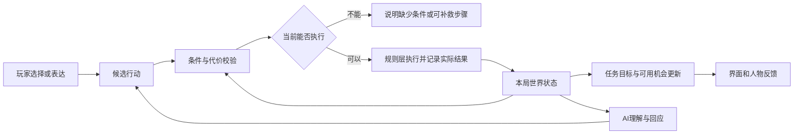

# 社区源码深读与《来自月亮的 Z》实现参考

2026-10-10。重点：时间推进、任务状态、人物关系、道具交互。本文补充既有研究，**没有实现或批准新的游戏功能**。

**项目版本复核：**交付前工作区已有[游戏设计总案 v2](../../docs/游戏设计总案-v2.md)、[核心系统 v2](../../docs/核心系统与数值草案-v2.md)与[AI/状态规格 v2](../../docs/AI与状态规格-v2.md)。以下以其 21 天、四章、分钟＋精力、危险区动作步和关键 Z 视角为当前设计依据；旧 v1 的七天、实时潜行与终局三日切片仅作历史资料。当前设计仍未实现或经试玩验证。本轮提供代码证据和实现补充，不重新批准或撤销 v2 的采用决定。

**核心结论：社区代码最有价值的部分，是揭示“状态读取、动作执行、变化观察、界面表现”之间的边界；它不能替代原作完整规则。对 Z 应保留跨系统因果，并由自己的规则层明确结算。**不要直接移植 Mod 的 Hook、轮询和推定结果作为本项目权威逻辑。

## 1. 本次到底查到了哪一层

| 标记 | 含义 | 本次能支持什么 |
|---|---|---|
| O 原作机制 | 官方产品/机制介绍；历史玩法另标年代 | 时间影响资源与设施；关系开放交易、故事、帮派机会；工具参与探索。详见既有机制研究 |
| D 社区数据 | 2022 Demo 数据、当前可访问资料站 | 实际可读字段、条件与公开资料间差异；未核定资料站对应的游戏 build |
| C 社区实现 | 固定 commit 的 C#、JSON、实际调用处 | 这份插件怎样读写、观察、分派事件；不等于原作全部内部实现 |
| Z 创作建议 | 结合本项目现有边界提出的适配方案 | 可以进入下一轮设计与实现选择；不自动成为已确认需求 |
| V 待验证 | 需要游戏运行或 Z 原型的实验 | 兼容性、回调顺序、数据可达性、玩法手感；本轮未执行 |

社区代码固定于 [ModLoader commit c766a431](https://github.com/LittleCAT8449/BackToTheDawn-ModLoader/tree/c766a431fe1d959e4418b07fe1980b60397b6b33)；历史数据固定于 [Demo commit 86d65435](https://github.com/catchtest/BackToTheDawn-Data/tree/86d65435780fef72e136cd4c52d038b314f4ac16)。本轮下载文本至临时缓存，只做静态阅读；未构建、安装、注入或运行插件。源码引用固定到文件与行号，详细范围见四篇笔记：

| 深读笔记 | 真实追踪到的范围 | 相关机制卡 |
|---|---|---|
| [时间推进](notes/代码深读-时间推进.md) | 时钟 Provider、原生方法的 Postfix、快照比较、载入基线、任务轮询 | K01、K03、K08、K11 |
| [任务状态](notes/代码深读-任务状态.md) | 注册配置、待接取队列、原生任务桥接、目标完成、任务观察与示例 | K05、K10、K11、K12 |
| [人物关系](notes/代码深读-人物关系.md) | 关系字段读取、空值语义、交易/关系观察、推定值与原生值边界 | K04、K09、K12 |
| [道具交互](notes/代码深读-道具交互.md) | 使用前取消、嵌套入口、背包前后差分、部分完成、旧新数据对照 | K02、K03、K05、K07、K08、K11 |

## 2. 时间：保留行动的机会成本，不照搬观察器

**O：**官方确认时间会改变资源和设施可用性；例如专注恢复、饱腹下降、医生下班。普通移动/待机不推进时间的具体依据仍主要来自 EA 资料，本轮没有用社区代码将其升级为所有正式版模式的规则。[官方资源介绍](https://www.cloudedleopardent.com/zh-hans/news/8295/)、[设施介绍](https://www.cloudedleopardent.com/zh-hans/news/8951/)

**C：**`GameContext.Time` 经 Provider 读取 `TimeManage.nowTime`；插件在两个 `GameProcess.PassMinutes` 方法返回后比较时间快照，并通知订阅者。没有看到原生 `PassMinutes` 方法体，也没有完整的原生行动调用者。因此这解释的是“怎样观察时间改变”，没有解释“每种行动为什么扣这些时间”。约 0.2 秒的采样是插件任务日志轮询，不能拿来当原作游戏计时频率。[时间笔记 T01—T09](notes/代码深读-时间推进.md)

**Z：**遵循 v2：活动确认后按游戏分钟与精力结算，危险区移动/操作按明确动作步推进巡逻。应区分三种时间用途，但不建立相互竞争的玩法时钟或额外 AP 池：

| 时间 | 用于什么 | 谁可以推进 |
|---|---|---|
| 故事日程：天/分钟/时段 | 工作、深入调查、正式约谈和机会窗口 | 已确认且实际结算的活动 |
| 高风险操作的动作步 | 巡查、镜头、迁移复核与分阶段操作 | 按预告分钟结算动作步，并推进同一个世界时钟 |
| 技术等待时间 | AI/网络响应、加载、界面阅读 | 用于技术超时；不直接扣玩家故事时间 |

v2 允许 NPC 有视觉循环动作，但其任务位置和机会状态不能因玩家读字或等待 AI 而过期。日程状态与动画表现必须分开；切换到 Z 视角也不能再次扣除同一共享区间的时间。

v2 已提出完整窗口预检、普通活动不暗中过饭点/开播边界、可分段任务单列进度。代码研究补充的是怎样验证这些约定：确认后保存 pending、跨区间按先后处理事件、按实际结果一次提交成本。首个 Demo 可用少量作者定义的窗口；AI 回答耗时、菜单重绘和读取状态都不触发活动结算。

**V：**在目标原作版本核对免费动作、跨营业边界、睡眠/日切和切图耗时；在 Z 原型核对跨窗口预检、加载不扣时、危险动作步、双视角共享时间。时间笔记给出了六个原作实验，均未执行。

## 3. 任务：任务日志应读取事实，而不是制造事实

**O：**官方确认手工任务和多路线结构，但未发布通用任务状态机。原作如何自动结算整项任务，不能由社区 API 名称补全。[官方商店](https://store.steampowered.com/app/1735700/Back_to_the_Dawn/)

**C：**社区将任务定义、原生任务记录、目标状态分开。接取请求进入队列，`Scheduled` 只代表已安排；目标完成接口调用原生方法后回读目标。整个任务的完成/待完成等标志仍来自原生对象。日志变化再由轮询快照推断，可能跳过采样间的中间状态。[任务笔记](notes/代码深读-任务状态.md)

一个值得保留的反例：社区示例的完成文案表示“苹果已送到床边”，但触发代码只观察背包新增苹果；没有实现床边送达或扣除交付。因此 **日志文字、目标标记、世界实际结果是不同证据**。这不代表原作有此问题，也不表示示例不能教学；它提醒我们不要从完成文案倒推出功能已实现。

**Z：**任务目标应使用可检查的事实条件。例如：

| 目标 | 可以据以完成的事实 | 不能单独代替它的信号 |
|---|---|---|
| 获得演出单 | 有来源记录的材料确已进入玩家持有/证据集合 | 点过搜索按钮、对白提到演出单 |
| 让 Z 见到材料 | 一次有效展示或共同查看已发生 | 玩家已持有材料 |
| 让 Z 理解某命题 | Z 对该命题形成的判断及其所依据的共同经历 | 好感增加、播放“我明白了”文案 |
| 打开登记窗口 | 当前有效的维护流程确已开启窗口 | 拿到门卡、身处维护室 |
| 完成迁移 | 本项目规定的传输、外部核验、源端退出与外部继续行动均成立 | 任务打勾、收到文件、迁移 UI 到 100% |

实现上可先分成三份小数据：**任务定义**（文字、目标、前置）、**本局任务实例**（状态、目标、时间）、**世界事实**（人物/设备/物品真实结果）。任务根据事实更新；任务完成后的奖励也要经过实际结算并记录，不能靠重新打开日志重复触发。

**V：**核对接取排队后立即读档、快速接取并完成、多个目标只完成一个、目标完成但整项未结算、任务记录恢复后的奖励去重。先保证日志准确，再讨论更多支线数量。

## 4. 人物关系：把交往变成机会，保留理解与同意的独立性

**O：**原作官方介绍区分个人好感与帮派信任，关系可开放交易内容、故事与协作机会；帮派承诺也有收益与排他性。它支持 K04/K09 的体验联系，不支持把 Z 的理解、意愿和出口条件都压成好感阈值。[官方社交介绍](https://www.cloudedleopardent.com/zh-hans/news/8618/)

**C：**关系 API 是读取快照，桥接从角色字段复制 `Friend`、`Affection` 与上下限，并调用原生模式判断。原生换算与夹断规则不在本仓库。关系变化的部分社区事件直接使用调用参数；交易观察也存在用预期值补足的路径。所以事件里的 `RelationshipDelta` 不能一概视为已经确认的净变化，查询为空也不等于所有关系为零。[人物关系笔记](notes/代码深读-人物关系.md)

**Z：**建议用“关于谁、关于什么、因为什么经历、愿意做哪一步”的结构，而非一个通用好感数：

| 状态 | 示例 | 对玩法的具体作用 |
|---|---|---|
| 已知事实 | Z 亲眼核验了某次事故是预先安排的 | 她可据此质疑一个解释 |
| 命题判断 | 接受节目存在安排，仍未接受自身身份结论 | 后续谈话能针对具体疑问 |
| 对玩家的信任依据 | 玩家兑现了一个小约定，或承认了自己不知道的事 | 愿意透露顾虑、讨论下一步 |
| 行动约定 | 在某时段到指定位置核验一件事 | 产生一项可执行安排 |
| 合作意愿 | 当前同意尝试某条计划，附有停止条件 | 允许分工，不凭空产生出口 |

AI 可提出解释、回应和行动意向；确定性规则检查证据、权限、时间与可执行动作。对 Z 的承诺最好记录对象、内容、来源事件、有效窗口、取消/履行状态，让失约或环境改变有具体后果。

不需要一开始模拟所有情绪或完整心理学模型。先验证一项共同经历能否改变一项真实行动。友情与恋爱也不应被当成同一数值到达另一阈值，本次没有为这部分确定系统方案。

**V：**重复展示同一材料是否重复增长、玩家声称与共同核验是否分开、理解真相但拒绝合作是否可表达、兑现/失约是否改变具体机会，以及读档后共同记忆是否和世界状态一致。

## 5. 道具：把用途连接到对象和后果，而非只有物品栏

**D：**同编号 137 的螺丝刀，2022 Demo 表与本次资料站显示的配方、制作时间和耐久存在差异；但两者都让工具连接制作、探索与战斗。值得保留的是系统联系，数值须按版本核对。资料站的对应钥匙也明确服务特定库房，说明“持有钥匙”之外还需要“它能作用于哪个目标”。[道具深读 I06—I07](notes/代码深读-道具交互.md)

**C：**社区在使用前允许取消，再分别报告使用结果和实际背包差分。库存增减可以部分完成；部分使用事件按请求数报告消耗；位置移动又与数量变化分开。这里有可借鉴的结果结构，也有不能当权威事实的观察近似。[道具深读 I01—I05](notes/代码深读-道具交互.md)

**Z：**物品定义、具体持有、目标适配、操作权限、场景结果分别处理。以灯塔转接器为例：

```text
获准进入维护室
  → 检查是否可领取转接器
  → 领取成功，记录持有与领用痕迹
  → 在正确目标上执行接线
  → 目标确已接通
  → 再判断登记窗口、接收端和 Z 的参与条件
```

这沿用最新地点 UI 的“进入许可有范围、领取会留记录、拿道具不等于迁移”的边界。接通设备后是否消耗或留置转接器，属于下一轮动作设计，应明确选择，不能从社区 `ConsumedCount` 推定。

首个 Demo 的重点是少量物品具有清楚且可复用的用途。背包格子、重量、耐久和完整合成树均可在它们确实产生选择时再加入。

**V：**取消是否扣费、重复确认是否重复领用、错目标/失效许可是否拒绝、接通后存读档是否保留、道具变更是否被误当迁移成功。详见道具笔记 IV01—IV06。

## 6. 四个系统如何在 Z 中合起来

以下是**实现研究补充，不是原作架构**。它与 v2 的规则/状态分工一致；完整游戏按 21 天设计，首个 D1—D3 Demo 主要验证认识与主动邀约，约 30—40 分钟只是设计预算。后期灯塔与迁移用作系统边界例子，不纳入首个 Demo 的必做范围。



### 6.1 最小状态组织

| 数据 | 最少包含 | 解决的问题 |
|---|---|---|
| WorldState | 本局/存档标识、加载代次、状态版本 | 旧异步结果不能写入新的局面 |
| ClockState | 天、分钟、时段、事件窗口、动作区间 | 普通活动与危险动作共用时钟；视角切换不重复扣时 |
| ActorState | 当前控制者、角色位置、独立物品/能力/知情范围 | 操作者看见 Z 视角不等于玩家角色已收到信息 |
| FactState | 事实 ID、来源、谁知道/谁核验过、相关事件 | 传闻、物品持有与共同经历分开 |
| AgreementState | 人物、约定动作、时间条件、状态、依据 | 关系产生具体可兑现的协作 |
| PermissionState | 主体、地点/操作、有效窗口、来源 | 门卡不自动授权所有设备操作 |
| ItemState | 定义 ID、实例/数量、持有/位置、必要属性 | 听说、拥有、装备、留置不混淆 |
| QuestState | 定义 ID、本局实例、目标条件与结果 | 日志读取实际进展 |
| ActionReceipt | 请求 ID、行动、实际成本/效果、结果 | 重复点击、重复回调可识别，错误可追溯 |

这是一种拆分思路，可以先保存在一个本地状态对象和存档中。没有必要为每一行建立独立服务、数据库或复杂事件溯源基础设施。

### 6.2 单次动作的处理约定

1. **预览**：根据当前状态显示已知成本、可执行性与可预见机会损失。
2. **确认时复核**：检查世界版本、时间窗口、物品、权限与人物当前约定；预览不是永久有效许可。
3. **按动作规则结算**：短动作统一提交它的成本与结果；若会跨强制事件，明确允许完成、拒绝开始还是中断，并按预设顺序处理。不能让多个 UI 监听器各自扣一次时间。
4. **记录实际结果**：区分未确认拒绝、按预告规则提交的失败结果、完成和已启动的持续操作；不把社区 API 的 `Partial` 直接作为 Z 的事务设计。迁移维护独立阶段和中断原因，每步成本与结果仍完整提交。
5. **更新任务和反馈**：基于已提交的世界状态更新日志、可用行动和人物表达。失败也应说明发生过什么、仍保留什么。

首个 Demo 可验证：咖啡馆工作结算时间、精力和收入 → 买到节目准备所需的物品 → 夜间用真实准备产生一次有效互动 → 履行小承诺 → Z 的短视角节点发出邀约。v2 已为不同工作规定限定机会，访问凭证应记录范围和期限，不能把岗位权限泛化成所有区域可进。灯塔取用、接线和迁移链放到后期路线验证。

双视角执行按 v2 的区间契约：只有从同一起点独立发生的动作才能在汇合时取较晚完成时刻；若一侧等待另一侧送达消息，必须从真实收到消息以后继续。现成社区插件没有提供此能力，本段是对 Z 规格的实现提醒。

### 6.3 读档和异步 AI 的边界

社区代码里有几处静态风险值得反向借鉴：载入时旧时间/地图基线可能残留，待接取队列没有明确存档作用域，轮询可能合并短时间变化。这些是**条件性风险，未复现为原作或插件 bug**，具体证据在时间/任务笔记。

Z 可采用简单做法：开始读档时增加 `loadEpoch`、取消待执行输入与过期异步请求；恢复世界、任务、道具、人物经历和约定；校验一致性后再开放操作。AI 请求携带本局标识、加载代次和它所依据的状态版本；返回时再次检查，过期结果不能凭空兑现旧约定。正常的“稍晚回答”如何保留上下文可单独设计，但已过期的世界操作必须重新判定。

存档应保存实际状态和共同经历，而不只保存聊天文本；重复请求标识随相应存档状态一致恢复。合法的局部重试可回到当时状态，不应被跨周目的去重表错误阻止；旧周目记忆也不应无声进入新局。

## 7. 下一次验证的优先顺序

| 优先级 | 在何处验证 | 一条最小实验 | 为什么先做 |
|---|---|---|---|
| P0 | Z 原型 | 确认一次工作，重复点击/回调，再存读档 | 证明时间、钱、任务只按真实动作结算 |
| P0 | Z 原型 | 有材料但 Z 不理解；理解但不愿合作；合作但无出口 | 验证主体验依赖的状态没有被合并 |
| P0，后期路线 | Z 原型 | 灯塔取用、接线、登记、迁移分别失败一次 | 证明道具与设备操作不会跳过主线条件；不塞进 D1—D3 Demo |
| P0 | Z 原型 | AI 回答返回前载入另一存档 | 证明旧响应不会修改新局面 |
| P1 | 原作目标版本 | 免费观察、耗时活动、跨窗口、工具多用途对照 | 补齐社区代码无法提供的原作运行规则 |
| P1 | 社区插件测试环境 | 关系上限、部分库存操作、快速任务变化与跨存档队列 | 评估该插件能否作为可靠观察工具 |

所有上述验证目前均待执行。研究可以为实现提供明确规格和风险线索，但不能替代试玩对选择、公平性、节奏与人物可信度的检验。

## 8. 继续研究与实际开发的入口

- [源码核查清单](notes/源码核查清单.json)：固定版本引用文件的路径、SHA-256 和被引用行段，用于复核文本来源；不是可运行源码包。
- [开发参考导航](../../docs/开发参考导航.md)：按开发主题进入本报告或详细证据。
- [机制采用记录](../../docs/机制采用记录.md)：四个系统的建议保持研究候选，待具体任务选择；之后再补实现位置和验证证据。
- [当前 v2 总案](../../docs/游戏设计总案-v2.md)、[核心系统与数值草案](../../docs/核心系统与数值草案-v2.md)、[AI 与状态规格](../../docs/AI与状态规格-v2.md)：Z 的当前设计依据优先于类比推断。旧[地点 UI](../../ui/locations-v1/README.md)仅保留其地点分工与交互边界参考。
