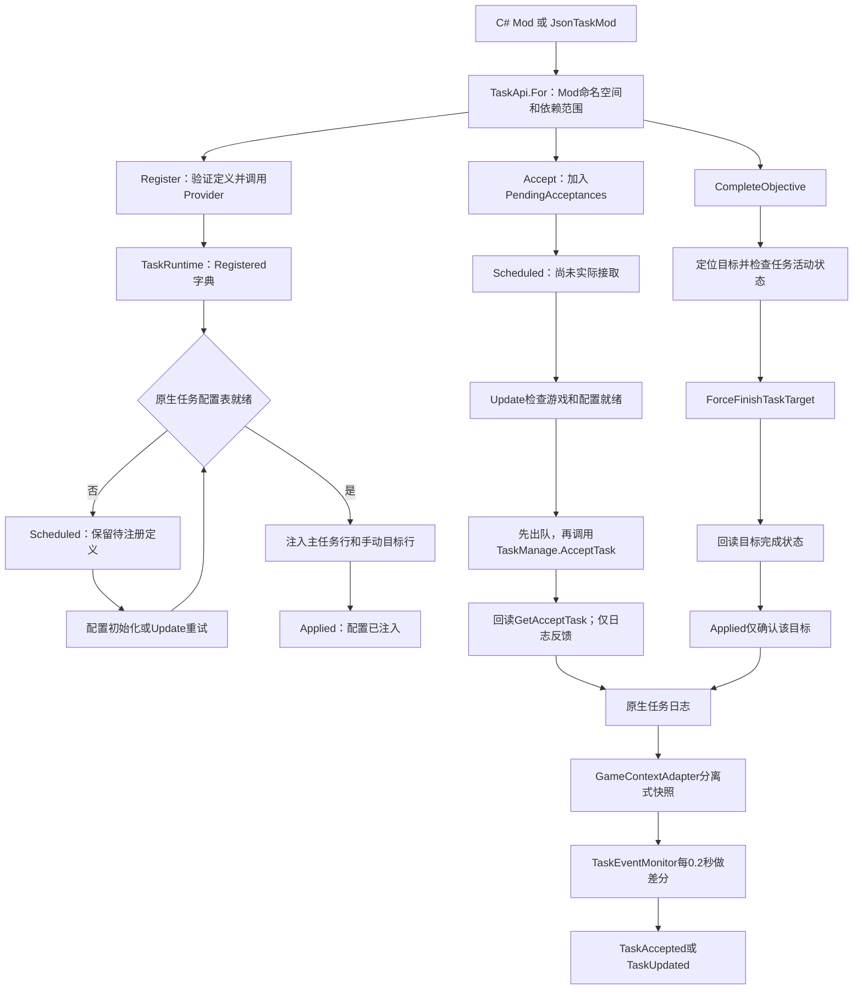

# 社区代码深读：任务定义、任务状态与世界事实

研究日期：2026-10-10。研究对象为社区仓库 [LittleCAT8449/BackToTheDawn-ModLoader](https://github.com/LittleCAT8449/BackToTheDawn-ModLoader) 的固定 commit `c766a431fe1d959e4418b07fe1980b60397b6b33`。本轮静态阅读父任务准备的只读文本缓存 `/tmp/bttd-research-20261010/modloader`，未构建、运行插件或游戏，未读用户存档，未执行测试。

**这是一份社区适配层源码研究，不是《动物迷城》官方源码分析。** 下文的 `TaskManage`、`TaskDetail`、`TaskTargetManage` 为此社区代码所调用的游戏侧类型；方法体不在本次实读源码内。能确认社区层如何调用与核验，不能因此确认原生方法全部语义、当前游戏版本兼容性或磁盘存档格式。

本轮已读根 `AGENTS.md`、研究入口及开发参考导航；关联 K05（不同条件通向同一障碍）、K10（共享准备与路线切换）、K11（失败与补救）、K12（逃离与故事分别结算）。Z 的现有设计约束来自当前玩法稿和较新的地点说明，候选建议不改变现有需求或机制采用状态。

## 1. 最值得带走的结论

1. **注册、排队接取、实际接取、目标完成、整项任务完成、世界行动完成，是六个不同层次。** `Succeeded` 包含 `Scheduled`，因此不能用于统一显示“已完成”。[Q01][Q02][Q03][Q05]
2. **这个接口是手动目标适配器。** 社区把每个自定义目标注入为无法自然到达的地图目标，之后由 Mod 自己判断条件并强制完成；没有在 JSON 中声明并执行任意条件图。[Q04][Q05][Q07]
3. **任务文案能超前于世界事实。** 苹果示例在“获得苹果”事件后完成目标，而整任务完成文案描述已经交付到病床。实读实现没有扣除苹果、检查医务室位置或让 NPC 接收。[Q11] 这说明静态文案和目标勾选本身不是世界行为证据。
4. **社区任务事件是 0.2 秒快照差分，不是完整事件流水。** 读档建立基线，不将旧任务重放为新接取；轮询间发生的短暂状态和记录消失没有完整报告。[Q08][Q09]
5. **持久化主要依赖原生任务记录。** 本次任务链中没有独立的 Mod 任务存档、请求回执账本或稳定 ID 映射文件。定义从 Mod 重新加载，完成状态从原生日志读取；这与证明跨进程、跨版本、卸载 Mod 后完整恢复是两回事。[Q03][Q04][Q09][Q10]

## 2. 实际调用链

这张图只描述所读社区代码。整项任务何时交付、是否发奖励、所有目标完成后如何自动结算，不能从原生方法名补全。

### 谁接上了 Provider

- `Plugin.Load` 将任务查询 Provider 接到 `GameContextAdapter`；`TaskRuntime.InstallProviders` 接上注册、接取、完成目标三个写接口。[Q02]
- 启用生命周期钩子时，`Harmony.PatchAll` 安装当前程序集补丁。任务配置初始化后尝试注入；进入可控制场景后标记 GameplayReady，再建立事件基线，最后通知 Mod。[Q02][Q09]
- `TaskEventMonitorRunner.Update` 先调用 `TaskRuntime.Tick`，再调用事件监控 `Tick`。因此同帧接受任务可被后者观察，但监控仍受 0.2 秒采样间隔约束。[Q08]
- 所读实现没有独立命名为 TaskBridge、TaskRegistry 或 TaskPersistence 的任务组件：原生桥接、注册字典和接取队列主要集中在 `TaskRuntime`，不要凭接口名称虚构多层架构。

## 3. 从定义到配置：注册不是接取

### 定义和命名

`TaskApi.For(context)` 记录当前 Mod ID 及声明的依赖命名空间。注册只能使用自己的命名空间；接取和推进可以访问自己或声明依赖的任务。键的底层规范化会去空白、转小写并限制字符。[Q01][Q13]

注册定义包含任务键、名称、说明、类别与手动目标列表。名称/说明不能为空，目标至少 1 个、至多 64 个，目标本地 ID 不得重复；**64 是此社区接口的验证约束，不是本次证明的原作上限**。不满足条件可能直接抛异常，并非都返回 `InvalidDefinition`。[Q01]

JSON 路径先解析全部符合 `type=task` 的文件并验证，再逐个注册；支持 schemaVersion 1、注释和尾随逗号。C# Mod 的 JSON 定义在 `IMod.Initialize` 前加载，数据型 Mod 则由 `JsonDataMod.Initialize` 加载。后续初始化失败由 ModHost 调用任务注销清理。[Q07][Q10]

### 注入方式

社区为 `namespace:path` 的 SHA-256 片段生成原生整数 ID，遇到配置碰撞时逐个试下一个 ID，最多尝试 10,000 次。主任务行的动作、交付 NPC、时限、奖励等字段为空或零；目标数组按顺序分配 `index+1` 的原生编号。[Q04]

每个自定义目标使用 `TaskTargetType.ArriveMap`，目标值为 `2147483647`。代码注释解释，这是为避免未知目标类型被原生系统丢弃而使用的哨兵值；**“未知类型会怎样处理”在这里是社区作者的兼容性说明，未通过本轮游戏实测独立验证**。在对外快照中，社区又把这些目标呈现成 `Manual`。[Q04][Q08]

实际写入包含主任务 List/Dictionary、目标 List 与按任务分组的 Dictionary。注入期间发生异常，会回滚已加入的行。立即注册路径的 `TryApply` 异常会向调用者传播；Update 的待注册路径捕获异常、记录错误并移除注册项。两条路径的错误表现并不相同。[Q03][Q04]

注册成功仅表示任务配置可供原生任务系统使用，**没有因此创建世界物品、打开区域、消费资源、接受任务或完成目标**。

## 4. 接取、完成及失败语义

| 操作/结果 | 社区代码实际保证 | 尚未保证的内容 |
|---|---|---|
| `Register → Scheduled` | 定义已经进入本进程注册字典，等待配置表可写 | 原生配置存在、日志可见、重启后请求仍存在 |
| `Register → Applied` | 配置表注入路径已完成 | 玩家已经接取该任务 |
| `Accept → Scheduled` | 接取请求在队列内；同键再次请求仍返回 Scheduled | 原生系统接受成功；以后一定重试到成功 |
| `Accept → AlreadyExists` | 活动或历史任务列表中找到同原生 ID | 它当前仍可做；它是成功、失败还是放弃记录 |
| `CompleteObjective → Applied` | 调用强制完成后，原生目标查询返回完成 | 全任务完成、奖励交付、相应物理行动发生 |
| `CompleteObjective → AlreadyExists` | 目标查询已完成，不重复执行强制完成 | 本次请求刚刚产生了一个新世界结果 |
| `RuntimeUnavailable` | Provider 缺失，或完成目标时未在可玩状态 | 任务不存在或永久失败 |
| `NotFound` | 当前注册/目标/活动记录未找到 | 该世界行动永远不可做；数据加载失败与不存在已被全面区分 |
| `Failed` | 完成目标抛异常，或回读未确认完成 | 请求此前完全没有副作用 |

来源：[Q01][Q03][Q05]。`Succeeded` 只检查 `Scheduled` 或 `Applied`；`AlreadyExists` 返回 false。调用者若要“确保已存在”的幂等语义，需单独处理 AlreadyExists，不能把它与全新执行成功混为一谈。

### 实际接取是在下一步完成的

`Accept` 先查注册，再查活动与历史记录，然后按任务键去重排队。`Tick` 等待 GameplayReady 和配置 `Applied` 后，**先从列表移除请求**，再调用 `AcceptNative`。[Q03]

`AcceptNative` 再次去重，调用 `TaskManage.AcceptTask` 并回读 `GetAcceptTask`。回读为空仅记警告；异常仅记错误。这一方法没有返回 `TaskMutationResult`，没有对调用方发最终失败回执，也没有将失败请求重新排队。[Q06]

因此，排队成功后需要通过原生任务快照或后续任务事件确认实际接取；但任务事件的轮询限制意味着“未收到事件”也不能反向证明接取失败。

### 目标完成与任务完成分开

`CompleteObjective` 找目标本地 ID，再换成位置编号；要求游戏可玩且 `GetAcceptTask` 能找到活动任务。已有完成标记则返回 AlreadyExists；否则 `ForceFinishTaskTarget(..., isShowLogTips:true)`，之后回读 `IsFinishTaskTarget`。[Q05]

**这个调用链没有 `CompleteTask` 方法。** 快照同时读取 `TaskDetail.IsFinished()` 与 `IsToBeCompleted()`，再保留失败、放弃、超时、中止等标志。只能说明适配层没有把这些状态折叠成一个布尔量；不能从方法名断言原生任务的提交/奖励顺序。[Q01][Q08]

`isShowLogTips:true` 是让原生方法显示提示的参数，日志是对这次调用及回读结果的解释；它不验证“苹果已送达”“人物已知情”等叙事事实。成立哪些世界条件，完全取决于调用完成接口之前的 Mod 逻辑。

## 5. 苹果示例：UI 与世界事实之间的具体缺口

| 层次 | 静态证据 |
|---|---|
| 定义的目标 | JSON 唯一目标为获得苹果；完成目标描述说已找到，可以送医务室。[Q11] |
| 实际触发 | C# 只接受成功的库存 Added 事件，且 Delta>0、ItemKey=苹果，就调用完成目标。[Q11] |
| 整任务完成文案 | JSON 描述苹果已送至病床并得到病号回应。[Q11] |
| 本次未见实现 | 无交付地点检查、无接收对象检查、无苹果扣除、无NPC行为确认，也无“先持有苹果再接任务”的初始状态核对。 |

结论是**该示例的叙事文案比已实现条件更强**，并非已经证明游戏本体的交付任务同样如此。其 `CompletedDescription` 是否在当前原生任务结算中按预想时间显示，也仍需运行验证。

对 Z 的直接启示：不能让“玩家捡到演出单”事件直接完成“Z 已理解真相”，更不能让任务完成文案代替她同意行动或迁移执行。获得、展示、核验、理解、愿意、执行必须在相应边界结算；是否采用什么技术形式仍是候选设计。

## 6. 读档、持久化、事件与去重

### 静态可见的读档顺序

1. `ReadArchiveDataAndStartGame` 前置补丁将 GameplayReady=false，重置任务监控并发布 ArchiveLoadStarted。[Q09]
2. 方法返回时只发布 ArchiveLoadInvocationReturned；代码没有把它视为已可操控游戏。[Q09]
3. `ShowCurrentMapAndCanControl` 后置补丁设置 GameplayReady=true；尝试注入待处理定义和补本地化；建立任务基线；最后发布 GameplayReady。[Q09]
4. 任务示例在 GameplayReady 时重新请求接取各任务，已有活动/历史记录由 `HasTaskRecord` 阻止再次接受。[Q06][Q11]
5. `TaskEventMonitor.BeginSession` 直接把当前日志设为基线，不把存档里的旧任务播成新接取；后续才开始差分。[Q08]

### 实际保存了什么、还不知道什么

本次读取的任务文件只包含内存注册字典、待接取列表和快照基线；没有任务专用序列化或写盘。原生任务记录的读取通过 `TaskManage`，但其底层磁盘读写实现不在缓存中。源码的防孤儿处理是：注销 Mod 时若当前任务列表含记录，就保留配置；整体 TaskRuntime.Reset 清字典和队列，却刻意不删除已注入行。[Q03][Q06]

这只能支持“尽量维持当前会话内原生记录的配置引用”，**不能支持“扫描了所有存档”“卸载 Mod 后仍可恢复”“跨版本目标 ID 不变”**。`HasTaskRecord` 查的是当前运行时的活动/历史列表，没有遍历磁盘上每个档案。[Q06]

### 事件不是事务日志

`TaskEventMonitor` 使用 `(TaskId, StartDay, TaskType, 同身份出现次序)` 作为比较键。新出现且仍活动的记录触发 Accepted；原有记录字段变化触发 Updated。来源标签由快照比较推断，按放弃、失败、超时、中止、完成、目标变化等顺序选一个标签。[Q08]

由代码可推出以下限制，均未实机复现：

- 若接取与完成都发生在两次轮询之间，且上一快照不存在该任务，当前记录又已非活动，则既不发布 Accepted，也不走旧记录 Updated。
- 当前快照中消失的记录没有专门删除/撤销事件。重复任务同身份排序变化可能改变 occurrence 对应关系。
- `CaptureAllTasks` 实际只调用原生历史列表；是否包含所有活动任务取决于原生方法语义，不能由 AllTasks 名称补全。
- API 查询遇未就绪/异常可返回空集合；单条 TaskSnapshot 失败也可被跳过。因此空集合不等于世界确实没有任务。
- 订阅者异常被捕获并记录后继续通知其他订阅者；没有订阅失败重放、确认或事务回滚。[Q08][Q12]

## 7. 条件性风险：不把静态发现写成已复现 Bug

| 情境 | 已读实现依据 | 条件性风险/推断 | 仍需验证 |
|---|---|---|---|
| 排队后切换存档 | 待接取项只有 owner/requester/key；读档补丁不清该列表。[Q03][Q09] | 原会话未处理请求可能在下一存档可玩时执行。 | 在A档排队、执行前加载B档，观察实际接受位置；确认其他原生流程有无阻断。 |
| 原生配置表被重新初始化 | ApplyPendingRegistrations只遍历 `!Applied`；生命周期入口没有使已应用项失效。[Q03][Q04][Q09] | 如果原生表在同进程重建，旧 Applied 项可能不重新注入；IsStillApplied虽存在，却不被已应用项常规调用。 | 验证原生InitConfig会否真重建任务表，以及插件实际生命周期。 |
| Mod热重载或碰撞顺序变化 | ID基于哈希，冲突时顺延；Reset留原生行却清注册表，没有写入稳定映射。[Q03][Q04] | 相同逻辑键在留有旧行或不同碰撞顺序时可能得到新数字ID，影响旧记录关联。 | 重载同一键、构造碰撞、交换装载顺序后读旧档。 |
| 修改任务目标数组顺序 | 原生目标编号是数组位置+1，不是持久化本地ID。[Q04][Q05] | 若游戏按原生序号保存进度，重排目标可能错配既有完成记录。 | 改序后读档，检查每条目标的完成与时间；原生存档表示仍待确认。 |
| 注入异常 | TryApply有行回滚；Update捕获后移除注册；立即Register未统一包装异常。[Q03][Q04] | 调用者收到的异常/结果不一致；不能只检查 `Succeeded`。 | 在每个注入阶段模拟失败，验证无半写入以及后续能否再注册。 |
| 已有苹果才接受任务 | 示例只监听之后的Added事件。[Q11] | 持有状态已满足但不会自动完成，除非再出现符合条件事件。 | 读档已持有物品、之后丢失、重复获得分别观察。 |

这些问题有创作参考价值，但本轮并未向仓库提交漏洞结论或补丁，也没有证明它们出现在某个具体玩家版本。

## 8. 四栏结论：原作、社区、Z 候选、待实机

| 主题 | 原作证据范围 | 社区实现已读事实 | Z 的候选建议 | 待实机或原型验证 |
|---|---|---|---|---|
| 任务定义与实例 | 通过桥接调用能看见配置与活动记录分离；未读原生方法体 | Register注入表、Accept另排队 | 作者任务定义、每局状态和请求回执分开 | 原生接取何时持久化，Z重启恢复路径 |
| 阶段完成 | 快照读到目标/待完成/已完成/失败等不同字段 | CompleteObjective只回读目标完成 | 证据、理解、同意、出口、迁移分别写入有来源的事实 | 一项变化是否误带动其他维度 |
| 世界行动 | 无本次实机证据证明日志与每次物理交互一致 | 苹果示例只有Added事件，没有交付 | 文案从已提交事实生成；权限和物品由确定性规则结算 | 有苹果未交付、有证据未展示、收到文件未恢复运行 |
| 去重 | 原生接受重复任务的全面规则未知 | 注册按键去重，接受查当前活动/历史、目标查完成标记 | 按本局+行动ID幂等；重复命令返回已发生的事实 | 相同动作重发是否重复耗时/扣物/给权限 |
| 读档与事件 | 原生存档格式与事件重放未知 | 读档设快照基线，0.2秒轮询差分 | 读档恢复状态后重建UI；不将旧事件再应用一次 | 不重复奖励、不跨存档接受、不让旧周目记忆污染新局 |
| 失败与恢复 | 原生多种任务状态被读取，具体迁移未知 | 返回值、日志、快照分别承担部分反馈 | 命令失败、任务失败、角色拒绝和系统不可用分开 | UI能否说明可恢复的是哪个条件 |

## 9. 面向 Z 的最小候选结构

当前项目已经要求事实与结果分立。交付前已复核工作区新增的[AI 与状态规格 v2 第 1—3、9—10 节](../../../docs/AI与状态规格-v2.md)与[剧情路线 v2](../../../docs/剧情路线与角色视角-v2.md)；它们替代初读时的 v1 作为当前依据。以下提供实现研究补充，未修改这些设计规则或将其升级为已实现。迁移属于后期路线，不是 D1—D3 首个 Demo 的必做内容。

| 独立状态 | 建议写入依据 | 不足以使其成立的信号 |
|---|---|---|
| `EvidenceOwned` | 本局世界物品/记录取得结果，含来源 | AI说玩家应该有某材料 |
| `EvidenceVerifiedByZ` / `Understanding` | Z实际接触材料、本人核验及所理解命题的记录 | 玩家独自捡到材料；一次含糊回应 |
| `WillingToCooperate` | 在具体风险与计划范围内明确选择 | 已理解身份；亲密度高；任务接取成功 |
| `ExitOpportunityValid` | 当次维护窗口、权限范围、接收端兼容条件 | 持有门卡；进入灯塔；对话中声称授权 |
| `MigrationCompleted` | 当前状态到达、接收端恢复并核验、源端本次运行退出、外部行动继续 | 请求排队、显示进度100%、出现头像或任务完成提示 |

建议任务日志成为这些事实的派生展示，AI 负责解释和提出候选行动；一条被接受的建议只有通过确定性规则及执行回执，才能改写世界事实。可以用明确的命令结果如 Requested / Rejected / Applied / Verified 区分阶段；不要为了模仿社区 API 直接复用其把 Scheduled 算 Succeeded 的用户语义。

K05/K10 的适配是共享已获得的材料和已建立的理解，但每条路线重新验证当次权限、窗口和代价；K11 的适配是失败时保留仍真实成立的事实；K12 的适配是将离岛与实际迁移成功分别结算。这里的状态名称仅为候选模型，不意味着需要建立复杂事件溯源框架或引入某一现成库。

## 10. 验证用例：本轮未运行

| 编号 | 前置/动作 | 期望可观察结果 | 失败说明什么 |
|---|---|---|---|
| V01 证据不自动传播 | 玩家取出演出单，尚未向Z展示 | 仅EvidenceOwned成立；Z能合理表示尚不知情 | 库存事件被错误升级为角色理解 |
| V02 理解不自动同意 | Z亲自核验后判断外部方案仍不可靠 | 理解记录保留，合作状态拒绝/待定；出口可单独准备 | 对话进度或任务勾选替代角色意愿 |
| V03 门卡不等于迁移许可 | 门卡开门，但维护登记窗口关闭 | 可进入允许区域；迁移请求被具体拒绝 | 把空间权限与操作授权合并 |
| V04 已排队后切档 | A局提交尚未执行的出口/迁移操作，马上读B局 | B局不执行A请求；UI不显示Applied | 请求缺少run/archive/session作用域 |
| V05 迁移末段失败 | 已传输数据，但接收端核验失败或源端未退出 | 不给成功结局；明确仍未完成的阶段 | 文案、百分比或文件存在被当作成功事实 |
| V06 重复请求 | 同行动ID重复发出领取/交付/授权命令 | 最多扣一次资源、写一次事实；返回同一结果 | 去重只限UI或事件监听器 |
| V07 存档已满足状态 | 读入已持有目标物的存档，然后接受相关任务 | 根据明确规则核对现有状态；不要求制造一次假Added事件 | 仅靠瞬时事件，没有状态对账 |
| V08 快速接受再完成 | 在一个0.2秒窗口内接受并完成社区任务 | 快照最终正确；若事件漏报能被检测，不能依赖其发唯一奖励 | 把轮询差分当可靠事件链 |
| V09 任务配置升级 | 重排目标定义后读旧档 | 按稳定逻辑ID迁移或明确拒绝不兼容数据 | 用位置索引当长期身份 |
| V10 重试与新周目 | 读阶段档与开新局分别执行 | 阶段档恢复对应事实；新局不继承未经定义的Z记忆 | 缓存/任务历史跨局污染 |

V01—V07、V09—V10 是未来 Z 原型候选验收；V08及表7相关用例适合社区桥接兼容性研究。它们都不是本轮已通过的测试。

## 11. 固定版本来源登记与实际读取范围

所有 Q 编号均指上述同一 commit；`#Lx-Ly` 为稳定行号链接。本次全文读取的社区文件不会因此升级为原生游戏源码。

| ID | 固定来源与读取范围 | 支撑内容 |
|---|---|---|
| Q01 | [TaskApi.cs L1—252](https://github.com/LittleCAT8449/BackToTheDawn-ModLoader/blob/c766a431fe1d959e4418b07fe1980b60397b6b33/src/BackToTheDawn.ModAPI/TaskApi.cs#L1-L252)；[TaskRegistration.cs L1—102](https://github.com/LittleCAT8449/BackToTheDawn-ModLoader/blob/c766a431fe1d959e4418b07fe1980b60397b6b33/src/BackToTheDawn.ModAPI/TaskRegistration.cs#L1-L102)，均全文 | Provider接口、命名空间、验证、快照、结果状态 |
| Q02 | [Plugin.cs L50—74](https://github.com/LittleCAT8449/BackToTheDawn-ModLoader/blob/c766a431fe1d959e4418b07fe1980b60397b6b33/src/BackToTheDawn.Loader/Plugin.cs#L50-L74)、[L126—149](https://github.com/LittleCAT8449/BackToTheDawn-ModLoader/blob/c766a431fe1d959e4418b07fe1980b60397b6b33/src/BackToTheDawn.Loader/Plugin.cs#L126-L149)、[L172—187](https://github.com/LittleCAT8449/BackToTheDawn-ModLoader/blob/c766a431fe1d959e4418b07fe1980b60397b6b33/src/BackToTheDawn.Loader/Plugin.cs#L172-L187)、[L251—267](https://github.com/LittleCAT8449/BackToTheDawn-ModLoader/blob/c766a431fe1d959e4418b07fe1980b60397b6b33/src/BackToTheDawn.Loader/Plugin.cs#L251-L267) | Provider装配、Hook安装、Runner、清理 |
| Q03 | [TaskRuntime.cs L20—211](https://github.com/LittleCAT8449/BackToTheDawn-ModLoader/blob/c766a431fe1d959e4418b07fe1980b60397b6b33/src/BackToTheDawn.Loader/TaskRuntime.cs#L20-L211)、[L287—312](https://github.com/LittleCAT8449/BackToTheDawn-ModLoader/blob/c766a431fe1d959e4418b07fe1980b60397b6b33/src/BackToTheDawn.Loader/TaskRuntime.cs#L287-L312) | 注册字典、接受队列、执行先出队、异常与注销 |
| Q04 | [TaskRuntime.cs L11—18](https://github.com/LittleCAT8449/BackToTheDawn-ModLoader/blob/c766a431fe1d959e4418b07fe1980b60397b6b33/src/BackToTheDawn.Loader/TaskRuntime.cs#L11-L18)、[L314—522](https://github.com/LittleCAT8449/BackToTheDawn-ModLoader/blob/c766a431fe1d959e4418b07fe1980b60397b6b33/src/BackToTheDawn.Loader/TaskRuntime.cs#L314-L522) | 原生配置注入、手动目标哨兵、回滚、ID分配 |
| Q05 | [TaskRuntime.cs L213—284](https://github.com/LittleCAT8449/BackToTheDawn-ModLoader/blob/c766a431fe1d959e4418b07fe1980b60397b6b33/src/BackToTheDawn.Loader/TaskRuntime.cs#L213-L284) | 完成目标前检查、强制完成和回读 |
| Q06 | [TaskRuntime.cs L524—741](https://github.com/LittleCAT8449/BackToTheDawn-ModLoader/blob/c766a431fe1d959e4418b07fe1980b60397b6b33/src/BackToTheDawn.Loader/TaskRuntime.cs#L524-L741) | 接受原生任务、当前/历史去重、本地化、移除与类别映射；TaskRuntime总计L1—741已全文读 |
| Q07 | [JsonTaskMod.cs L1—247](https://github.com/LittleCAT8449/BackToTheDawn-ModLoader/blob/c766a431fe1d959e4418b07fe1980b60397b6b33/src/BackToTheDawn.Loader/JsonTaskMod.cs#L1-L247)；[JsonDataMod.cs L1—41](https://github.com/LittleCAT8449/BackToTheDawn-ModLoader/blob/c766a431fe1d959e4418b07fe1980b60397b6b33/src/BackToTheDawn.Loader/JsonDataMod.cs#L1-L41)，均全文 | JSON验证、顺序、装载与注册 |
| Q08 | [TaskEventMonitor.cs L1—176](https://github.com/LittleCAT8449/BackToTheDawn-ModLoader/blob/c766a431fe1d959e4418b07fe1980b60397b6b33/src/BackToTheDawn.Loader/TaskEventMonitor.cs#L1-L176)，全文；[GameContextAdapter.cs L60—209](https://github.com/LittleCAT8449/BackToTheDawn-ModLoader/blob/c766a431fe1d959e4418b07fe1980b60397b6b33/src/BackToTheDawn.Loader/GameContextAdapter.cs#L60-L209)，另读L1—59、1233—1255 | 原生快照、Manual呈现、轮询、差分与异常空值 |
| Q09 | [GameLifecyclePatches.cs L1—95](https://github.com/LittleCAT8449/BackToTheDawn-ModLoader/blob/c766a431fe1d959e4418b07fe1980b60397b6b33/src/BackToTheDawn.Loader/GameLifecyclePatches.cs#L1-L95) | 配置/菜单/读档/可玩边界 |
| Q10 | [ModHost.cs L1—104](https://github.com/LittleCAT8449/BackToTheDawn-ModLoader/blob/c766a431fe1d959e4418b07fe1980b60397b6b33/src/BackToTheDawn.Loader/ModHost.cs#L1-L104)、[L148—203](https://github.com/LittleCAT8449/BackToTheDawn-ModLoader/blob/c766a431fe1d959e4418b07fe1980b60397b6b33/src/BackToTheDawn.Loader/ModHost.cs#L148-L203) | 依赖初始化、C#前加载JSON、失败/关闭时清理 |
| Q11 | [TaskApiExampleMod.cs L1—18](https://github.com/LittleCAT8449/BackToTheDawn-ModLoader/blob/c766a431fe1d959e4418b07fe1980b60397b6b33/examples/BackToTheDawn.TaskApiExample/src/main/TaskApiExampleMod.cs#L1-L18)、[L150—228](https://github.com/LittleCAT8449/BackToTheDawn-ModLoader/blob/c766a431fe1d959e4418b07fe1980b60397b6b33/examples/BackToTheDawn.TaskApiExample/src/main/TaskApiExampleMod.cs#L150-L228)；[json-find-apple.json L1—17](https://github.com/LittleCAT8449/BackToTheDawn-ModLoader/blob/c766a431fe1d959e4418b07fe1980b60397b6b33/examples/BackToTheDawn.TaskApiExample/tasks/json-find-apple.json#L1-L17)，JSON全文 | 世界事实与完成文案错位的具体反例 |
| Q12 | [GameEvents.cs L348—358](https://github.com/LittleCAT8449/BackToTheDawn-ModLoader/blob/c766a431fe1d959e4418b07fe1980b60397b6b33/src/BackToTheDawn.ModAPI/GameEvents.cs#L348-L358)、[L555—607](https://github.com/LittleCAT8449/BackToTheDawn-ModLoader/blob/c766a431fe1d959e4418b07fe1980b60397b6b33/src/BackToTheDawn.ModAPI/GameEvents.cs#L555-L607)、[L626—643](https://github.com/LittleCAT8449/BackToTheDawn-ModLoader/blob/c766a431fe1d959e4418b07fe1980b60397b6b33/src/BackToTheDawn.ModAPI/GameEvents.cs#L626-L643)；[TaskEventExampleMod.cs L1—72](https://github.com/LittleCAT8449/BackToTheDawn-ModLoader/blob/c766a431fe1d959e4418b07fe1980b60397b6b33/examples/BackToTheDawn.TaskEventExample/src/main/TaskEventExampleMod.cs#L1-L72)，示例全文 | 任务事件载荷、订阅异常与仅记录日志的示例 |
| Q13 | [Shop.cs L1—69](https://github.com/LittleCAT8449/BackToTheDawn-ModLoader/blob/c766a431fe1d959e4418b07fe1980b60397b6b33/src/BackToTheDawn.ModAPI/Shop.cs#L1-L69) | ModTaskKey借用的键规范化 |

补充检索范围：在 `src` 查找全部 TaskManage/TaskTargetManage/TaskRuntime/CompleteTask 调用；在上述任务文件检查保存、序列化与文件写入线索；在 `tests` 目录检索 Task/task。未发现本次任务链的独立持久化实现或专项任务测试。该否定结论限定为这份固定版本和上述检索范围，不代表任何外部测试或原作实现不存在。

本笔记不包含原生方法反编译、游戏数值规格、实机结果或第三方程序执行结论；需要复现时按本次登记的 commit 和目标游戏平台/构建另行记录。
