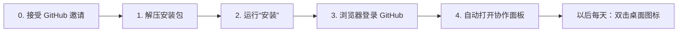

# Z 项目组员安装包

装好后，你只需要双击桌面上的 **打开 Z 协作面板**，在浏览器里点按钮就能开工、保存进度、交付。



## 开始前准备

| 准备什么 | 怎么做 |
| --- | --- |
| GitHub 账号 | 没有就去 [github.com/signup](https://github.com/signup) 注册 |
| 仓库邀请 | 把 GitHub 用户名发给 Yiiime，收到邮件后点 **Accept invitation** |
| Codex | 安装 [ChatGPT 桌面版](https://chatgpt.com/download/)，登录后打开 Codex |
| Unity（按需） | 改场景、动作或试玩时，用 Unity Hub 安装 **6000.6.7f1** |

电脑要求：macOS 13 或更新版本，Apple 芯片或 Intel 都可以。安装大约需要 10～20 分钟，大部分时间在下载。

## 安装：二选一

### 方法 A：让 Codex 帮你装（最省事）

1. 解压收到的 zip。
2. 打开 Codex，把解压出的文件夹拖进对话框，发送：

```text
请读取这个文件夹里的 AGENT.md，帮我安装 Z 项目协作环境。需要我登录或确认时告诉我怎么做。
```

3. Codex 会让你在浏览器里登录 GitHub。照着屏幕上的一次性代码操作即可。

### 方法 B：自己双击安装

1. 解压收到的 zip。
2. **右键**“安装.command” → **打开** → 再点 **打开**。
3. 终端窗口出现后，按提示按回车。浏览器打开 GitHub 时，粘贴终端里显示的一次性代码，点 **Continue / Authorize**。
4. 看到“安装完成”，浏览器会自动打开协作面板。

如果右键打开后仍提示“无法验证开发者”：打开 **系统设置 → 隐私与安全性**，在页面下方点 **仍要打开**，再运行一次。

## 安装后会多出什么

| 位置 | 内容 |
| --- | --- |
| 桌面 `打开 Z 协作面板.command` | 每天双击这个打开面板 |
| `~/Project-Z` | Z 项目文件 |
| `~/.project-z` | Node.js、GitHub CLI、.NET 8 和安装记录；只在你的用户目录，不需要管理员密码 |

## 每天怎么用

| 想做什么 | 在面板里点 |
| --- | --- |
| 开始一个任务 | 选 1～2 个区域 → 写一句目标 → **开工** |
| 让 Codex 开发 | **复制开工提示词**，粘贴给 Codex |
| 暂时离开 | **保存进度**，写一句交接 |
| 做完了 | **交付**，检查通过后自动合并 |
| 看到 🔴 红色提醒 | 先和对方沟通，确认后勾选再继续 |

更多说明在项目里的 `docs/team/START-HERE.md`。

## 遇到问题

| 看到的提示 | 怎么办 |
| --- | --- |
| 无法验证开发者 | 右键打开；或在“隐私与安全性”点 **仍要打开** |
| 需要安装开发者命令行工具 | 在弹窗点 **安装**，完成后重新运行安装 |
| 等待仓库邀请 | 把终端显示的 GitHub 用户名发给 Yiiime，接受邀请后重新运行安装 |
| 下载失败 | 换稳定网络后重新运行；已下载的部分会保留 |
| 关掉终端后面板打不开 | 正常：面板需要终端窗口开着。再次双击桌面图标即可 |
| 其他问题 | 把 `~/.project-z/logs` 里最新的记录发给 Yiiime |

重复运行安装是安全的：已装好的部分会跳过，项目里的修改不会被删除。
