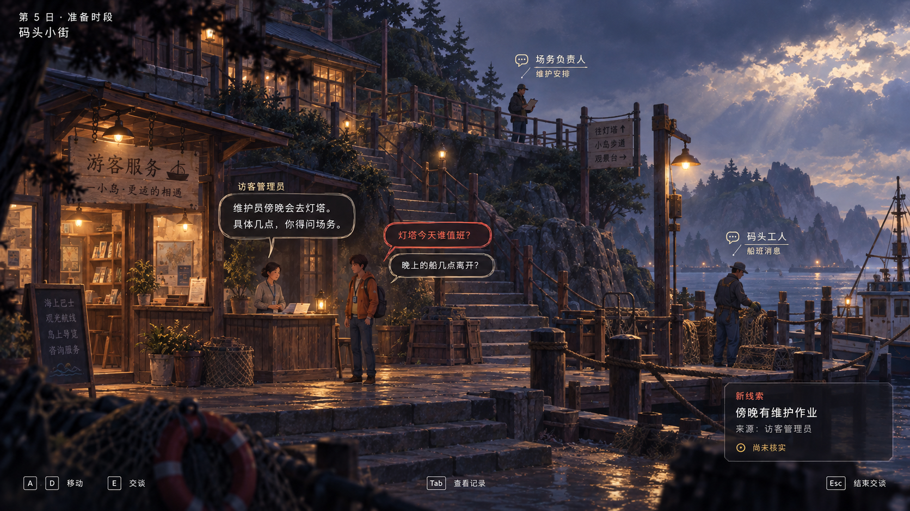
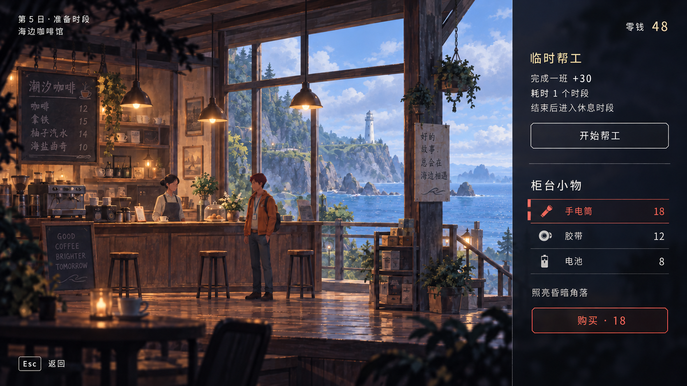
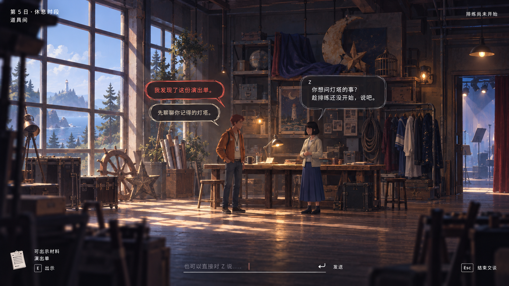
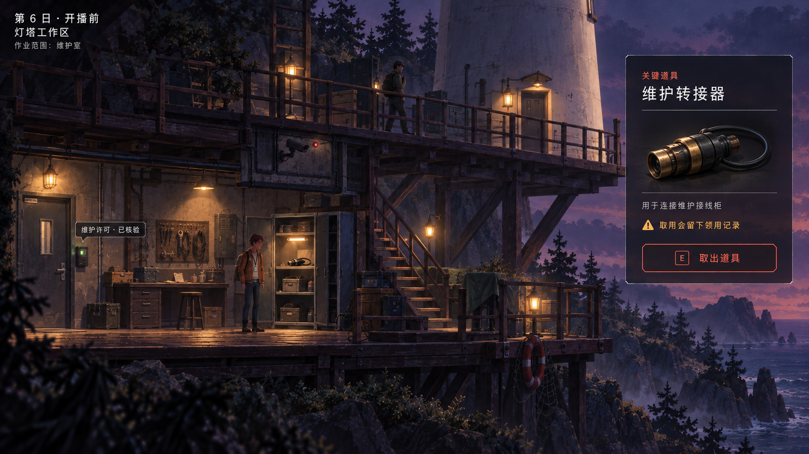

# 四个地点的游戏 UI · 2026-10-09

按用户本次明确的功能分工制作，沿用已选择的第二套视觉方向。地点功能以本次要求为准：码头询问信息、咖啡馆打工与买道具、道具间白天与 Z 交流、灯塔权限与关键道具。原玩法稿与旧版地图中“咖啡馆侧重与 Z 交流”的表述属于此前版本，尚未对旧文件进行全量回改。

四张均为 1672 × 941 的独立静态 PNG，通过内置 image_gen 制作。人物、世界材质、深靛蓝底色、琥珀灯光、珊瑚交互和透明深色 UI 延续同一系统。

## 01 · 码头小街：询问不同 NPC，获取信息

玩家当前询问访客管理员。码头工人对应船班消息，场务负责人对应维护安排。线索面板写明“来源：访客管理员”和“尚未核实”，让玩家知道接下来可以找谁求证。画面展示的维护作业消息和对白是本次示意内容。

## 02 · 咖啡馆：打工赚钱，购买道具

同屏展示打工和购买两个操作。打工预先显示收入 +30、耗时 1 个时段，以及结束后进入休息时段；商店显示零钱 48、三种商品与价格，手电筒处于选中状态，尚未购买。

收入、价格及手电筒／胶带／电池均为界面示意，尚未完成经济平衡设计。打工任务的具体操作与结算反馈尚待后续设计。本屏先呈现接取与购买界面。

## 03 · 道具间：白天与 Z 交流

白天排练前，玩家可使用快捷回应、自由输入或出示演出单。窗外日光与道具环境强化时间和地点；不使用好感条，也不把选择某句话等同于 Z 已同意合作。房间有交流机会，不代表永久安全。

## 04 · 灯塔工作区：受限危险区域，获取关键道具

这是玩家已凭维护许可进入后的画面。入口显示许可已核验，同时限定作业范围为维护室；上层巡查和实体摄像头仍然可见。玩家可取出维护转接器，并在操作前看到“取用会留下领用记录”。

维护转接器的名称、位置及“连接维护接线柜”的用途为本次 UI 提案。它不自动授予权限，也不代表迁移已经开始。本屏不展示警戒百分比或迁移倒计时。

## 自检与修订

- 四张图逐张检查了中文内容、主要操作、角色与物品位置、文本层级、选中态、状态说明和风格一致性。
- 码头：NPC 话题各有用途，消息来源与待核实状态一致。
- 咖啡馆：余额 48，购买前价格 18／12／8；+30 只表示完成一班的收入，没有混作余额。v2 修正准备时段的日落光线，并统一日期在前、地点在后的左上角排版。
- 道具间：自由输入、快捷回应和出示材料并列可理解；没有提前显示共同约定或已接受的结论。
- 灯塔：许可已核验与作业限制同时成立；巡查、摄像头和领用记录构成具体风险；只有一座灯塔。
- 所有数值、对白与物品以示意设计看待；未验证实际关卡、经济平衡和交互手感。以上按钮与提示是画面内容，并未实现游戏功能。

## 文件

交付原图为 `01-dock.png`、`02-cafe-v2.png`、`03-prop-room.png`、`04-lighthouse.png`。各自的 `.prompt.json` 文件保存生成与编辑提示词；咖啡馆 v2 的基础提示词在 `02-cafe.prompt.json` 中。

`02-cafe.png` 是保留在项目中的咖啡馆初稿，不作为最终四张之一。

