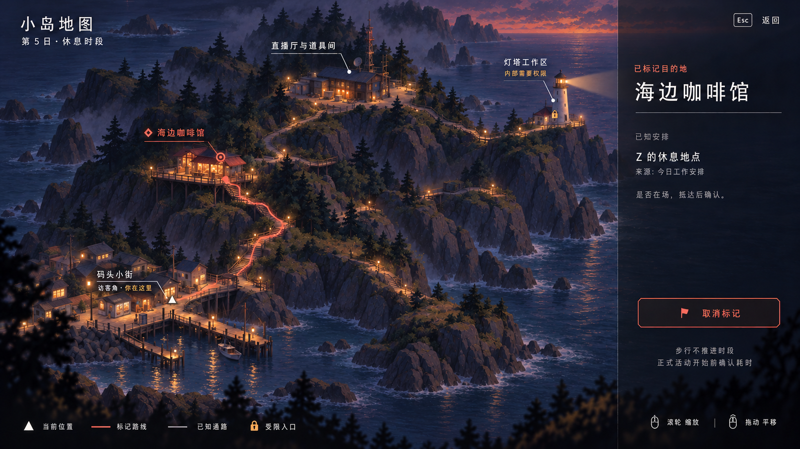

# 小岛地图 UI · v2（交付版）

用户需求：设计一张小岛的游戏地图界面。基于已有玩法文档及用户选定的第二套视觉方向生成，使用内置 image_gen。

## 图面状态

第 5 日 · 休息时段。玩家位于码头小街与访客角，已将海边咖啡馆标记为目的地。地图展示 Demo 的四个核心区域及连接道路：码头小街与访客角、海边咖啡馆、直播厅与道具间、灯塔工作区。

珊瑚色仅用于已标记地点、导航路线和取消标记；暖白三角为玩家位置；琥珀色锁形标记只限制灯塔内部入口。地图以有实际道路连接的海岸地形表达步行关系，具体建筑位置与坡道组织是本次视觉提案，尚非已验证的关卡布局。

咖啡馆侧栏的 Z 信息来自今日工作安排，只表达休息时段的机会，是否在场需要到达后确认。步行不推进时段，正式活动在开始前确认耗时。

## 视觉与交互设计

半俯视地图与现有横向探索场景共用深靛蓝海岸、松林、岩壁、琥珀灯光和克制的珊瑚色。四处地标用细引线标注，右侧只展示当前目标，底部图例和操作提示降低寻找成本。

预期操作为选择地点、标记或取消目的地、缩放、平移、返回探索。这些为静态 UI 示意，未接入实际导航、人物日程或游戏状态。

## 图面自检

- 排版：标题、地名、选中地点详情分级；标注未压住主要建筑；图例与操作提示集中在底部。
- 视觉层级：地图占主要面积；当前目标与路线突出；右侧信息只围绕一个目的地。
- 色彩：遵循已选方案的深靛蓝、琥珀、暖白、珊瑚色；状态同时使用文字和图形表达。
- 玩法一致性：四区域连通；单一灯塔；灯塔外侧可通行、内部受限；没有人物实时追踪、即时传送、安全评分或提前揭露迁移站。
- 边界：这是美术与信息架构示意，路线长度、遮挡、实际步行时间及实时缩放效果尚待关卡实现和试玩验证。

独立审查确认文字、四区连接、目的地状态、灯塔权限和信息来源表达成立，同时指出 v1 岩石、树冠与碎光过细，偏向写实微缩模型。v2 保留布局、全部文字、道路和标记，仅归并材质与明暗细节、简化浪花高光，使地图更贴近既有手绘游戏场景。复看 v2 后未发现明显的文字错漏、路线断裂或额外灯塔。

交付文件：`island-map-v2.png`，1672 × 941 PNG；`island-map-v2.prompt.json` 保存本次修订提示词。`island-map-v1.png` 与 `island-map-v1.prompt.json` 作为初稿及原始提示词保留。两次均使用内置 image_gen。保留既有 18 屏设计集不变。
