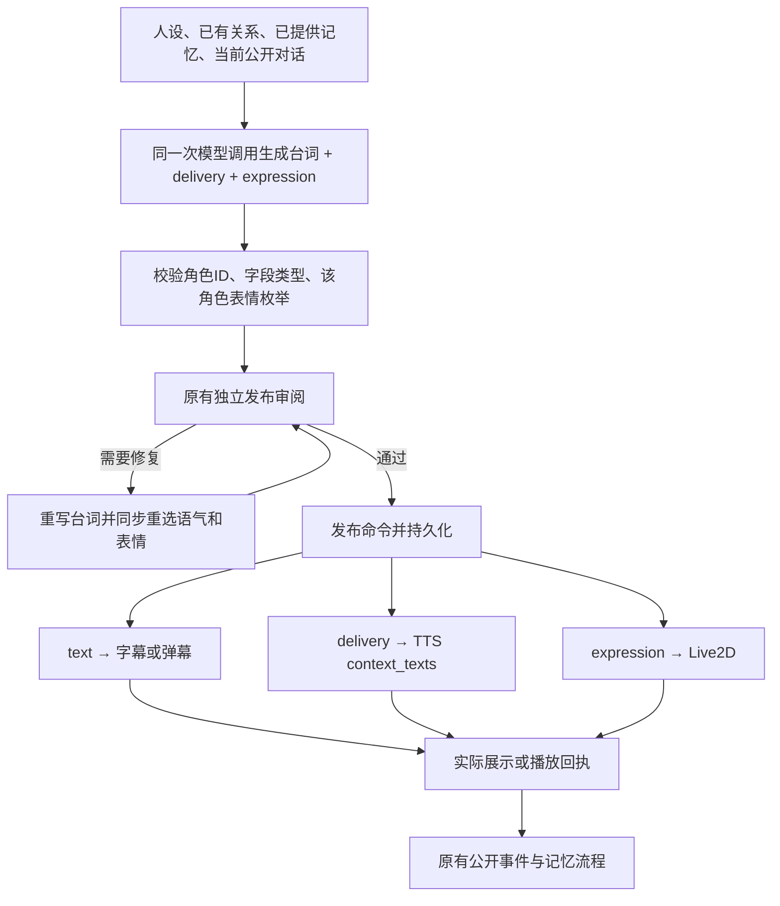

# 直播台词、发声指导与角色表情

本地分支：`local/live-delivery-expression-20261112`。基于 main `1d863aa33b975b276c5ad1311ba1150ea4daedb5`，本轮不推送、不发布 PR。玩家界面布局、样式、任务、Action/Info、日程和直播参与规则不变。

## 交给客户端的字段

现有 `host.present` 和 `audience.present` 的 `payload` 新增三个字段，不变更原有命令类型、protocolVersion、回执和执行顺序。

```json
{
  "actorId": "linxu",
  "text": "行，你去吧。我又没拦着你。",
  "delivery": "舍不得但故作无所谓，音量稍低，最后一句带一点赌气。",
  "expression": "troubled"
}
```

| 字段 | 类型 / 约束 | 如何使用 |
| --- | --- | --- |
| `actorId` | 本项目八个稳定 ID 之一；必须与当前生成者一致 | 主播固定 `z`；观众必须与原有 `npcId` / `npc_id` 一致。美术模型名 `c01` 不是角色 ID |
| `text` | 原有台词正文和长度限制 | 字幕、弹幕、TTS 朗读正文；不拼接表情、语气、动作或旁白 |
| `delivery` | 非空字符串，最多160字 | 只描述可听见的发声方式；情绪、语气，必要时语速、音量、停顿 |
| `expression` | 当前角色专属枚举的准确值 | 提交 Live2D 表现层；不能用其他角色表情、别名或内部动画阶段 |

Z 的模型内部协议继续使用 `speech`，传到 `host.present.payload.text` 时改名。岛民候选内部保留 `npc_id`，输出时并存稳定 `actorId`；原有消费者不需要把整个消息重命名。`delivery` 只在直播生成中新增；日间继续使用 `dialogue/action/info` 加独立 `expression`。

`host.present` 仍包含 `speechId`、`mood`、`gesture`、`transition`、`modality`、音频引用等现有字段。`audience.present` 仍包含 `messageId`、`npcId`、`replyTo`。上面的四字段对象是共同发言内容，不是整个传输命令。

## 生成和接线



- 模型在一次回复中选择三个内容字段，不增加单独的“情绪模型调用”。自然平静、复杂、克制的情绪都允许；不用关键词强制触发，不要求每句换脸，不机械模仿对方情绪。
- 发声指导只是一句表达说明，不是推理过程、剧情分析、视觉动作或新的世界事实。本人未被提供的私聊、关系变化或记忆不能凭它补出来；本次不扩张现有直播可见记忆范围。
- 连麦流式输出先生成并校验 actorId/delivery/expression，再释放首句。整句进入原有审阅，缺失或非法元数据的模型回复不发布。若修复一句，新的台词、语气、表情一起进入下一次审阅和语音预热。
- TTS 将 `delivery` 传到已有的 `req_params.additions.context_texts`，`req_params.text` 仍只有正文。有 delivery 时，不再由旧 mood 的固定语速偏移覆盖它。MP3、PCM 与预热路径一致。
- 音频预热使用候选 ID 加 `text + mood + delivery` 匹配。相同台词但语气改变，不能误用旧音频。
- Z 主播通过 Unity 的 LiveAudioPlayer/CharacterPresenter 消费 expression；已有静态表情使用同源头像资源，cry/bawl/surprise/starry_curious 使用同源动画，口型继续由实际语音或现有文字播放驱动。七位岛民保留弹幕参与形式及元数据，不因此自动配音或新增直播头像布局。
- 元数据随 `commands/events` 持久化并保留在待执行命令快照中。它不显示在字幕或弹幕正文里，也不直接写成 Action/Info、已完成任务或角色记忆；实际发布/播放回执继续决定哪些台词已经说过。

## 唯一表情表

原始表完整保存在 `Tools/MemoryLab/content/current/contracts/portrait-expressions.json`，内容与用户提供的《日间对话角色表情枚举.json》一致，包括 sourceCommit、stateEmotionEnum 和周伯伯的模型限制。日间直接读取，直播构建生成 `Tools/live-service/server/shared/expression-catalog.js`。

| 稳定 ID / 显示名 | expression |
| --- | --- |
| `z` / Z | neutral, happy, sad, shy, serious, happy_wave, cry, bawl, surprise, starry_curious |
| `liyuan` / 梨园 | neutral, smile, bawl |
| `liting` / 李庭 | neutral, smile, surprise, starry_curious, troubled, blush, angry, disappointed, cry, bawl, gloom, sigh, wink, laugh |
| `axing` / 阿星 | neutral, repair, puzzled, angry, surprise, sigh, smile |
| `zhengyi` / 正义 | neutral, smile, surprise, shock, puzzled, curious, angry, shy, bawl |
| `xiaoxiaoqing` / 晴野 | neutral, smile, bawl, surprise, shock, question, starry_curious, angry |
| `linxu` / 留洋 | neutral, smile, troubled, bawl, sigh |
| `zhou_bobo` / 周伯伯 | neutral, gloom |

周伯伯 `Memory/Portraits/ZhouboDaily` 支持 neutral/gloom，`Memory/Portraits/ZhouboFinal-v03` 只支持 neutral。共享校验器支持传入实际 portrait 进一步缩小允许集合；现有日间展示器仍按当前模型能力执行。

`info.emotion` 是角色状态，`expression` 是本次表现：两者枚举独立，不互相填充。删除旧日间正则猜表情和别名转换（例如 Z 的 smile、李庭的 curious、周伯伯的“沉脸”均不再当作合法输入）。日间缺失或非法元数据安全归为 neutral；新直播模型输出严格拒绝缺失或非法字段。历史包和本地固定台词允许整组缺失，兼容为自然平静/neutral，不重放未确认的发言。wait/skip/inspect 没有实际发言，不要求这组字段。

## 源码入口

| 用途 | 路径（相对 unity-sideview） |
| --- | --- |
| 表情源及日间约束 | `Tools/MemoryLab/content/current/contracts/portrait-expressions.json`、`Tools/MemoryLab/lib/portrait-expression.mjs` |
| 直播校验及模型发声规则 | `Tools/live-service/server/shared/utterance.js`、`server/shared/worker/agent-director.js`（后者相对 live-service） |
| 主持和修复提示词 | `Tools/live-service/main-agent/prompts/conversation-host.txt`、`skills/audience-reaction/references/host-sentence-repair.md`（后者相对 live-service） |
| 队列、流式和修复 | `Tools/live-service/server/shared/ui/{live-engine,conversation-engine,call-engine,call-review,audience-director}.js` |
| 持久化命令和 TTS | `Tools/live-service/server/session.mjs`、`server/providers.mjs`、`server/shared/worker/volc-tts.js`（后两者相对 live-service） |
| Unity 表情与字幕 | `Assets/Seabreeze/UI/ZLive/Runtime/{CharacterPresenter,LiveAudioPlayer}.cs` |

构建提示词/表情表：在 live-service 目录运行 `node scripts/build-agent-bundle.mjs`。本轮同时重新生成主线上已与源人设不同步的 z-persona/island-roster 构建物，人设 MD 本身不修改。

## 本地验收（2026-11-12）

- `node --test tests/*.test.mjs`：live-service 146/146，MemoryLab 70/70；包括逐角色精确枚举、ID 冒用、非法流式首句、修复、TTS 参数、缓存隔离、HTTP 回包、存档重放。
- `Z_DOTNET=… bash Tools/check.sh`：静态资源检查通过，303 个 C# 文件语法检查零错误。
- Unity 6000.3.27f1 实际 Play Mode：`Seabreeze.Editor.DeliveryExpressionVerification.Begin`，37 项通过。实际 V3 模型十种表情/动画、复位、旧 mood 与新 expression 优先级、正文字幕、播放回执、拒绝主播冒用 NPC ID。模型截图已人工检查星星眼和大哭表现。
- 真实 DeepSeek：Z 与七位岛民共8次调用，8/8返回合法角色 ID、delivery、expression。单次完整生成约1.1–2.5秒；这是候选生成耗时，不包含审阅、TTS、网络播放，也不代表大规模延迟保证。
- 真实 TTS/RTC/ASR 尚未配置；已验证发声指导进入实际 TTS 请求结构及模拟传输，尚未验证真实合成听感和麦克风端到端。

本机证据保存在 `/private/tmp/z-delivery-qa/`，包含报告、测试日志、模型样本和截图；不提交临时存档或密钥。Unity 验证使用独立临时场景/存档，未替换正在运行的 main 体验包。

复验 Unity：先设置 `Z_DELIVERY_QA_DIR=/private/tmp/独立目录`、`Z_MEMORY_SAVE_ROOT=/private/tmp/独立存档目录`，用固定版本 Unity 打开主工程，传入 `-batchmode -executeMethod Seabreeze.Editor.DeliveryExpressionVerification.Begin -memoryDisabled`。不要加 `-quit`，验证结束会自行退出。
