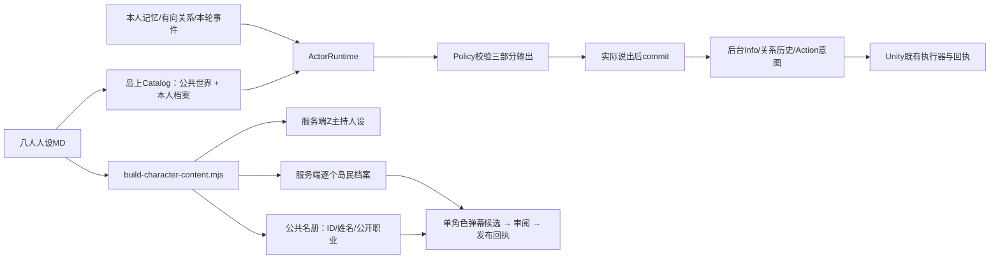

# PR #54 · 新版人设接入当前主线

目标：将已确认的八人故事用于岛上对话和直播，保留主线已有地图、动画、点歌、连麦与收播流程。来源与逐人对照见 [Before/After](../../docs/人设更新Before-After-20261112.md)。

## 唯一素材源与调用链

人物MD在 `Tools/MemoryLab/content/current/moonlife-actors/references/characters/`。对应ID为 z、liyuan、liting、axing、zhengyi、xiaoxiaoqing、linxu、zhou_bobo。晴野沿用xiaoxiaoqing，留洋沿用linxu。不要改存档ID来完成改名。

岛上仍是主线1.2.0三部分协议，pack_version=2.0维持已有存档兼容；persona_revision=2026-11-12单独表示素材版本。此PR没有导入旧本地Schema 3.0、option_id简版协议或独立实验室。

直播继续使用主线主持与弹幕协议，由适配器加载相同人物素材。Z主持，七位岛民均在名册；每轮允许安静。批量旧请求也只选一人，不能同时把七人的私有档案交给模型。客户端公共roster没有幕后身世。

生成：`node unity-sideview/Tools/live-service/scripts/build-character-content.mjs`；核对同步加 `--check`。生成文件位于直播服务 `server/shared/worker/{z-persona,island-roster}.js` 及公共 `server/shared/audience-roster.js`。直播Skill入口改为引用唯一源，移除旧重复故事文件。

## 关系、记忆与知情

- NPC关系是有方向的affinity/trust；来自registry.initial_relationships中的故事初值。这些数值是可调设计参数，不是飞书原文量表。玩家初值仍为原30–70范围。
- 已有关系边原样保留，包括null；缺失边补背景值。仅当前角色可提出本人这一侧的变化，另一方不会自动跟着改变。
- 玩家转述、NPC来信、亲眼见证都可改变判断。变化必须引用本轮真实来源，符合0–100边界，不对同一事件重复计分；每边保留最近12次原因及前后值。原事件仍留在记忆/事件存储中。
- 提案未实际说出前不生效。台词和数值均可拒绝、犹豫、求证，好感高不直接兑换援助。周伯伯仍不提供实际逃离帮助；Z自行决定去留。
- 未来阶段放在story-stages.md，不加载为开局记忆。删除live-memory中的未确认父母锚点；保留李庭故事进度、真实发生的历史记录和主线点歌记忆。
- 四项旧任务map_blank/map_trial/map_packing/flowers的新局开关关闭；已接受、已拒绝或完成的旧任务仍可承接。不新增执行器和固定日期通知。

## 验收

| 项目 | 本PR结果 |
| --- | --- |
| MemoryLab npm test | 56/56通过：旧接口回归、关系提交与回放、传闻不变事实、旧档兼容、任务停用、人物素材隔离 |
| live-service npm test | 137/137通过：七岛民轮转、单角色提示、输出ID校验、原点歌/连麦/收播/声纹及HTTP回归 |
| 真实DeepSeek | 八角色各一轮 + 七岛民各一条弹幕均通过协议；岛上单轮约1.2–1.9秒，仅为本机少量样本，不是延迟SLA |
| 静态检查 | 287个C#文件0语法错误；3586资产、1856 GUID、31场景通过引用检查 |
| Unity实际试玩 | 两项通过：UnifiedRuntimeVerification真实对话与占用释放；PersonaReleaseVerification三位NPC真实对话、关系初值、台词UI、七岛民直播姓名/头像/发布回执（直播UI采用确定性fixture；真实弹幕模型已单独抽测） |
| Skill与生成物核对 | 两个Skill入口quick_validate通过；build-character-content.mjs --check通过 |
| 团队检查与范围 | tools/team/z check通过；59个改动文件均落在用户确认范围，Unity自动导入副作用已恢复 |

真实模型报告 `/private/tmp/pr54-real-personas.json`，日志 `/private/tmp/pr54-real-personas.log`。可选付费复验命令：`Z_PERSONA_REAL_CONFIG=<本机私有模型配置JSON路径> node unity-sideview/Tools/MemoryLab/tests/verify-personas-real.mjs`。测试只用独立内存存档，报告不保存密钥。

## 实现边界

Z继续使用主线已有的公开回忆投影。七岛民直播目前使用本人常驻人设、背景关系和本场公开弹幕，未新增从岛上动态私有存档同步每位岛民记忆/数值的跨服务接口；不能将“资料同源”描述成“七人所有运行记忆已打通”。后续如果接这层同步，要逐角色投影，不能广播全体私聊。

晴野压花册人体转送、正义信号枪、完整新任务执行器与全部结局尚未实现；此次更新也不能保证任意多轮对话永不出戏。上述回归和抽测不等于全剧情通关。

用户于2026-11-12确认正式交付PR #54。按仓库流程保存后运行tools/team/z ship，交由GitHub队列检查与合并；该流程交付仓库代码，不等于部署外部线上体验服务。

Unity报告：`/private/tmp/pr54-unity-baseline.json`、`/private/tmp/pr54-unity-personas.json`；后者包含三次真实台词和七人发布名单。截图为同目录`pr54-unity-baseline.png`、`pr54-unity-personas.island-0.png`至`island-2.png`、`pr54-unity-personas.live.png`，已人工查看对话与直播截图。场景可见5位角色，不把名册8人误称为8人同时在场。

本次追加修复Unity直播端的三处绑定：LiveFeatureController从SevenCharacterCatalog读取姓名；LiveFeatureView用稳定ID选已有头像/颜色；LivePackageVerification采用七岛民名册。没有修改USS/UXML、场景、美术或布局。复验入口为PersonaReleaseVerification.Begin，需要临时Z_MEMORY_SAVE_ROOT、-memoryService和-personaVerificationOutput参数；直播fixture为Z_VERIFY_AUDIENCE=1 node Tools/live-service/scripts/verify-session-ui.mjs。

未单独打包新的Mac可执行程序，也未做真实TTS/麦克风和全剧情通关；这些不是上述Unity编辑器和文本模型验证的覆盖范围。

## 正式交付复核（2026-11-12）

交付前重新读取AGENTS.md，检查工作区、暂存区及相对最新origin/main的完整PR差异。59个文件均在原始及本轮追加授权范围内，没有新超范围路径。分支已包含最新main；代码与本次真实模型、Unity试玩时一致，后续只补交付文档。

ship-check发现与PR #51的engine.mjs/机制记录、PR #53的机制记录有普通文本重叠；没有场景、美术等难合并文件重叠，missing confirmations为空，可按仓库规则继续交付。检查结果与自动合并状态以[PR #54](https://github.com/Yiiime/Project-Z/pull/54)为准。
