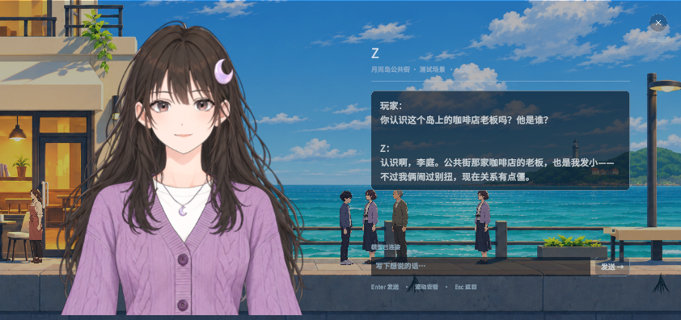

# PR #42 交付验收

日期：2026-11-07。任务：当前八位角色人设 Skill、自然记忆与 Unity 空间 A2A 融合。

## 代码范围与合并

在任务分支 `task/evanc4823-commits/memory-ai-1107-2014` 核对相对 main 的完整差异。范围包括本次选区及用户此前单独授权的 `Scripts/Memory/**`。同步 main 的 #40 直播收播更新；唯一文档冲突保留双方完整规则，直播源码与 main 一致。Unity 导入生成的模型、字体和其他资源改写不进入提交。

## 自动检查

- `cd unity-sideview/Tools/MemoryLab && npm test`：35/35，通过。HTTP测试使用本机回环端口和显式模型替身，覆盖网页仅收到dialogue、后端仍保存并提交完整三部分结果。
- `tools/team/z check`：团队规范与自动化通过；262个C#文件语法无错误，资源Meta/GUID和三个场景引用通过。
- `git diff --check`：源码及交付文档无空白错误。

## Unity 实际运行

在本PR工作目录使用Unity 6000.3.27f1运行 `Street.unity`，连接隔离的当前MemoryLab后端，使用已有本机DeepSeek配置和临时存档。先批处理验证，再打开可见Game窗口复验；没有使用离线台词替代模型。

| 观察项 | 结果 |
| --- | --- |
| 编辑器编译与场景启动 | 通过 |
| 注册表 | 八人，当前Street场景五人 |
| 后端连接 | real模式 |
| 玩家问题 | 你认识这个岛上的咖啡店老板吗？他是谁？ |
| Z实际回复 | 认识啊，李庭。公共街那家咖啡店的老板，也是我发小——不过我俩闹过别扭，现在关系有点僵。 |
| 玩家占用 | 对话期间Z被占用，仍有其他NPC未被占用 |
| 结束交谈 | Z释放玩家占用 |
| 玩家界面 | 只显示台词和正常任务交互，已移除Action／Info面板 |
| 内部结果 | Unity内部仍保留action和info供执行，不通过界面打印 |
| 立绘 | Z在可见Game窗口实际渲染 |

截图是本机编辑器Game视图的实际分辨率，不代表全部屏幕尺寸验收。验证脚本通过实际控制器发起对话和结束操作；未将这次自动试玩描述为人工按键与手感验收。

## 复现

先在 `Tools/MemoryLab/` 配置本机模型并启动后端。使用临时目录传入 `Z_MEMORY_SAVE_ROOT`，在Unity命令行执行 `-executeMethod Seabreeze.Editor.UnifiedRuntimeVerification.Begin`，通过 `-memoryService` 指定后端，通过 `-moonlifeVerificationOutput` 指定临时JSON文件。可见编辑器模式同时保存PNG；批处理模式可能没有渲染帧，报告会明确标记截图未生成。

本次可见运行报告中，`passed`、`sceneReady`、`connected`、`playerFocusIsolated`、`focusReleased`、`internalStateHidden`、`backendResultRetained`、`screenshotCaptured`均为true。密钥、数据库、个人存档和Unity导入缓存不随证据提交。

网页通过浏览器实际发送“你认识岛上的咖啡店老板吗？他叫什么？”，Z回复李庭与咖啡店的身份关系；页面仅呈现台词。点击结束对话后显示角色可自由交流。原始Action／Info、当前数值、关系和内部社交判断不再展示。

## 未验证范围

- Day1至Day7完整逃离剧情、多次长局与自由文本信息泄露的语义质量。
- 全地图导航、美术入口、物品交付和修理等尚未完成接线的玩法触发器。
- 长时间多NPC实机交流、任务接受／拒绝／协作的完整Unity操作路线；相关协议与规则已有后端测试。
- 并发负载下的首字／整段P95延迟，不能据此次真实调用承诺秒级输出。
- 另一台全新机器的首次资源导入、独立版打包与全部分辨率。
