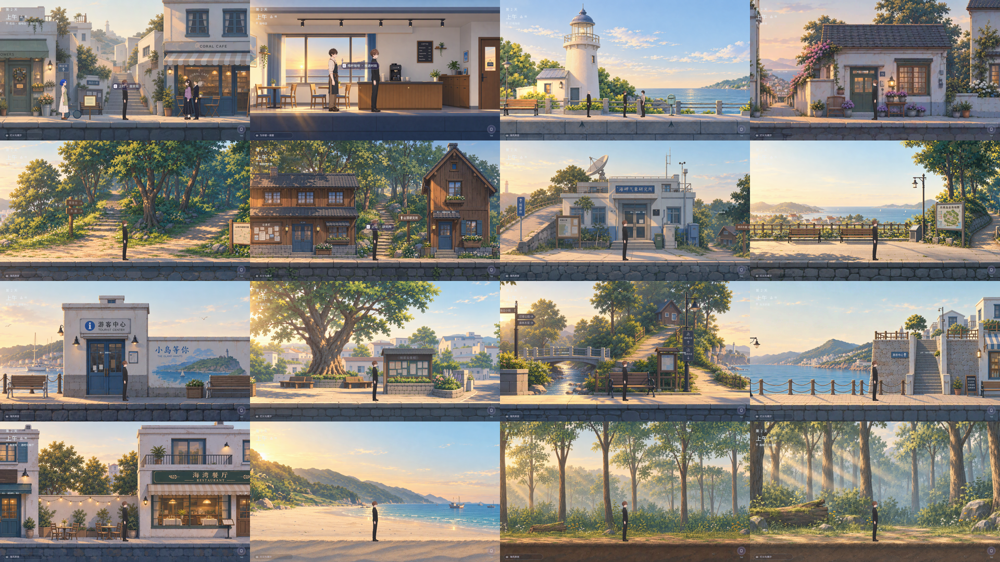
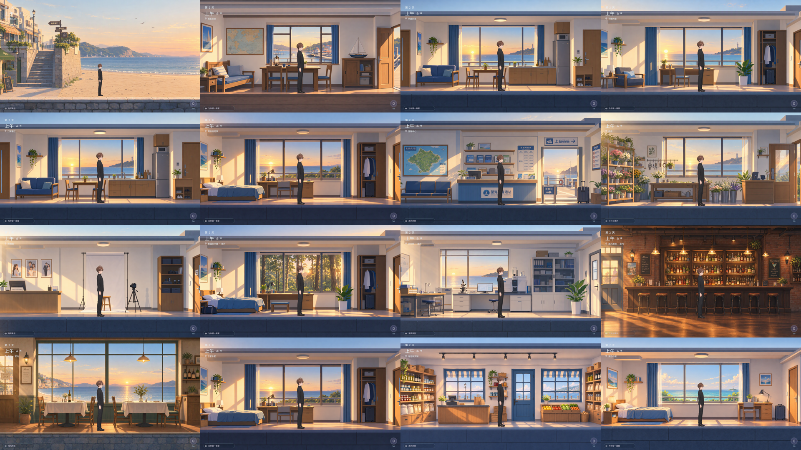

# 清晨地图运行验收 · 2026-11-13

环境：Unity 6000.3.27f1，现有 URP 2D 工程，1920×1080 Game View。采用隔离存档，结束后已停止 Play、清除临时存档路径；真实存档 SHA256 前后相同。没有创建测试脚本、测试工程或运行测试套件。

## 已执行的检查

- `unity recompile --project-path <project>`：编辑器编译完成，0 错误、0 警告。
- `node Tools/check-source.mjs`：6576 个资产文件、3374 个 GUID、32 个 Build 场景静态检查通过。
- 通过现有 `WorldDirector.TravelToMapPoint` 及实际场景转场逐一到达 32 地点。每处执行午后→上午→傍晚→夜晚→上午，160 次记录见 [period-matrix.csv](period-matrix.csv)。上午均使用 `IslandMorning/<PlaceId>`，傍晚均使用既有 `IslandEvening/<PlaceId>`，另外两个时段不残留变体。世界宽度不变，反复切换后上午中心与尺寸一致。
- 每个场景保存一张实际截图，两个总览包含全部 32 地点。单图和总览复查角色落点、门口、地面、场景边缘、室内家具和光照。
- 居民街初始脚线 481 像素导致鞋底位于路缘立面，调整到 470 后复查，鞋底回到铺路面。最终 CSV 已替换为修正后的 5 次采样，其余 31 场景数据未改。
- Input System 实际输入：D 持续移动使居民街自动进入森林，A 返回居民街，未用 E 触发横向边界。门口定位后向下一次 player loop 排入 E 按键事件，经原 `PlayerInteraction` 进入 Z 家，再 E 返回居民街 x=11.5；转场结束使用正确清晨图。
- 详细结果及输入位置见 [runtime-report.json](runtime-report.json)。输入检查采用编辑器注入，不等同于真人手动长时游玩。

## 实际画面

总览按 Build Settings 顺序、从左到右逐行排列。

第一张：公共街、咖啡馆、灯塔、居民街；森林入口、木屋、研究所、山顶；码头、广场、东口、海滨步道；海滨街、沙滩、森林一、森林二。

第二张：沙滩入口、船长家、李庭家、子晴家；Z客厅、周伯伯家、游客中心、花店；照相馆、木屋内、研究所内、酒吧；餐厅、Z卧室、杂货铺、玩家房间。

可放大查看：[公共街](Street-morning.png)、[居民街修正后](ResidentialCenter-morning.png)、[码头](Harbor-morning.png)、[森林补图](ForestPath2-morning.png)、[玩家卧室补图](PlayerHome-morning.png)。

## 异常记录与范围

首次导入后 Play 的 GameSession 丢失，MusicDirector.Update 产生空引用。停止 Play、重新打开未修改的 Street 场景、重新进入后恢复正常；随后完整地图巡检和输入往返中 Console 当前错误为 0、没有新增异常。未修改音乐或启动逻辑，也不将一次恢复等同于已根治该既有生命周期现象。最终 Console 有 77 条警告，主要为 Metal memoryless depth load/store；未据此扩改渲染管线。

提供图的 2172 像素居民街覆盖约 69 世界单位，近镜比室内柔和；没有放大图片冒充更高细节。灯塔石墙上的两簇草属于既有独立场景装饰，未加入清晨 PNG。此轮没有验证全剧情、AI 服务、所有 NPC 行为或独立应用构建。
