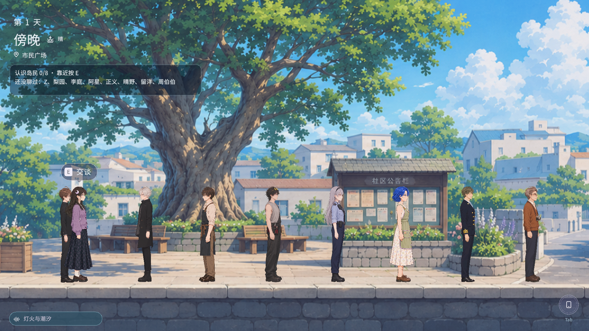
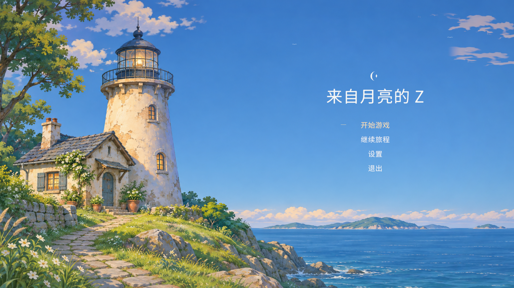

# 紧凑 BGM 控件与启动背景动画

日期：2026-11-13。Unity 6000.3.27f1 / Metal。继续原首页草稿 #53；合入 #60 的已有任务卡与 NPC 转场修复（含其 main 基线 259b893），保留两个分支的功能。没有将此集成标记为完整第一天流程重新验收。

## 本轮改动

- `GameUI.cs`：左下角 BGM 控件从 580×48 缩为 300×44，图标与歌名均放在按钮内部。歌名宽 236，单行省略；删除冗长的点击开关提示，保留实际音乐开关和歌名/关闭状态。
- `StartPageCoastalMotion.cs` 与 `CoastalTitle.shader`：海面位移由 .00065 增至 .0022，水域使用沿岸斜向遮罩；叠加独立漂移云层，直接采样现有灯塔原画的云彩笔触，无新增图片。左上树冠按颜色遮罩微动。建筑、菜单和镜头不整体平移缩放。
- `StartPageAtmosphere.cs`：高光 26→38，增强流动并在循环边界渐隐；远鸟 2→3，穿越周期由 64/70 秒改为 28/33/38 秒，保留滑翔与间歇翼振。
- 所有背景动画沿用 unscaledDeltaTime；首页、设置和开始加载时持续运行，已有“动效”设置可以冻结并从原位置恢复。
- 合并兼容：保留新版任务卡、NPC会话隔离和黑屏准备，同时移除剧情视图对旧 taskPanel 的残留引用。剧情对话不展示自由聊天任务卡。

## 实际验证

- Unity `recompile` 完成：0 编译错误、0 编译警告。集成后重新 Resolve 清单中原有的 Video 内置包，解决切换分支后包缓存尚未加载造成的初次 VideoPlayer 缺失；未新增第三方插件。
- `CoastalTitle` 在 Metal 下 supported=true，ShaderUtil 编译消息为空，实际 Game View 渲染正常。
- `title-motion.mp4` 是实际 Play Mode 约 8 秒画面采样，80 帧按记录的墙钟时间编码为 30fps 容器，没有插帧或加速。原采样约10fps，完整游戏仍按既有60fps目标运行；它不是性能基准。
- 原生鼠标选中“继续旅程”，Enter 进入隔离存档的广场。BGM实际尺寸300×44，原生鼠标关闭后读回 `MusicEnabled=false`、文案“音乐已关闭”；再次点击恢复播放并显示“灯火与潮汐”。截图 `bgm-compact.png`、证据 `bgm-off.json`。
- 显式调用现有 `ShowLoading()` 观测：timeScale=0，动画时钟18.80375→19.8625946；关动效一秒后保持19.8625946；开启后一秒增至20.86466。云海与飞鸟时钟一致。详见 `loading-motion.json`、`loading.png`。这项为受控加载状态检查，不声称测量了实际资源加载耗时。
- 真实存档未改写；隔离路径 `UserSettings/TitleMotion-20261113`。真实存档 SHA256 前后为 `210b8d23cd6094255360f9bfb93a4da0735032fb601567e6e579576930a10c9d`。结束隔离验收后清除覆盖路径，再打开真实首页供用户体验。
- 未运行测试套件、未添加测试工程/脚本，未重做角色或原画。源插画为单层，树冠遮罩会带动部分绿褐色细枝；当前是实时环境动画，不是完整手绘逐帧影片。

