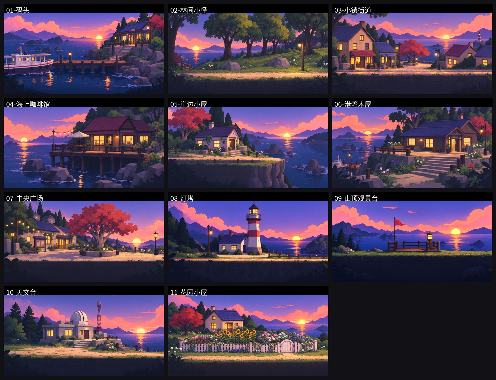
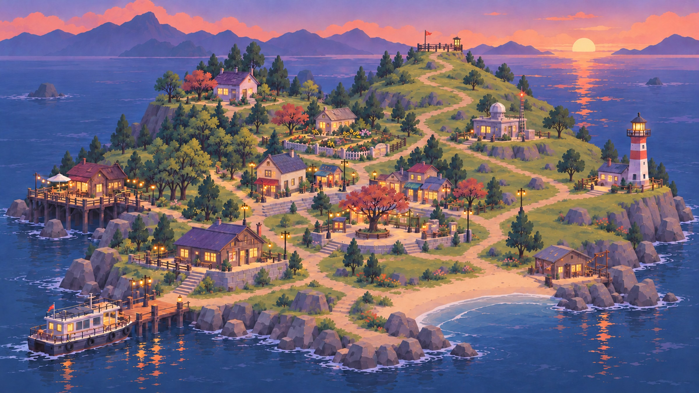

# 场景盘点与项目结构规划 v1（待确认，未开工）

> 2026-11-03 ｜ 依据：Figma「来自月亮的Z」Version 2.0（node 43-6）衍生导出 + 《游戏设计文档_v1》+《UI规划方案_v1》
> 本文只做确认与规划，不改工程。

---

## 1. 我从哪里拿到的场景信息

**Figma 文件本身打不开**：`figma.com/design/GQsDhP4EXFWLJYimH44zQ9` 匿名访问返回 403（私有文件）；本机没有 Figma token，桌面端也没有可用的本地接口。

**但磁盘上已有完整的 Figma 导出集**（`~/Desktop/Z/docs/scenes-v2`，2026-11-02 11:56–13:21）：

| 目录 | 内容 | 数量 |
|---|---|---|
| `横版图/` | 11 个地点的严格正侧视横版图，2730×1536 JPG | 11（+2 张 v1 废稿） |
| `refs/` | 每地点的「鸟瞰 / 人视」参考图 + 全岛总览 | 22 |
| `figma-export/` | Figma 原始导出 PNG（~2375×1337） | 20 |
| `screens-v2/场景/` | 叙事场景图（标题页/序章/房间/直播工厂/结局…） | 11 |
| `~/Desktop/Z/docs/ui-mockups/` | 32 屏 UI 设计稿 + 视觉规范板 | 32+ |



> 需要你确认：这套导出是否仍是 Figma 最新版？（你 00:47 还在用 Figma，可能有更新）

## 2. 11 个地点（横版图现状）

| # | 地点 | 画面要点 | 叙事定位 |
|---|---|---|---|
| 01 | 码头 | 左渡轮、中木栈桥、右岩岸+蓝紫顶站房；可走＝栈桥 | 登岛/离岛、开场 |
| 02 | 林间小径 | 土路横穿草坡，中景大树排开、路灯 | 散步/独处事件 |
| 03 | 小镇街道 | 米色石墙小楼+蓝顶平房+红叶树+酒红顶小屋 | 主街/日常动线 |
| 04 | 海上咖啡馆 | 高脚木平台、酒红顶咖啡馆、遮阳伞、串灯 | 白天邀约/聊天 |
| 05 | 崖边小屋 | 白灰石墙小屋、崖边断开、海景 | 神秘 NPC/危机线索 |
| 06 | 港湾木屋 | 深木色大屋、门廊长椅、左侧港湾短栈桥 | Z 的住处/夜谈 |
| 07 | 中央广场 | 巨型红叶树+石树池、告示板、串灯 | 多人事件/公告 |
| 08 | 灯塔 | 红白条纹灯塔+守塔小屋+电线杆 | 关键地标/高潮 |
| 09 | 山顶观景台 | 木平台+旗杆+灯笼柱，天空占 45% | 看月亮/关系升温/结局 |
| 10 | 天文台 | 石砌平顶楼+白色圆顶+红钢塔 | 揭示 Z 的 AI 身份 |
| 11 | 花园小屋 | 白篱笆花园、向日葵绣球 | 治愈/收尾 |

**共同构图语法（11 张一致）**：严格正侧视平视、天空约 35%（09 为 45%）、**可行走地面上沿约在画面 78%**、底部约 10% 深色前景剪影、无人物/无文字、傍晚统一光。

## 3. 与当前 Unity 工程的三处不一致（必须先定）

| 项 | 现在工程 | 这 11 张图 | 处理建议 |
|---|---|---|---|
| 画风 | 码头用的是写实饱和版（`冲刺Z/gen_dock` 母版，吉卜力/新海诚） | 绘本风、低饱和、厚描边、扁平 | **统一到 11 张这套**（否则每加一个地点都要重画码头） |
| 尺寸 | 码头 3840×1080 分层，可走 38.4 单位 | 2730×1536 单张平铺，只够一屏（19.2 单位） | 见 §6 的 A/B/C 方案 |
| UI | 紫玻璃对话框（代码里已有） | 纸白卡片 + 海青 + 墨线（UI 方案 v1） | 按 UI 方案重做 |

## 4. 建议的项目结构（数据驱动）

```
Assets/_Game/
├─ Scenes/
│  ├─ App.unity                 # 常驻：GameSession / 输入 / 相机 / UI / 玩家
│  └─ Locations/
│     ├─ Loc_Dock.unity         # 01
│     ├─ Loc_ForestPath.unity   # 02 …每个地点一个 additive 场景
├─ Data/
│  ├─ Locations/*.asset         # LocationDefinition（id/显示名/场景路径/相机边界/BGM）
│  ├─ Routes/*.asset            # 场景连接（出口 → 目标地点 + 目标出生点）
│  ├─ Schedules/*.asset         # NPC 作息（地点 × 时段）
│  └─ Dialogue/*.asset          # 现有 DialogueDefinition
└─ Scripts/
   ├─ Core/     GameSession / GameState / TimeSlot
   ├─ World/    SceneContext / LocationRouter / SceneExit / ParallaxLayer / CameraFollow
   ├─ Actors/   PlayerMotor / NpcActor / NpcScheduleRunner
   └─ UI/       DialogueView(+Staging) / HUD / IslandMap / Phone
```

关键新增：**LocationRouter**（走出口 → 淡出 → 卸载 → 加载 → 落在目标 entry → 淡入），现在的 `GameSession` 只会加载初始场景。

## 5. 岛屿拓扑（从全岛总览 + 场景内容推导）



```
            09 观景台
                 │
   05 崖边小屋 ─ 11 花园小屋 ─ 10 天文台 ─ 08 灯塔
        │             │            │
        └──── 02 林间小径 ─── 07 中央广场
                       │
                  03 小镇街道 ── 04 海上咖啡馆
                       │
                  06 港湾木屋
                       │
                   01 码头
```

- 每个地点左右两端各留 1–2 个出口（`SceneExit`），走到边缘按 E/自动切场景。
- 全岛地图（05_全岛地图 UI）用于不耗时的快速旅行，只显示当前时段已知在场的 NPC。

## 6. 三种场景形态（需要你选）

| 方案 | 做法 | 优点 | 代价 |
|---|---|---|---|
| **A 单屏切景** | 每地点一屏 19.2 单位，走到边缘淡出切下一屏（NITW 小镇做法） | 11 张图直接用，零改图，最快 | 横向探索感弱 |
| **B 多屏可走** | 每张扩画到 3840×1080（左右 outpaint），相机跟随 | 最接近“横版 2D 项目” | 11 张要重出/扩图 |
| **C 混合**（推荐） | 主街/码头/广场（01/03/07）做多屏可走；小屋/室内/观景台做单屏 | 体验与成本平衡 | 需要标注哪些扩 |

## 7. 一天循环（火山的女儿式）

- 4 个时段：清晨 / 午后 / 傍晚 / 夜晚；每天天气随机（晴/多云/雾/雨）。
- 地图移动、闲聊、送礼 **不耗时**；接受 1 个关键事件即结束本时段。
- NPC 按「地点 × 时段」作息；关键事件只能当面触发。
- 夜晚固定回家直播，不开放自由活动。
- 需要：`DateCard` 过场卡、睡前回顾、月相羁绊、手账/相册。

## 8. 演出与手感（NITW 式）

- 走动：加速度/刹车、转身、脚步尘、相机前瞻（look-ahead）。
- 场景切换：淡出 0.25s → 加载 → 淡入，目标点出生。
- 对话：推镜 → 压暗 → 小人淡出 → 立绘滑入 → 面板升起（已做 v1）。
- 环境动效：灯笼呼吸、海面流光、萤火/尘埃、云漂移（每地点 1–2 个）。

## 9. 垂直切片建议（先做这一条线）

**01 码头 → 06 港湾木屋 → 03 小镇街道**（3 个场景 + 地图 + 1 个 NPC + 1 个关键事件 + 过场卡）。
理由：码头已可走；木屋/街道各补一屏；能验证「走 → 换场景 → 对话 → 时段推进」完整闭环。

## 10. 需要你拍板

1. Figma 导出是否为最新？可以这套 11 张为准吗？
2. 画风统一到 11 张绘本风（码头重做）——还是保留现在的写实码头？
3. 场景形态选 A / B / C？（我推荐 C）
4. UI 按《UI规划方案 v1》的纸卡风重做，还是沿用现在的紫玻璃？
5. 垂直切片按 01→06→03 走，可以吗？
