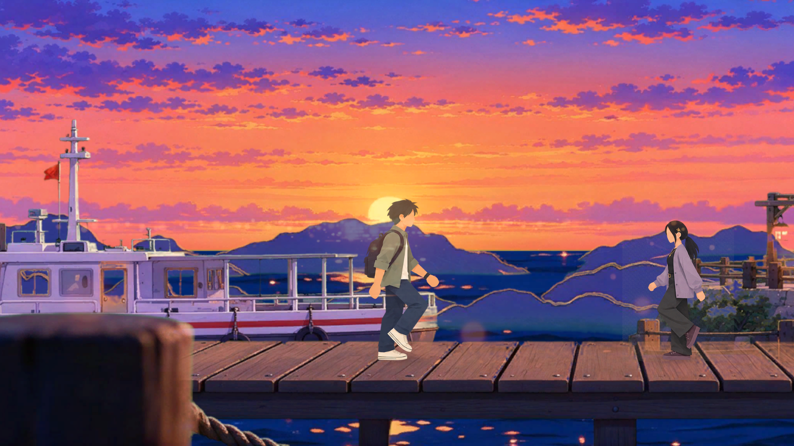
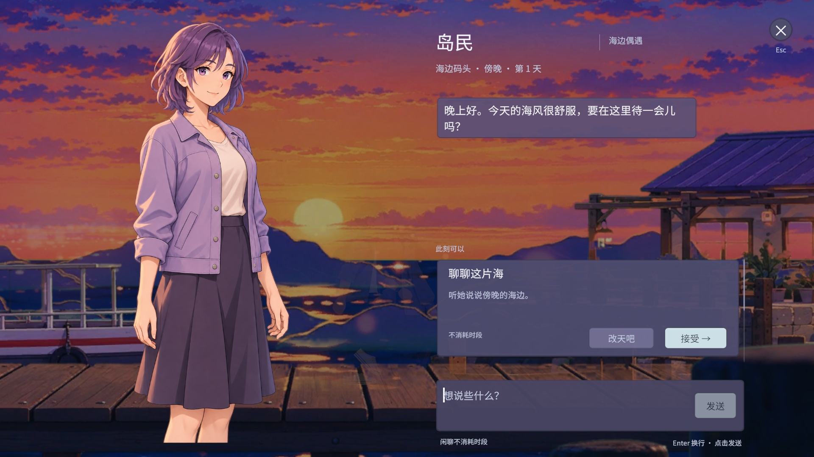

# 海边码头 · 可走动地点 v1（实现说明 + 美术管线）

> 2026-11-03 ｜ Unity 6000.6.7f1 ｜ 目标：横版走动 → 靠近 NPC → E 对话 → 对话演出





---

## 1. 这次做了什么

| 模块 | 内容 | 文件 |
|---|---|---|
| 新地点 | `DockLocation.unity`：38.4 × 10.8 世界单位（3840×1080 @ PPU100），地面线 `y = -3.35` | `Assets/_Game/Scenes/DockLocation.unity` |
| 视差 | 7 层，深度 0.25 / 0.45 / 0.75 / 0.75 / 1.0 / 1.04，公式 `x = base + (camX - refX) × (1 - depth)` | `Scripts/World/ParallaxLayer.cs` |
| 相机 | 水平跟随 + 边界钳制（±8.8）+ 对话推近（5.4 → 4.85） | `Scripts/World/CameraFollow.cs` |
| 移动 | A/D 横移（沿用 PlayerMotor），脚底 = 根节点原点 | 既有 |
| 交互 | 靠近 → 头顶「E 交谈」→ E 打开对话 | 既有 `PlayerInteractor` / `InteractionPromptView` |
| 对话演出 | 推镜 → 压暗 → 小人淡出 → 立绘滑入 → 面板升起（GDD §7.1） | `Scripts/UI/DialogueStaging.cs` |
| 角色 | 男主 8 帧走路 + idle + 落地对齐 + 接触阴影 + 呼吸 | `Art/Characters/Player/` |
| 入口 | `GameSession.initialScenePath` 已指向 DockLocation | App.unity |

### 一键重建

Unity 菜单：**Z From Moon → Build Dock Location**

它会：导入分层贴图 → 生成走路 Animator → 补玩家视觉/影子 → 挂相机跟随 & 对话演出 → 生成并保存地点场景 → 加入 Build Settings。

### 想改数值？

全在 `Assets/_Game/Scripts/Editor/DockLocationBuilder.cs` 顶部常量：

```csharp
GroundY = -3.35f;   // 脚底线（栈道板面）
SpawnX  = -5f;      // 出生点
CameraMinX/MaxX = ±8.8f;
PlayerHeight = 4.0f; // 角色世界高度（屏高 37%）
```

改完重跑菜单即可（场景会被重建）。

---

## 2. 演出参数在哪调

`DialogueStaging`（挂在 DialogueCanvas 上，运行时自动找面板）：

| 字段 | 默认 | 作用 |
|---|---|---|
| `pushInOrthoSize` | 4.85 | 对话时相机正交尺寸（越小越近） |
| `enterDuration` | 0.55s | 入场时长 |
| `dimAlpha` | 0.55 | 世界压暗强度 |
| `actorFadeAlpha` | 0.06 | 场景小人淡出后的不透明度 |
| `portraitSlide` | 170px | 立绘横向滑入距离 |
| `panelRise` | 55px | 对话面板上浮距离 |

> 目前退场是「压暗/相机回位」淡出，面板本身仍是瞬隐；下一步可做真正的倒放退场。

---

## 3. 如何高质量重出 PSB 分层（建议路线）

现在的 11 层是从一张母版上「抠 + 补」出来的 PNG，问题：海面/天空不是真分层、绿幕溢色、道具位置乱。要真正可复用，按下面做：

### 3.1 规格（不要改）

| 项 | 值 |
|---|---|
| 画布 | 3840 × 1080，sRGB，PPU 100 |
| 地平线 | 画布 y ≈ 640（世界 y ≈ -1.0） |
| 地面线（脚底） | 画布 y ≈ 860（世界 y ≈ -3.2） |
| 层名 | 全英文小写：`sky / cloud_far / cloud_near / island_far / sea / boat / house / props / ground / foreground / fx` |
| 人物 | 不画进背景 |

### 3.2 生产顺序（母版 → 拆层，一致性最好）

1. **先出母版**：写一条整体场景 prompt（见 `桌面/冲刺Z/海边码头_分层重绘Prompt包_v0.1.md`），生成 4K 21:9，挑一张定稿。
2. **以母版为底**，在 Photoshop / Photopea 里逐层「选中物体 → 内容识别填充 → 单独存层」。被遮挡的部分必须补画，否则视差一动就穿帮。
3. **满幅层**（sky / sea）直接出实底，不做透明；**物件层**（boat / house / props / ground / foreground）必须透明。
4. 抠像质量三条硬指标：
   - 边缘 1px 内缩（Erode 1px），去掉半透明毛边；
   - 去溢色：`G > max(R,B) + 12` 的像素把 G 压到 `max(R,B)`；
   - 全透明区域 RGB 清零，避免压缩/缩放时泛色。
5. **合成 PSB**：从远到近命名图层，导出 `loc_dock_dusk.psb` + 一张合并预览。
6. **Unity 导入**：2D PSD Importer，Texture Type = Sprite，PPU = 100，背景层 Pivot = Bottom-Left，Character 层 = Bottom-Center。

### 3.3 用即梦 CLI 出图（已登录，5131 点）

```bash
# 整体母版
dreamina text2image \
  --prompt="横版超宽游戏场景背景，傍晚蓝调时刻的海岛小码头…（风格锚定词）" \
  --ratio=21:9 --resolution_type=4k --model_version=5.0

# 单层（透明底靠绿幕 + 本地抠像）
dreamina text2image \
  --prompt="单体道具，侧面视角的小型红白条纹渡轮…纯绿幕背景，无人物，无文字" \
  --ratio=21:9 --resolution_type=4k --poll=120

# 以母版做参考，保证风格/光照一致（推荐）
dreamina image2image \
  --images=母版.png \
  --prompt="只保留木栈道地面层，去掉船/房子/人物，保持同一透视与光照，纯绿幕背景" \
  --ratio=21:9 --resolution_type=4k --poll=120
```

生成后用本地脚本做「色键 → 去溢色 → 内缩 1px → 清 RGB」，得到可进 Unity 的透明 PNG。项目里用的就是这套（`deliveries/交付分层_v2` 即产物）。

### 3.4 验收清单

- [ ] 11 层齐全、层名英文、无中文/无 exec-uuid
- [ ] 隐藏人物时画面完整（每层被遮挡处都补画）
- [ ] 地面线水平贯穿，角色脚底不悬空/不陷地
- [ ] 左右走满屏不露底（两侧用 sky/sea 延展）
- [ ] 灯笼/窗灯独立成层，方便 Unity 叠加发光

---

## 4. 已知问题 / 下一步

1. **idle 仍是走路帧**（帧 2），下一步最好单独出 2–4 帧站立呼吸，或用即梦按母版人物出一张正面/侧面站立图。
2. **岛民的世界形象暂时借用 Z 的走路图**（立绘是另一位紫发岛民）——等 Figma 里导出对应角色，或在即梦里用立绘生成一套全身图。
3. **对话退场是瞬切**（面板 GameObjects 直接隐藏），可做倒放。
4. **无音频**（脚步/海浪/UI）。
5. 旧 `DockParallax.unity` demo 已废弃（分层错位、用的是旧切片），可删。
6. Figma 里还有更多角色/UI 素材（`image 21/22/23` 对应其余角色），需要时从客户端导出 3939×2625 原图再切 2×4。
