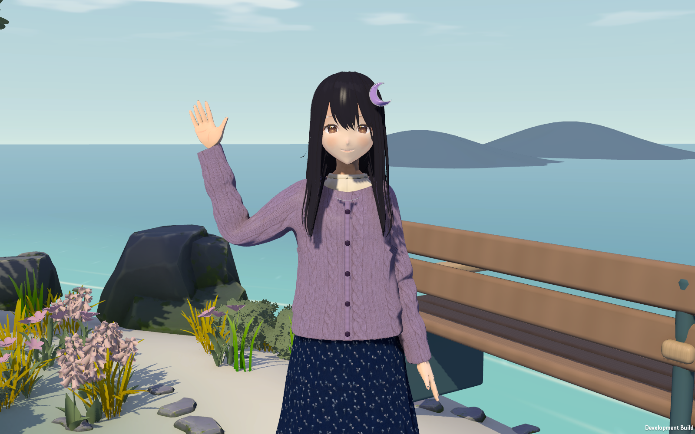
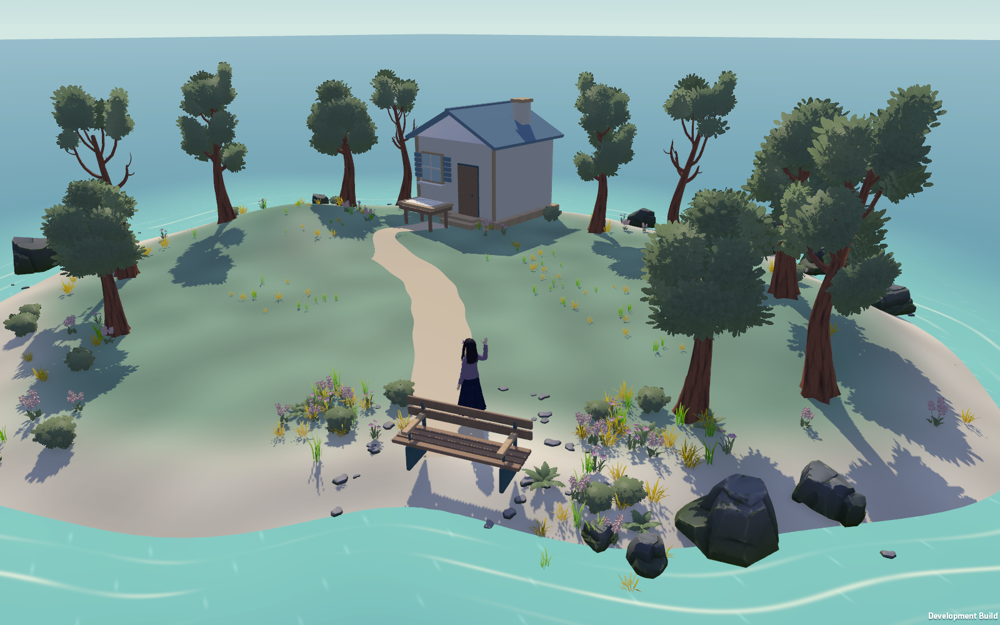

# 海湾美术试作 · 第三版角色精修

视觉参照确定为《女神异闻录 3 Reload》的角色建模与现代光影。本轮修整 Z 的肩袖、发型和裙长，加入布料贴图、材质高光、接触阴影、海岸起伏与远景。Z 仍采用原设定的黑色披发、左侧月牙发卡、紫色开衫、深蓝长裙、白袜与棕色便鞋；当前是继续迭代的美术小样。

2026-10-23 更新：Z 增加可编辑的站立动画片段、手指姿态、头眼跟随与脚部约束，模型修整眼形、发尾和领口。见 [第三版制作与验证说明](character-v3.md) 和 [动作短片](Screenshots/v3/z-standing-motion.mp4)。以下海湾截图保留第二版场景记录。

| 部分 | 当前实现 | 后续替换入口 |
| --- | --- | --- |
| Z | VRoid A 基础面部与骨骼；基于原肩袖拓扑裁剪开衫、平滑并调整发束，重制裙子与饰品；移除衣服下的多余身体面 | `ArtSources/Models/Z_ArtSlice.blend`；`Assets/ProjectZ/Art/Characters/Z` |
| 表演 | 56 个基础面部形变；四段 Animator 动画、手指姿态、注视与脚部约束；头发、裙摆轻微跟随 | `Runtime/ZPerformance.cs`、`Editor/ZMotionAuthoring.cs`、`Art/Animation`；原 Humanoid Avatar 保留 |
| 树木、花草、礁石 | Quaternius 免费 Standard 版中的 16 个模型，统一材质、尺寸与摆放 | `Art/Nature`；`Art/Prefabs` |
| 长椅、木屋、地图桌 | 本项目制作的倒角模型，保留 Blender 源文件 | `ArtSources/Models`；`ArtSources/build_coastal_props.py` |
| 海岸、海水与光照 | 起伏草坡、曲线步道、远处岛影、云层、环境光、材质高光、接触阴影与 ACES 色调映射 | `Runtime/IslandScene.cs`；`Art/Shaders`；`Settings/Coastal-Post.asset` |
| 玩家 | 戴草帽的简化旅行者轮廓 | 后续仍需完整角色模型与行走动画 |

对话中可用左右方向键绕 Z 转动镜头，上下方向键拉近、拉远。小样的截图检视覆盖正面、侧面、背面、近景与挥手；普通试玩继续使用原有事件与存档流程。

上述镜头操作及退出对话后的移动已通过实机按键验收，带界面的 [旋转截图](Screenshots/v2/gameplay-orbit.png) 和 [拉近截图](Screenshots/v2/gameplay-zoom.png) 可供核对。

所有美术资源通过 `Resources/Art/CoastalArtCatalog.asset` 接入。更换角色与场景美术不修改事件、存档格式和角色服务协议。FBX 原始根节点保留坐标与单位转换，场景使用独立父节点摆放。

## 素材来源与适用范围

| 素材 | 来源 / 许可 | 本次使用 |
| --- | --- | --- |
| Stylized Nature MegaKit Standard | [作者发布页](https://opengameart.org/content/stylized-nature-megakit)；[CC0 1.0](https://creativecommons.org/publicdomain/zero/1.0/) | 仅免费 Standard 文件，不含付费 Source 工程或着色器 |
| VRoidPreset A | [官方模型](https://hub.vroid.com/en/characters/2843975675147313744/models/5644550979324015604)；[官方使用条件](https://vroid.pixiv.help/hc/en-us/articles/4402394424089-VRoidPreset-A-Z) | 允许修改为原创角色并用于商业项目；不是 CC0。不得单独转售未修改样例，或用于角色创建服务等受限用途 |
| Z 的新服装、饰品、道具与着色器 | 本项目源代码与 Blender 文件 | 本地生成、可继续编辑；未购买素材 |
| 碎花与针织布料贴图 | 内置 `image_gen` 工具，无输入参考图 | [保存位置、完整提示词与用法](generated-textures.md)；贴图原样使用，已打包进 Blender 文件 |

VRoid A 的下载文件来自公开样例镜像；名称、原始 SHA-256、下载地址与自然素材逐文件校验见 [sources.json](sources.json)。第三方使用条件以链接原文为准。自然素材原始许可保存在 `Assets/ProjectZ/Art/Nature/License_Standard.txt`，分发说明保存在 `Assets/StreamingAssets/ArtCredits.txt`。

## 编辑和重建

1. 在 Blender 打开 `ArtSources/Models/Z_ArtSlice.blend` 或三个道具 `.blend`。角色文件已打包基础贴图及第二版的针织、碎花贴图。
2. 修改后的模型导出到 `Assets/ProjectZ/Art` 对应目录。角色保留 `J_Bip_*` 骨骼名及面部形变名；素材映射在 `Z_metadata.json`。
3. Unity 菜单 **Project Z → Art → Rebuild Coastal Art**，或 `bash Tools/unity.sh art`，重建本轮生成的材质与 Prefab。该操作会覆盖这些生成资产；手工定制版本先复制为独立资产。
4. `bash Tools/unity.sh playmode` 检查角色、道具尺寸、两处地点通行与存档流程；`bash Tools/unity.sh build` 生成 Mac 试玩包。

`build_z.py` 接收 VRoid A 的 GLB 文件与输出目录；`build_coastal_props.py` 接收输出目录。二者使用 Blender 4.5 LTS 后台执行，输出 FBX 与可编辑 `.blend`，没有下载或上传逻辑。

当前没有布料物理、发丝物理、语音口型同步、动作捕捉或自主行走。长裙使用骨盆与四个辅助骨骼，适用于站立对话；正式走路、坐下和大幅度动作前需要进一步制作权重和动画。脸型、局部发束、衣服版型和环境资产精度仍需后续美术评审。

开发构建支持 `-z-art-review <绝对输出目录>`，并要求同时指定 `-z-save-root <独立测试存档目录>`。该模式在实际场景中隐藏 UI，拍摄七个机位后退出，不生成剧情进度。macOS 通过 `open -n` 启动 `.app`。本机曾出现 Metal 画面提交等待；macOS 玩家端现关闭垂直同步并保留 60 帧上限，修复后完成了整组拍摄。采样记录在 `TestResults/art-v2-process-sample.txt`，完成日志在 `TestResults/art-v2-final-60fps.log`。
