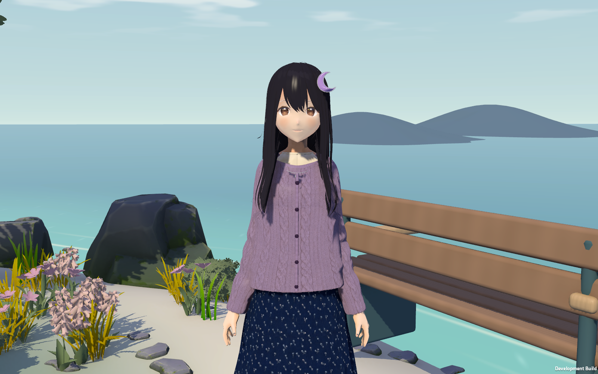

# Z · 第三版模型与站立表演

2026-10-23。本轮集中精修待机、注视、点头和挥手。新增可编辑动画片段与手指姿态，调整眼形、发尾和领口，保留原角色设定。

[播放 15 秒 Unity 动作短片](Screenshots/v3/z-standing-motion.mp4)

| 短片时间 | 内容 | 检查重点 |
| --- | --- | --- |
| 0–2 秒 | 站立待机 | 手指自然弯曲、呼吸与微小重心变化、双脚着地 |
| 2–4 秒 | 注视旁侧目标 | 眼睛与头部跟随、躯干有限转动 |
| 4–8 秒 | 挥手并收回 | 准备、抬手、手腕摆动、手指展开、自然放下 |
| 8–11 秒 | 点头 | 单次完整动作、颈部和胸部配合、眨眼 |
| 11–15 秒 | 回到待机 | 姿态连续、表情逐步恢复 |

视频由 Unity 玩家端逐帧采集，以 30 fps 编码，1600 × 1000，共 450 帧。它用于观察动作，不是运行帧率测试。已查看动作关键阶段与侧面、背面截图，并完整解码检查视频。

| 变更 | 实现 | 编辑入口 |
| --- | --- | --- |
| 站立表演 | Idle、Wave、Nod、Pause 四段动画；Unity Animator 负责混合与返回待机 | `Assets/ProjectZ/Art/Animation` |
| 动作编排 | 呼吸与重心、肩肘联动、手腕摆动、各指节弯曲 | `Assets/ProjectZ/Editor/ZMotionAuthoring.cs` |
| 注视与脚部 | 有范围限制的头眼跟随；双腿逆向运动学保持脚部位置 | `Assets/ProjectZ/Runtime/ZPerformance.cs` |
| 头发与裙摆 | 轻微骨骼跟随；裙子增加四个辅助骨骼 | `ArtSources/build_z.py`、`ZPerformance.cs` |
| 模型细节 | 眼形和下颌调整、发尾层次、领口贴边、纽扣与门襟权重 | `ArtSources/Models/Z_ArtSlice.blend` |

角色原有 Humanoid Avatar 保留在 `SourceAvatar`。当前四段片段按 Z 的骨骼路径烘焙，由角色根节点的 Animator 播放；其他角色复用这些片段需要重新绑定或重定向。导入模型上的原 Animator 保持关闭，避免两套动画同时驱动骨骼。

`bash Tools/unity.sh art` 会根据模型重建生成的动画、材质与 Prefab。手工编辑的动画版本应复制到独立资产，再替换控制器引用，防止重建时覆盖。

## 验证

| 检查 | 结果 |
| --- | --- |
| C# 核心 / 本机接口 | 21 + 13 项通过 |
| Unity PlayMode | 4 项通过，包含手指姿态变化、动作中断衔接、脚部稳定、返回待机、移动与存档流程 |
| 资源与构建 | 187 个资源/目录 metadata 唯一；Mac 开发包构建通过 |
| 动作录制 | `TestResults/art-v3-motion-final.log` 完成 450 帧，无脚本异常 |
| 模型视角 | [正面](Screenshots/v3/z-angle-0.png)、[侧面](Screenshots/v3/z-angle-100.png)、[背面](Screenshots/v3/z-angle-180.png)、[挥手](Screenshots/v3/z-wave.png) |

本轮没有加入走路、坐下、语音或布料仿真。头发和裙摆采用受限的骨骼跟随；动作适用于站立互动。角色脸型、发束精度与表情细分仍有进一步制作空间，当前结果应结合实机短片进行美术评审。
